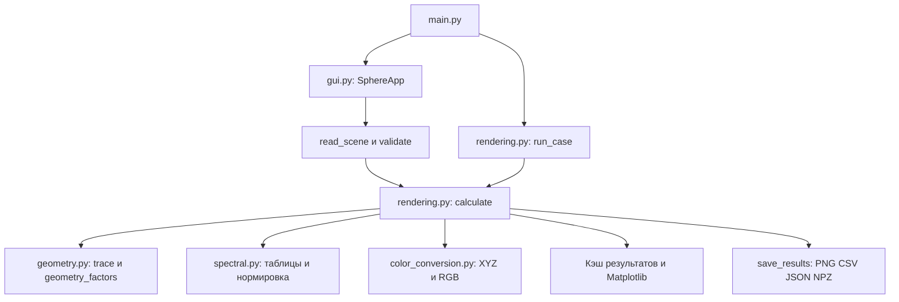

# ЛР 3 — Спектральный и RGB расчёт
# 实验三学习与答辩 · 中文 / Русский

Чжун Ц. Чэнь Х. · P3310 / P3316

这份材料配合当前 `lab3_color_sphere` 包阅读。公式、函数名和输出字段均对应实际代码。默认实验使用任务参考图模型 `reference_diagram`，不要在演示时无意切换成 `lambert`。

Этот материал предназначен для изучения текущего пакета `lab3_color_sphere`. Формулы, имена функций и выходные поля соответствуют реализации. Основной вариант работы использует модель рисунка задания `reference_diagram`. При демонстрации следует сохранять эту модель.

## 1. 先理解实验要比较什么 / Что сравнивает работа

**中文。** 场景相同，球面几何、光源位置、强度和材质相同，但计算颜色的顺序不同。

- `image_1`：在每个波长计算反射后的光谱辐亮度，再把完整光谱转为 XYZ 和 CIE RGB。
- `image_2`：预先把光源光谱和材质转换为三个 CIE RGB 分量，在 RGB 空间计算光照。
- 最后两条路径都转换为显示器 sRGB，得到可以查看和保存的 PNG。

**Русский.** Геометрия, положения и мощности источников, а также материал сферы одинаковы. Различается порядок цветового расчёта.

- `image_1`: сначала вычисляется спектральная энергетическая яркость отражённого света для каждой длины волны, затем спектр преобразуется в XYZ и CIE RGB.
- `image_2`: спектры источников и материал заранее переводятся в три компоненты CIE RGB. Освещение рассчитывается в этом пространстве.
- Для вывода обе ветви переводятся в экранное пространство sRGB и сохраняются в PNG.

**关键结论 / Основной вывод。** 对任意材质和任意照明，先相乘光谱再积分通常不等于先积分再逐通道相乘。本程序的材质 RGB 用 D65 参考光定义，因此在所有光源均为 D65 时两路一致，彩色照明时通常存在差异。这不是给第二张图人为加偏差。

Для произвольных спектров интеграл произведения обычно нельзя заменить покомпонентным произведением трёх цветовых координат. RGB-коэффициенты материала здесь определены относительно D65. Поэтому при освещении D65 ветви совпадают, а при цветном освещении обычно различаются. Различие не добавляется к изображению искусственно.

## 2. 文件结构与阅读顺序 / Структура и порядок чтения

| 文件 / Файл | 中文职责 | Назначение |
| --- | --- | --- |
| [main.py](lab3_color_sphere/main.py) | 解析启动参数，选择界面或命令行 | Разбор аргументов, запуск GUI или пакетного расчёта |
| [geometry.py](lab3_color_sphere/geometry.py) | 场景数据、参数验证、相机、射线求交、光照几何 | Данные сцены, проверка, камера, пересечение луча со сферой, геометрические множители |
| [spectral.py](lab3_color_sphere/spectral.py) | 波长、三份 CSV、积分权重、光谱和 JSON 输入 | Длины волн, три таблицы CSV, веса интегрирования, ввод спектров и JSON |
| [color_conversion.py](lab3_color_sphere/color_conversion.py) | 光谱到 XYZ/CIE RGB，材质 RGB，sRGB 与灰度 | Spectrum → XYZ → CIE RGB, материал, экранный sRGB и серое изображение |
| [rendering.py](lab3_color_sphere/rendering.py) | 独立计算两路，保存光谱数组、统计、采样点和文件 | Две расчётные ветви, спектральные массивы, статистика, контрольные точки, экспорт |
| [gui.py](lab3_color_sphere/gui.py) | 左侧输入，右侧图像与数值，后台计算与缓存显示 | Ввод слева, результаты справа, фоновый расчёт и показ сохранённых результатов |

`__init__.py` 只标识 Python 包，不实现另一套算法。`data/` 保存输入表，`results/white/` 与 `results/colored/` 保存正式场景结果。

`__init__.py` обозначает пакет Python и не содержит отдельного алгоритма. В `data/` находятся исходные таблицы, в `results/white/` и `results/colored/` — результаты стандартных сцен.

建议阅读顺序：数据类 → 几何公式 → 光谱积分 → 两路颜色计算 → 显示转换 → GUI。界面依赖计算模块，计算模块不依赖 Tkinter。

Рекомендуемый порядок изучения: классы данных → геометрия → спектральное интегрирование → две цветовые ветви → экранное преобразование → GUI. Интерфейс использует расчётные модули, но сами расчёты не зависят от Tkinter.



## 3. 入口与场景数据 / Вход и данные сцены

### 3.1 main.py

**中文。** `main()` 只负责组织运行。普通启动时导入 `launch_gui()`。加上 `--no-gui` 后调用 `run_case()`，所以命令行计算不要求 Tkinter 或 Matplotlib。`--no-gui --case both` 分别计算内置白光和彩光场景，不与自定义 `--config` 或 `--spectra` 混用。GUI 中的四图对比通过左侧照明模式选择。

**Русский.** `main()` организует запуск. В обычном режиме вызывается `launch_gui()`. С ключом `--no-gui` вызывается `run_case()`, поэтому для пакетного расчёта не нужны Tkinter и Matplotlib. `--no-gui --case both` рассчитывает два стандартных варианта и не совмещается с пользовательскими `--config` или `--spectra`. В GUI сравнение четырёх изображений выбирается через режим освещения слева.

```text
python -m lab3_color_sphere.main
python -m lab3_color_sphere.main --no-gui --case both
python -m lab3_color_sphere.main --no-gui --config scene.json --output my_results
```

Windows 上优先双击 `run_lab3.cmd`，它会优先使用项目内的 `.venv`。以上命令中的 `python` 应指向安装了依赖的解释器。

В Windows удобнее запустить `run_lab3.cmd`, который предпочитает локальное окружение `.venv`. В приведённых командах `python` должен соответствовать интерпретатору с установленными зависимостями.

### 3.2 geometry.py 中的数据类 / Классы данных

**中文。** `Light` 保存一盏点光源的坐标、轴向总辐射强度 `intensity_w_sr`、轴方向及 41 个光谱值。`Parameters` 保存屏幕、分辨率、观察者、球心、半径、反射谱、光源集合和模型。二者使用 `@dataclass(frozen=True)`，修改时用 `replace()` 生成新对象，减少界面与计算共享可变参数造成的错误。

**Русский.** `Light` хранит положение источника, суммарную осевую силу излучения `intensity_w_sr`, направление оси и 41 спектральное значение. `Parameters` содержит экран, разрешение, наблюдателя, сферу, отражение, источники и модель. Оба класса объявлены как `@dataclass(frozen=True)`. Изменение выполняется через `replace()`, создающий новый объект.

```python
height = round(self.width_px * self.height_mm / self.width_mm)
object.__setattr__(self, "height_px", height)
```

**中文。** `height_px` 自动按物理宽高比计算。但四舍五入后仍必须通过方形像素验证，不能只认为“自动计算”就永远满足比例。

**Русский.** `height_px` автоматически определяется по физическому отношению сторон. После округления всё равно проверяется квадратность пикселей. Само округление не гарантирует точного равенства масштабов по двум осям.

### 3.3 validate() 为什么重要 / Зачем нужна проверка

**中文。** 检查输入有限且类型正确，屏幕宽高 100～10000 mm，横纵分辨率 200～800，反射系数在 [0,1]，光源光谱非负且非零，轴和观察方向非零。观察者、光源必须在球外。球体必须全部位于相机视锥中，并位于观察者与屏幕之间。负 Z 光源允许存在，球心 Z 可以为 0。

**Русский.** Проверяются конечность и тип чисел, размеры экрана 100–10000 мм, разрешение по обеим осям 200–800, отражение в [0,1], неотрицательный ненулевой спектр и ненулевые направления. Источники и наблюдатель должны находиться вне сферы. Вся сфера должна попадать в пирамиду видимости и располагаться между наблюдателем и экраном. Отрицательная координата Z источника допустима, Z центра сферы может равняться нулю.

## 4. 实验二复用的几何 / Геометрия из лабораторной 2

### 4.1 相机基与任意观察方向 / Базис камеры

`camera_basis()` 将观察方向归一化为 `forward`，由叉积得到 `right` 与 `up`。接近竖直方向时更换辅助轴，避免平行向量叉积为零。`screen_offset_mm()` 根据显式 `screen_distance_mm` 或屏幕 Z 确定屏幕距离。水平观察时必须填写正的 `screen_distance_mm`。

`camera_basis()` нормирует направление взгляда в `forward`, затем строит `right` и `up` векторными произведениями. Для почти вертикального взгляда вспомогательная ось меняется, чтобы избежать нулевого произведения. `screen_offset_mm()` использует явное расстояние `screen_distance_mm` либо координату Z экрана. Для горизонтального взгляда необходимо положительное явное расстояние.

### 4.2 射线与球面求交 / Пересечение луча со сферой

**中文。** 对每个像素中心构造归一化射线 `d`。设观察者为 O，球心 C，半径 R，交点为 `P=O+t*d`。代入球方程，令 `oc=O-C`，得到 `b=d·oc`、判别式 `D=b²-(oc·oc-R²)`。取较近的交点 `t=-b-sqrt(D)`，只保留 `D>=0` 且 `t>0` 的像素。

**Русский.** Для центра каждого пикселя строится единичный луч `d`. При наблюдателе O, центре C и радиусе R точка имеет вид `P=O+t*d`. Подстановка в уравнение сферы даёт `b=d·(O-C)` и дискриминант `D=b²-(|O-C|²-R²)`. Выбирается ближний корень `t=-b-sqrt(D)`. Видимыми считаются пиксели с `D>=0` и `t>0`.

Фрагмент `trace()` / `trace()` 实际片段：

```python
b = np.sum(rays * oc, axis=-1)
discriminant = b * b - (np.dot(oc, oc) - p.radius_mm ** 2)
t = -b - np.sqrt(np.maximum(discriminant, 0))
return (discriminant >= 0) & (t > 0), p.observer() + t[..., None] * rays
```

`maximum(D,0)` 只避免背景射线开方出 NaN，是否命中仍由独立 `mask` 判断。背景的坐标不能当作真实球面点使用。

`maximum(D,0)` предотвращает NaN для лучей фона. Настоящее попадание определяется отдельной маской `mask`. Координаты вне маски нельзя трактовать как точки сферы.

### 4.3 参考图决定双余弦 / Почему в модели рисунка два косинуса

定义 / Обозначения：

- `n=(P-C)/R`：球面外法线 / внешняя нормаль.
- `l=(PL-P)/|PL-P|`：表面指向光源 / направление от поверхности к источнику.
- `a`：光源发射轴 / ось излучения источника.
- `c_e=max(a·(-l),0)`：发射余弦 / косинус излучения.
- `c_i=max(n·l,0)`：入射余弦 / косинус падения.
- `r_m=|PL-P|/1000`：米制距离 / расстояние в метрах.

**中文。** 任务参考图中 `E=I cosσ/r²`，`f=kd cosσ`，外面还有 `1/π`。逐项代入后，接收余弦出现两次。因此默认模型的第 i 盏光几何因子为：

**Русский.** На рисунке задания задано `E=I cosσ/r²`, `f=kd cosσ`, а также внешний множитель `1/π`. При буквальной подстановке косинус падения входит два раза. Поэтому для i-го источника по умолчанию используется:

\[
G_i(P)=\frac{I_{0,i}\,c_{e,i}\,c_{i,i}^{\,2}}{\pi r_{m,i}^{\,2}}.
\]

代码中的 `geometry_factors()` / Фрагмент реализации：

```python
power = 2 if p.model == "reference_diagram" else 1
factors.append(light.intensity_w_sr * emission * incidence ** power
               / (math.pi * np.sum((to_light / 1000) ** 2, axis=-1)))
```

**中文。** 可选 `lambert` 把指数改成 1，用于单余弦对照。答辩时应明确本实验默认遵循任务图，并不是声称标准朗伯公式本身需要两次入射余弦。两个模型仍保留发射方向余弦。

**Русский.** Дополнительная модель `lambert` использует степень 1 для сравнения. На защите следует пояснить, что основной вариант буквально следует рисунку задания. Это не утверждение о двух косинусах падения в стандартном законе Ламберта. В обеих моделях сохраняется косинус направления излучения источника.

## 5. 光谱输入与积分 / Спектры и интегрирование

### 5.1 三份 CSV / Три таблицы

| 文件 / Файл | 内容 / Содержание |
| --- | --- |
| `data/cie_xyz_1931.csv` | `wavelength_nm,x_bar,y_bar,z_bar`，CIE 1931 标准观察者 / стандартный наблюдатель |
| `data/light_spectra.csv` | D65、红、蓝、6500 K 黑体 / D65, красный, синий, чёрное тело 6500 K |
| `data/reflectance.csv` | 波长及球面的反射系数 / длина волны и коэффициент отражения |

**中文。** `load_tables()` 检查恰好为 380,390,…,780 nm 共 41 个波长，所有值有限且非负，反射不超过 1。数据只加载一次并缓存。老师的 XYZ Excel 实际步长为 5 nm，当前 CSV 精确选取每 10 nm 的行。D65 与 6500 K 黑体是两组不同数据，不能混称。

**Русский.** `load_tables()` проверяет 41 длину волны 380,390,…,780 нм, конечность и неотрицательность значений, а также отражение не выше 1. Таблицы загружаются один раз с кэшированием. В исходном Excel шаг XYZ равен 5 нм, из него выбраны строки с шагом 10 нм. D65 и чёрное тело 6500 K представлены разными спектрами и не отождествляются.

### 5.2 梯形积分 / Метод трапеций

```python
weights = np.full(41, 10.0)
weights[[0, -1]] = 5.0
```

**中文。** 相邻采样间隔是 10 nm，端点权重减半，积分写成 `spectrum @ weights`。XYZ 三个积分写成 `spectrum @ (cmf * weights[:,None])`。末端 780 nm 并没有被遗漏。

**Русский.** Шаг равен 10 нм, крайние веса уменьшены вдвое. Интеграл вычисляется как `spectrum @ weights`. Для XYZ используется `spectrum @ (cmf * weights[:,None])`. Конечная точка 780 нм включена.

### 5.3 为什么先归一化光源 / Нормировка источников

`normalize_spd()` 的核心 / Основные строки：

```python
values = values / np.max(values)
return values / np.dot(values, tables.weights)
```

**中文。** 第一步按最大值缩放，降低数值溢出风险。第二步使梯形积分等于 1。输入的光谱只决定形状，`I0` 决定可见波段总轴向辐射强度，单位 W/sr。这样把输入光谱整体乘 10，不会把光源总能量也意外乘 10。归一化谱具有 `1/nm` 的尺度。

**Русский.** Первое деление уменьшает риск переполнения. Второе делает интеграл по методу трапеций равным 1. Входной спектр задаёт форму, а `I0` — суммарную осевую силу излучения в видимом диапазоне, Вт/ср. Умножение всей исходной таблицы на 10 не меняет полную мощность источника. Нормированный спектр имеет масштаб `1/нм`.

## 6. 两条独立路径 / Две независимые ветви

用 `T(S)` 表示光谱经过 XYZ 积分再转为 CIE RGB 的线性变换。令 `k_d(λ)` 为反射谱，`S_i(λ)` 为第 i 盏灯归一化后的光谱。

Обозначим через `T(S)` линейное преобразование спектра в XYZ и затем в CIE RGB. `k_d(λ)` — отражение, `S_i(λ)` — нормированный спектр i-го источника.

### 6.1 image_1：先计算完整光谱 / Сначала полный спектр

\[
L_\lambda(P)=k_d(\lambda)\sum_i G_i(P)S_i(\lambda),
\qquad RGB_1(P)=T(L_\lambda(P)).
\]

`radiance_at()` 实际执行 / Реальные строки：

```python
factors = geometry_factors(points_mm, p)
spectra = np.array([normalize_spd(light.spectrum, tables) for light in p.lights])
spectral = (factors @ spectra) * np.asarray(p.reflectance)
xyz = spectrum_to_xyz(spectral, tables)
```

**中文。** `factors` 的最后一维是光源数，`spectra` 的形状是“光源数×41”。矩阵乘法先叠加各光源的光谱，再逐波长乘反射谱。之后 `rgb1=xyz @ XYZ_TO_CIE_RGB.T`。

**Русский.** Последняя размерность `factors` равна числу источников, а `spectra` имеет размер «число источников × 41». Матричное умножение суммирует спектральные вклады, затем применяется отражение на каждой длине волны. Далее вычисляется `rgb1=xyz @ XYZ_TO_CIE_RGB.T`.

### 6.2 image_2：RGB 空间计算 / Расчёт в RGB

\[
RGB_{L,i}=T(S_i),\qquad
k_{d,RGB}=\frac{T(D65\,k_d)}{T(D65)},\qquad
RGB_2(P)=k_{d,RGB}\odot\sum_i G_i(P)RGB_{L,i}.
\]

分式和 `⊙` 均为逐通道运算。D65 在此只用于定义材质的 RGB 反射系数，不能替换当前彩色光源的真实光谱。

Деление и `⊙` выполняются покомпонентно. Здесь D65 служит эталоном для определения RGB-отражения материала и не заменяет фактический спектр цветного источника.

`scene_rgb()` 与 `radiance_at()` 的对应代码 / Соответствующие строки：

```python
white = spectrum_to_rgb(tables.d65, tables)
kd = spectrum_to_rgb(tables.d65 * np.asarray(p.reflectance), tables) / white
lights = [spectrum_to_rgb(normalize_spd(light.spectrum, tables), tables) for light in p.lights]
# В radiance_at():
rgb2 = (factors @ lights) * kd
```

**中文。** 第二路直接由光源 RGB 与材质 RGB 算出，不读取第一路最终图像，不对第一路施加滤镜。两路共享正确的几何因子和输入表，是合理的公共基础，不代表两路颜色计算相同。

**Русский.** Вторая ветвь получает результат непосредственно из RGB источников и материала. Она не читает готовое первое изображение и не применяет к нему фильтр. Общие геометрические множители и исходные таблицы являются допустимой общей основой, при этом цветовые вычисления независимы.

### 6.3 白光为什么相同 / Почему D65 даёт совпадение

**中文。** D65 的归一化只相当于乘常数。将 D65 代入第二路，材质定义中的 `T(D65)` 在逐通道乘除时抵消，得到与第一路相同的 `T(D65*kd)`。彩光没有这一抵消关系，因此不能期待一致。恒定无色反射谱是另一种两路可以一致的情况。

**Русский.** Нормировка D65 отличается от исходного D65 только постоянным множителем. В ветви RGB множитель `T(D65)` сокращается с делителем в определении материала, и получается тот же `T(D65*kd)`, что и в спектральной ветви. Для цветного источника такого сокращения обычно нет. При постоянном нейтральном отражении ветви также могут совпасть.

## 7. XYZ、CIE RGB 与屏幕 sRGB / Цветовые пространства

### 7.1 线性积分与矩阵 / Интегралы и матрица

\[
(X,Y,Z)=\sum_{j=0}^{40}w_j L_{\lambda_j}(\bar x_j,\bar y_j,\bar z_j),
\quad
\begin{pmatrix}R\\G\\B\end{pmatrix}
=\begin{pmatrix}
2.36461&-0.89654&-0.46807\\
-0.51517&1.42641&0.08876\\
0.00520&-0.01441&1.00920
\end{pmatrix}
\begin{pmatrix}X\\Y\\Z\end{pmatrix}.
\]

**中文。** 题目给出的正反两个矩阵存在整体尺度不一致。程序保留指定 `XYZ_TO_CIE_RGB`，反向转换用它的数值逆 `np.linalg.inv()`，避免混用不互逆的矩阵。这里的 CIE RGB 是有符号的线性坐标，负分量不代表负能量，不能在物理计算阶段简单截成 0。

**Русский.** Прямой и обратный матричные переходы в задании имеют несовпадающий общий масштаб. Программа сохраняет заданную `XYZ_TO_CIE_RGB`, а обратную получает через `np.linalg.inv()`. Это обеспечивает взаимную обратимость. CIE RGB — знаковые линейные координаты. Отрицательная компонента не означает отрицательную энергию, поэтому её нельзя обнулять на стадии физических вычислений.

### 7.2 display_images() 如何生成 PNG / Вывод в PNG

**中文。** 显示流程为 CIE RGB → XYZ → 线性 sRGB。对当前场景的两张图取同一个线性最大值，使用同一曝光系数。之后裁剪到屏幕色域 [0,1]，进行标准 sRGB 分段编码，乘 255 并四舍五入成 `uint8`。对比模式中每种照明内部的两路共享曝光，白光行与彩光行分别使用各自场景的曝光。

**Русский.** Для вывода выполняется CIE RGB → XYZ → линейный sRGB. Для двух изображений одной сцены выбирается общий линейный максимум и единый коэффициент экспозиции. Затем значения ограничиваются экранным диапазоном [0,1], кодируются кусочной функцией sRGB, умножаются на 255 и округляются до `uint8`. В режиме сравнения экспозиция общая для двух ветвей каждого освещения, но отдельно определяется для белого и цветного вариантов.

**中文。** 因为显示有曝光、裁剪和量化，PNG 的像素值不是绝对辐亮度。即使把所有灯的强度同时加倍，自动曝光也可能使 PNG 几乎不变，但 NPZ 的物理量会按比例变化。

**Русский.** Из-за экспозиции, ограничения цветового охвата и квантования значение пикселя PNG не является абсолютной энергетической яркостью. Если удвоить мощности всех источников, автоматическая экспозиция может почти сохранить внешний вид, хотя физические массивы NPZ изменятся пропорционально.

### 7.3 为什么灰度不是简单平均 / Изображение в тонах серого

`display_images()` 先把实际生成的 8 位 sRGB 图解码为线性 RGB，再用 `LINEAR_SRGB_TO_XYZ` 的 Y 行得到亮度通道，最后重新编码为 8 位灰度。不直接对三个经过 gamma 编码的通道取平均。

`display_images()` декодирует фактически полученный 8-битный sRGB в линейный RGB, использует строку Y матрицы `LINEAR_SRGB_TO_XYZ`, а затем снова кодирует результат в 8-битное серое изображение. Простое среднее трёх нелинейно закодированных каналов не применяется.

## 8. 绝对亮度、统计与控制点 / Абсолютные величины и точки

| 符号 / Обозначение | 中文含义 | Русский смысл | 单位 / Единицы |
| --- | --- | --- | --- |
| `L_lambda` | 光谱辐亮度 | Спектральная энергетическая яркость | W/(m²·sr·nm) |
| `radiance` 或 `L_e` | 对波长积分的辐亮度 | Интегральная энергетическая яркость | W/(m²·sr) |
| `luminance1` 或 `L_v1` | 第一路光度亮度 | Фотометрическая яркость первой ветви | cd/m² |
| `luminance2` 或 `L_v2` | 第二路 RGB 重建的光度亮度 | Фотометрическая яркость из RGB второй ветви | cd/m² |

\[
L_e=\sum_jw_jL_{\lambda_j},\qquad L_{v,1}=683Y_1,\qquad
L_{v,2}=683\left(CIE\_RGB\_TO\_XYZ\cdot RGB_2\right)_Y.
\]

**中文。** 第一条是辐射量，后两条按人眼明视觉响应加权。灰度 PNG、绝对 `L_e`、绝对 `L_v` 是三个不同概念。第二路并未重建完整光谱，因此不能声称得到了独立的第二路 41 通道光谱辐亮度。

**Русский.** Первая величина радиометрическая, две последние учитывают фотопическую чувствительность глаза. Серое PNG, абсолютное `L_e` и абсолютное `L_v` — разные понятия. Вторая ветвь не восстанавливает полный спектр, поэтому отдельного 41-канального спектра второй ветви нет.

### 8.1 三采样点 / Три контрольные точки

**中文。** `control_points()` 根据观察者与球心构造正面点和左右偏移点，保证点在球面上并在几何上可见。它直接调用 `radiance_at()`，不读取最近像素。默认点为 P1=(0,0,950)、P2=(-210,0,880)、P3=(210,0,880) mm。改变球心、观察者和半径后，点也随场景重新构造，不固定为上述坐标。

**Русский.** `control_points()` строит переднюю и две боковые точки относительно наблюдателя и центра сферы. Точки лежат на сфере и геометрически видимы. Функция вызывает `radiance_at()` напрямую, а не выбирает ближайший пиксель. В стандартной сцене координаты равны P1=(0,0,950), P2=(-210,0,880), P3=(210,0,880) мм. При изменении сцены точки строятся заново.

### 8.2 两类极值不要混淆 / Два вида экстремумов

**中文。** `statistics` 中普通极值只对 `mask` 内的可见球面像素统计，黑色背景不参与。`sphere_sampled_*` 则对整球 181 个极角 × 360 个方位角采样。它包含背面，但只是离散估计，不能宣称是连续球面的解析精确极值。

**Русский.** Обычные экстремумы в `statistics` вычисляются только по видимым пикселям внутри `mask`, без чёрного фона. Поля `sphere_sampled_*` используют сетку всей сферы из 181 полярного и 360 азимутальных углов, включая обратную сторону. Это дискретная оценка, а не точный аналитический экстремум непрерывной поверхности.

### 8.3 正式默认结果的核对值 / Контрольные значения

以下为正式默认 600×600 场景的保存结果，使用 `reference_diagram`。改变参数或分辨率后，像素极值与图像误差可能变化。

Ниже приведены сохранённые значения стандартных сцен 600×600 для `reference_diagram`. При изменении параметров или разрешения пиксельные экстремумы и ошибки изображений могут измениться.

| 指标 / Показатель | D65 | 红蓝光 / Красный и синий |
| --- | ---: | ---: |
| 可见像素 / Видимые пиксели | 172448 | 172448 |
| 最大 `L_e` / Максимум `L_e`, W/(m²·sr) | 9.86414032 | 10.2918645 |
| 最大 `L_v1` / Максимум `L_v1`, cd/m² | 3849.19687 | 3508.91643 |
| 最大 `L_v2` / Максимум `L_v2`, cd/m² | 3849.19687 | 3891.14388 |
| PNG 通道平均绝对差 / Средняя абсолютная разность каналов PNG | 0 | 8.51783919 |
| PNG 最大通道差 / Максимальная разность канала PNG | 0 | 49 |

| 点 / Точка | D65 `L_e`, W/(m²·sr) | D65 `L_v1`, cd/m² | 彩光 `L_e`, W/(m²·sr) | 彩光 `L_v1`, cd/m² |
| --- | ---: | ---: | ---: | ---: |
| P1 | 6.79866854 | 2652.98473 | 6.73554100 | 1818.87201 |
| P2 | 6.46388193 | 2522.34389 | 5.97099712 | 2555.49886 |
| P3 | 8.30685259 | 3241.51015 | 8.66721899 | 1387.32744 |

白光 CIE RGB 浮点数组可能仍有约 `1e-14` 的舍入差异，最终 8 位 PNG 完全相同。不要把浮点舍入误差解释为可见差异。

У D65 в вещественных массивах CIE RGB может оставаться погрешность округления порядка `1e-14`, но 8-битные PNG полностью совпадают. Это не видимое цветовое различие.

## 9. calculate() 与结果导出 / Организация расчёта и экспорт

**中文。** `calculate()` 的顺序是验证 → 像素中心网格 → 球面求交 → 分配绝对数组 → 按块调用 `radiance_at()` → 两路显示转换 → 可见统计 → 整球采样 → 控制点 → 返回字典。主谱数组形状是 `Hres×Wres×41`，类型 `float64`。球外为零，但另有独立 `mask`，可以区分“背景零值”和“真实球面不受光”。

**Русский.** Последовательность `calculate()`: проверка → сетка центров пикселей → пересечение со сферой → выделение физических массивов → блочные вызовы `radiance_at()` → экранные изображения → видимая статистика → выборка всей сферы → контрольные точки → словарь результата. Полный спектральный массив имеет размер `Hres×Wres×41` и тип `float64`. Вне сферы записан ноль, но отдельная маска различает фон и неосвещённую точку сферы.

```python
for start in range(0, len(ids), 8192):
    chunk = ids[start:start + 8192]
    values = radiance_at(points.reshape(-1, 3)[chunk], p, tables)
    spectral.reshape(-1, 41)[chunk] = values["spectral"]
```

**中文。** 分块减少临时矩阵占用，不删除最终光谱。800×800×41 个 `float64` 仅谱数组约需 210 MB，另外还需要 XYZ、RGB、坐标和掩码。对比模式会保留两套结果，因此内存需求更高。

**Русский.** Блоки уменьшают объём промежуточных матриц, но полный итоговый спектр сохраняется. Массив 800×800×41 типа `float64` занимает около 210 МБ без учёта XYZ, RGB, координат и маски. В режиме сравнения сохраняются два набора результатов, что увеличивает расход памяти.

`save_results()` 每种照明输出七个文件 / Семь файлов на один вариант освещения：

| 文件 / Файл | 用途 / Назначение |
| --- | --- |
| `image_1.png`, `image_2.png` | 两路可视化彩图 / цветные изображения двух ветвей |
| `image_1_gray.png`, `image_2_gray.png` | 从实际 PNG 派生的灰度图 / серые изображения из фактических PNG |
| `three_points.csv` | 三点坐标、`L_e`、第一路 `L_v`、XYZ、两路 CIE RGB / координаты, физические значения и цветовые координаты точек |
| `results.json` | 完整参数、约定、矩阵、统计、误差与曝光 / параметры, соглашения, матрицы, статистика, ошибки и экспозиция |
| `radiance_data.npz` | 完整谱立方体、两路绝对数组、坐标、波长与 mask / полный спектр, абсолютные массивы, координаты, длины волн и маска |

`three_points.csv` 的 `luminance_cd_m2` 是第一路亮度。第二路亮度由同一行 `rgb2_R/G/B` 反变换得到，GUI 已显示 `Lᵥ₂`。读取绝对量应使用 CSV、JSON 或 NPZ，而不是用图片颜色反推。

Поле `luminance_cd_m2` в `three_points.csv` относится к первой ветви. Яркость второй ветви получается обратным преобразованием `rgb2_R/G/B` той же строки и показана в GUI как `Lᵥ₂`. Абсолютные величины следует брать из CSV, JSON или NPZ, а не восстанавливать из экранного цвета.

## 10. GUI 如何连接计算 / Связь GUI с вычислениями

### 10.1 布局 / Компоновка

**中文。** `SphereApp(ttk.Frame)` 用水平 `ttk.Panedwindow` 分配左右区域。左侧 `ttk.Notebook` 有“场景参数”和“高级 JSON”页。普通页的 `ttk.LabelFrame` 分组显示几何、观察者、点光源与反射谱，滚动区域适应较小窗口。右侧 `ttk.Notebook` 提供彩图、灰度、光谱和绝对亮度四页。前三页使用 `FigureCanvasTkAgg`，数值页使用表格和统计文本。

**Русский.** `SphereApp(ttk.Frame)` делит окно горизонтальным `ttk.Panedwindow`. Слева `ttk.Notebook` содержит параметры сцены и дополнительный JSON. Группы `ttk.LabelFrame` объединяют геометрию, наблюдателя, источники и отражение, а прокрутка позволяет работать в меньшем окне. Справа четыре страницы: цветные изображения, тоны серого, спектральные кривые и абсолютная яркость. Первые три используют `FigureCanvasTkAgg`, последняя — таблицу и текст статистики.

### 10.2 一次计算的调用顺序 / Один цикл расчёта

1. **中文：** 修改输入只调用 `mark_dirty()`，更新提示和便宜的分辨率预览。**Русский:** Изменение полей вызывает только `mark_dirty()`, подсказку и простой пересчёт разрешения.
2. **中文：** 点击 `Рассчитать`，`compute()` 调用 `read_scene()`，提交当前光源表单并验证完整场景。**Русский:** Кнопка `Рассчитать` вызывает `compute()` и `read_scene()`, фиксирует текущий источник и проверяет сцену.
3. **中文：** 工作线程调用原有 `calculate()`，把结果或异常放进队列。线程不操作 Tk 控件。**Русский:** Рабочий поток вызывает исходную `calculate()` и передаёт результат либо исключение через очередь, не изменяя виджеты Tk.
4. **中文：** Tk 主线程通过 `_poll()` 接收结果，更新 `self.results`，调用 `refresh_results()`。**Русский:** Главный поток Tk получает результат в `_poll()`, обновляет `self.results` и вызывает `refresh_results()`.
5. **中文：** 切换结果标签页只绘制已缓存的数组，不重新做光谱计算。**Русский:** Переключение страниц перерисовывает сохранённые массивы и не запускает новый спектральный расчёт.

**中文。** 计算过程中禁用左侧可编辑控件，避免参数和结果错配。输入错误不覆盖前一次结果。若修改后尚未重算，状态栏说明当前显示的是之前的结果，导出也以当前已计算结果为准。

**Русский.** Во время расчёта элементы ввода слева блокируются, чтобы параметры не расходились с результатом. Ошибка ввода не удаляет предыдущие результаты. После изменения параметров без пересчёта строка состояния указывает на предыдущие результаты, и экспорт сохраняет именно вычисленные данные.

### 10.3 模式和自定义谱 / Режимы и пользовательские спектры

**中文。** 选择 D65 或彩光模式会把所有灯的谱设为对应预设，保留灯的数量、位置、强度、几何和材质。彩光对多盏灯交替使用红、蓝。之后可编辑自定义光谱，点击计算不会偷偷重新覆盖为预设。对比模式则有意构造共同几何和材质的 D65、红蓝两个场景，按两行两列显示四张结果。

**Русский.** Выбор D65 или цветного режима устанавливает соответствующие спектральные шаблоны, сохраняя число источников, положения, мощности, геометрию и материал. Для нескольких источников красный и синий чередуются. После этого можно задать пользовательский спектр, который кнопка расчёта повторно не заменяет. Режим сравнения специально строит два варианта одной геометрии и материала: D65 и красно-синий. Четыре изображения показаны двумя строками и двумя столбцами.

**中文。** 在光源列表选择一盏灯后编辑其坐标、轴和强度，可以新增或删除，至少保留一盏。`Таблица 41 длины волны…` 打开反射和各光源的 CSV 表，列名保持数据格式 `wavelength_nm,reflectance,light_1,…`。高级 JSON 需要点 `Применить JSON` 才同步到表单，`Из формы` 则用表单更新 JSON。

**Русский.** После выбора источника в списке редактируются координаты, ось и мощность. Источники можно добавлять и удалять, оставляя хотя бы один. `Таблица 41 длины волны…` открывает CSV отражения и источников с полями `wavelength_nm,reflectance,light_1,…`. Для переноса дополнительного JSON в форму нужна кнопка `Применить JSON`, а `Из формы` обновляет JSON из формы.

**中文。** 光谱曲线页显示光源的相对谱形状和材质反射率。光源曲线除以各自峰值以便观察形状，这一绘图归一化不等于物理计算中的积分归一化，也不表示各灯实际总强度相同。

**Русский.** Страница спектров показывает относительную форму источников и отражение материала. При рисовании каждый спектр источника делится на собственный максимум. Такая нормировка для графика отличается от интегральной нормировки расчёта и не означает одинаковую полную силу излучения.

## 11. 答辩现场演示 / Демонстрация

建议先以 `Wres=200` 快速演示交互，再用默认 600 重现正式报告。分辨率改变后，三点值因直接求公式而应保持一致，图像采样统计不保证完全一致。

Для быстрой демонстрации удобно установить `Wres=200`, а для воспроизведения отчёта вернуть 600. Значения контрольных точек не зависят от пиксельной сетки, поскольку вычисляются напрямую. Пиксельная статистика может меняться.

| 顺序 / Шаг | 操作 | Действие и пояснение по-русски |
| --- | --- | --- |
| 1 | 启动，指出左侧分组参数、右侧结果区 | «Слева задаются параметры сцены, справа показаны результаты двух методов.» |
| 2 | 选择 `Белый свет D65`，点击 `Рассчитать` | «При D65 коэффициенты материала согласованы с эталоном, поэтому изображения совпадают.» |
| 3 | 查看 `Абсолютная яркость`，展示三点和单位 | «Здесь абсолютные величины до экранной экспозиции: Вт/(м²·ср) и кд/м².» |
| 4 | 选择 `Цветные источники`，再次计算 | «При цветном освещении трёхканальное приближение теряет спектральную информацию, поэтому результаты различаются.» |
| 5 | 选择对比模式并计算，解释四图 | «Строки соответствуют двум условиям освещения, столбцы — спектральному и RGB расчёту.» |
| 6 | 切换灰度、光谱、亮度标签页 | «Эти страницы используют готовые данные и не запускают повторный расчёт.» |
| 7 | 改变一盏灯强度，先指出旧结果提示，再计算 | «Изменение поля не запускает дорогой алгоритм. Пересчёт выполняется только кнопкой.» |
| 8 | 保存 JSON，再导出结果 | «JSON сохраняет сцену. PNG предназначен для просмотра, NPZ — для физических массивов, CSV — для трёх точек.» |

附加演示可用 `Пример: вид снизу (+Z)` 展示负 Z 光源和从下方观察。演示后重新加载原始 JSON，避免把改变后的场景误当成默认报告场景。

Дополнительно кнопка `Пример: вид снизу (+Z)` показывает отрицательный Z источников и наблюдение снизу. После этого следует загрузить исходный JSON, чтобы не спутать изменённую сцену со стандартной сценой отчёта.

## 12. 常见问题与中俄回答 / Вопросы и ответы

### Q1. 实验三比实验二增加了什么？ / Что добавлено по сравнению с ЛР 2?

**中：** 保留相机、球面求交和点光源几何，增加 41 通道光谱、CIE XYZ/RGB 转换、RGB 近似路径及两路比较。界面仍采用左输入右结果的布局。

**Ру:** Сохранены камера, пересечение со сферой и геометрия точечных источников. Добавлены 41 спектральный канал, преобразования CIE XYZ/RGB, RGB-приближение и сравнение двух методов. Сохранена компоновка с вводом слева и результатом справа.

### Q2. 为什么程序默认有 cos²？ / Почему по умолчанию cos²?

**中：** 任务图分别在照度 E 和反射函数 f 中写了接收余弦，逐项代入得到 cos²。可选 `lambert` 才是单入射余弦对照。

**Ру:** На рисунке задания косинус падения входит отдельно в E и f. Их произведение даёт cos². Дополнительный режим `lambert` использует один косинус падения.

### Q3. 为什么不直接把 XYZ 矩阵结果当作屏幕 RGB？ / Почему CIE RGB нельзя сразу показать на экране?

**中：** CIE RGB 与显示器 sRGB 的原色和定义不同。程序经 XYZ 转到线性 sRGB，之后做共同曝光和 sRGB 编码。

**Ру:** CIE RGB и экранный sRGB используют разные определения и основные цвета. Поэтому выполняется переход через XYZ к линейному sRGB, затем общая экспозиция и кодирование sRGB.

### Q4. CIE RGB 出现负值是否错误？ / Ошибка ли отрицательные компоненты CIE RGB?

**中：** 不是。它们是颜色匹配坐标，可能为负。物理光谱仍非负，负坐标保留到显示色域处理阶段。

**Ру:** Нет. Это координаты цветового согласования, которые могут быть отрицательными. Физический спектр остаётся неотрицательным, а ограничение применяется при экранном выводе.

### Q5. D65 是否等于 6500 K 黑体？ / Равен ли D65 чёрному телу 6500 K?

**中：** 不等。D65 是标准日光光谱，6500 K 黑体是另一种分布。程序保存两份独立表，白光默认使用 D65。

**Ру:** Нет. D65 — стандартный спектр дневного света, а чёрное тело 6500 K имеет другое распределение. В программе это разные таблицы, белый вариант использует D65.

### Q6. 为什么必须将 mm 转为 m？ / Зачем переводить миллиметры в метры?

**中：** 光强使用 W/sr，面积需要以 m² 计。平方反比公式直接使用 mm² 会让数值差 10⁶ 倍。

**Ру:** Сила излучения задана в Вт/ср, поэтому площадь должна измеряться в м². Использование мм² в законе обратных квадратов дало бы ошибку в 10⁶ раз.

### Q7. I0 是某个波长的强度吗？ / I0 относится к одной длине волны?

**中：** 本程序将它定义为 380～780 nm 总轴向辐射强度。归一化光谱负责将总强度分配到各波长。

**Ру:** Здесь I0 — суммарная осевая сила излучения в диапазоне 380–780 нм. Нормированный спектр распределяет эту величину по длинам волн.

### Q8. 两路是不是复制同一张图？ / Не копируется ли первое изображение во второе?

**中：** 不是。第一路是完整光谱反射后积分，第二路是光源 RGB 与材质 RGB 的逐通道光照。白光一致是公式推导的结果，彩光差异验证两条路径各自计算。

**Ру:** Нет. Первая ветвь интегрирует спектр после отражения, вторая использует покомпонентный расчёт RGB источников и материала. Совпадение при D65 следует из формул, а различие при цветном свете подтверждает разные вычисления.

### Q9. 为什么不在每次输入时重算？ / Почему расчёт не запускается при каждом вводе?

**中：** 光谱立方体和整球采样有明显计算与内存成本。输入过程还可能暂时不合法，所以只标记修改，点击按钮后统一验证并计算。

**Ру:** Полный спектральный массив и выборка сферы требуют времени и памяти. Во время ввода поле может временно быть некорректным. Поэтому ввод только отмечает изменение, а проверка и расчёт выполняются кнопкой.

### Q10. 工作线程能直接更新 Tk 吗？ / Может ли рабочий поток обновлять Tk?

**中：** 本实现不这样做。线程只计算并写入队列，Tk 主线程定期接收结果后更新控件和画布。

**Ру:** В этой реализации нет. Рабочий поток только рассчитывает и пишет в очередь. Главный поток Tk получает результат и обновляет виджеты и холсты.

### Q11. 灰度图能代表绝对亮度吗？ / Показывает ли серое PNG абсолютную яркость?

**中：** 不能。它来自已经曝光和量化的显示图。绝对亮度从光谱和 XYZ 计算，存储在数值文件中。

**Ру:** Нет. Серое PNG получено после экспозиции и квантования. Абсолютная яркость вычисляется из спектра и XYZ и хранится в числовых данных.

### Q12. 三个点是否随分辨率变化？ / Зависят ли контрольные точки от разрешения?

**中：** 只改变分辨率而保持几何不变时不变化。点由场景几何构造并直接代入公式，不依赖像素网格。

**Ру:** При неизменной геометрии изменение разрешения не влияет на точки. Они строятся геометрически и рассчитываются по формулам, независимо от сетки пикселей.

### Q13. 最小值为什么可能为 0？ / Почему минимум может быть нулевым?

**中：** 即使排除了背景，球面也可能有不受光的区域，例如位于灯的背向半空间或入射余弦非正。不能因此把所有零值都当作背景。

**Ру:** Даже без фона часть сферы может быть не освещена, например вне передней полусферы источника или при неположительном косинусе падения. Поэтому не все нулевые значения являются фоном.

### Q14. 整球最大值是精确解析值吗？ / Точен ли максимум по всей сфере?

**中：** 不是。它是 181×360 角度网格的离散采样估计。可见像素极值和整球采样极值也不属于同一组点。

**Ру:** Нет. Это дискретная оценка на угловой сетке 181×360. Экстремумы видимых пикселей и выборки всей сферы вычисляются по разным наборам точек.

### Q15. 为什么完整光谱不能只存 RGB？ / Почему нельзя хранить только RGB?

**中：** RGB 只有三个投影，不能恢复一般的 41 通道光谱。完整谱是实验第一条路径的必要数据，也方便检查积分和任意波长的结果。

**Ру:** RGB содержит только три проекции и не позволяет восстановить произвольный 41-канальный спектр. Полный спектр необходим первой ветви и позволяет проверять интегралы и отдельные длины волн.

### Q16. 如何证明只是重构界面？ / Как подтверждено сохранение алгоритмов?

**中：** 几何、光谱、颜色转换和渲染四个模块保持源文件校验值一致。原数值测试继续运行，另有真实 Tk 事件循环测试检查白光、彩光、四图、缓存、JSON、CSV 和结果导出。

**Ру:** Контрольные суммы модулей геометрии, спектров, цветовых преобразований и рендеринга сохраняются. Дополнительно к прежним численным проверкам выполняются тесты с настоящим циклом событий Tk для D65, цветного света, четырёх изображений, кэша, JSON, CSV и экспорта.

## 13. 约两分钟的开场陈述 / Краткое выступление

### 中文

我的实验比较了球面光照的两种颜色计算方法。第一种方法在 380 到 780 纳米之间以 10 纳米为步长计算完整光谱，再积分为 XYZ 和 CIE RGB。第二种方法预先把光源和材质转换成 RGB，然后在三通道空间计算光照。

几何部分复用实验二的透视相机和球面求交。对于每个可见像素，程序计算球面交点、外法线、光源方向、发射余弦以及入射余弦。默认公式严格对应任务参考图，因此入射余弦出现两次。距离从毫米转换为米，光源相对谱先做积分归一化，保证物理单位一致。

两条路径共用几何，但分别计算颜色。在 D65 白光下，由于材质 RGB 的定义与参考光一致，两路结果相同。换成红蓝光后，RGB 无法保留完整的光谱相互作用，因此出现差异。

界面左侧输入场景，右侧并排显示两路结果，也支持两种照明的四图比较。计算只在点击按钮后执行，工作线程完成计算，主线程更新界面。灰度、光谱和三个采样点的绝对亮度均可查看。PNG 用于显示，CSV、JSON 和 NPZ 保存可验证的物理数值与完整光谱。

### Русский

В работе сравниваются два способа цветового расчёта освещённой сферы. В первом способе полный спектр вычисляется от 380 до 780 нанометров с шагом 10 нанометров, а затем интегрируется в XYZ и CIE RGB. Во втором способе спектры источников и материал заранее переводятся в RGB, после чего освещение рассчитывается в трёхканальном пространстве.

Геометрическая часть использует перспективную камеру и пересечение лучей со сферой из второй лабораторной. Для каждого видимого пикселя определяются точка поверхности, внешняя нормаль, направление на источник и два угловых множителя. Основная модель буквально следует рисунку задания, поэтому косинус падения входит дважды. Расстояние переводится из миллиметров в метры, а относительный спектр источника нормируется по интегралу.

Две ветви используют общую геометрию, но независимо вычисляют цвет. При освещении D65 определение RGB-отражения материала согласовано с эталонным спектром, поэтому результаты совпадают. При красно-синем освещении трёхканальное приближение не сохраняет полное спектральное взаимодействие, и изображения различаются.

В интерфейсе параметры расположены слева, а результаты двух методов — справа. Режим сравнения показывает четыре изображения для двух условий освещения. Расчёт выполняется по кнопке в рабочем потоке, а интерфейс обновляется главным потоком. Доступны серые изображения, спектральные кривые и абсолютные величины в трёх точках. PNG используется для просмотра, а CSV, JSON и NPZ сохраняют физические данные и полный спектр.

## 14. 复习清单 / Перед защитой

- 能在 `geometry_factors()` 中指出 mm→m、两个余弦及 `1/π`。 / Показать перевод мм→м, косинусы и `1/π`.
- 能在 `radiance_at()` 中分别指出 `spectral`、`rgb1`、`rgb2` 的来源。 / Найти независимые вычисления спектра, `rgb1` и `rgb2`.
- 能解释 `scene_rgb()` 的 D65 材质比值。 / Объяснить отношение с D65 в определении материала.
- 能区分 CIE RGB、显示器 sRGB、PNG 值和绝对亮度。 / Различать CIE RGB, экранный sRGB, значения PNG и физическую яркость.
- 能说明三点直接计算、背景掩码与离散整球采样。 / Объяснить прямой расчёт точек, маску фона и дискретную выборку сферы.
- 能完整演示 D65、彩光、四图对比、切换视图、保存 JSON 和导出结果。 / Продемонстрировать D65, цветной свет, четыре изображения, страницы результатов, JSON и экспорт.
- 可运行 `python test_lab3.py` 与 `python test_gui.py`，查看 `validation_results.json` 和 `gui_validation.json`。 / Запустить численные и GUI-проверки и показать их отчёты.

正式实验报告在 `lab3_report.pdf`，Overleaf 源码在 `overleaf/main.tex`，上传包为 `lab3_overleaf.zip`。本学习文件解释程序与答辩，不替代实验报告。

Официальный отчёт находится в `lab3_report.pdf`, исходный LaTeX — в `overleaf/main.tex`, архив для загрузки — `lab3_overleaf.zip`. Этот материал помогает изучить программу и подготовиться к защите, но не заменяет отчёт.
