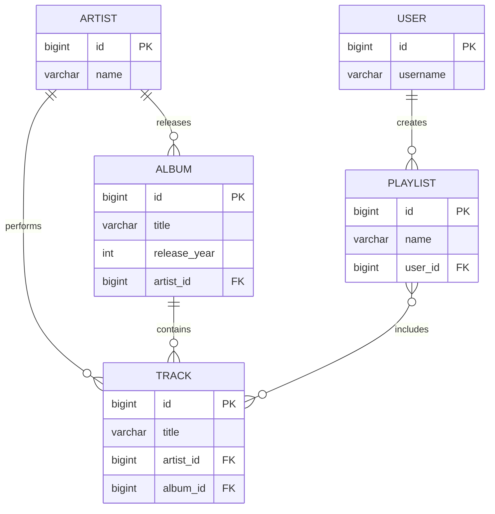
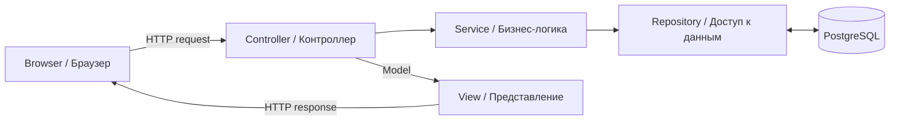

# 信息系统期中考试复习笔记｜Информационные системы — подготовка к тесту

> **使用方式**：先背第 1、2 题的完整参考答案，再复习后面的概念。根据往年截图整理，并对照 `is1-javaee.pdf`、`is2-persistence.pdf`、`is3-spring.pdf`、`is4-transactions.pdf`。代码采用现代 `jakarta.*` 命名空间。讲座中的部分示例属于较旧 Java EE / Spring 版本，考试须以老师要求的版本为准。
>
> **重要提醒**：截图第二题写的是“偶数 вариант：Spring MVC，奇数 вариант：Jakarta EE + JSF”。这里指 **вариант 编号**，不应未经确认直接理解为学号奇偶。

---

# 第一部分：往年考试两道题的完整参考答案

## Задание 1 — ER 模型 + JPA（五实体完整答案）

### 题目要求｜Условие

设计业务领域的 ER 模型，至少四个实体，必须包含 `Пользователь/Участник`，用户要与其他实体有关联，必须存在 M:N 关系，标出关系名称和基数，并编写映射已有 PostgreSQL 数据库表的 JPA Java 实体类。

**俄语答题开场：**

> Предметная область — музыкальный сервис. ER-модель содержит пять сущностей: Пользователь, Плейлист, Трек, Исполнитель и Альбом. Пользователь создаёт плейлисты (1:N). Исполнитель выпускает альбомы (1:N) и исполняет треки (1:N). Альбом содержит треки (1:N). Плейлисты содержат треки (M:N). Для связи многие-ко-многим используется промежуточная таблица `playlist_track`.

**中文：** 音乐服务包含用户、播放列表、歌曲、艺术家、专辑五个业务实体。用户创建播放列表，艺术家发布专辑并演唱歌曲，专辑包含歌曲，播放列表与歌曲为多对多关系。

### 1. ER 图（考试可照此画）



**基数｜Кардинальность：**

- `USER 1:N PLAYLIST` — Один пользователь может создать много плейлистов.
- `ARTIST 1:N ALBUM` — Один исполнитель может выпустить много альбомов.
- `ARTIST 1:N TRACK` — Один исполнитель может исполнить много треков.
- `ALBUM 1:N TRACK` — Один альбом может содержать много треков.
- `PLAYLIST M:N TRACK` — Один плейлист содержит много треков, а один трек может входить во многие плейлисты.

> **模型假设：** 每首歌曲对应一位主要艺术家和一张专辑，暂不考虑合作艺人、单曲无专辑等情况。`0..N` 表示零到多个。关联表 `playlist_track` 用于实现 M:N，但不是第六个业务实体。

### 2. 五个 JPA 实体类（Java 参考答案）

> **考试要求：** 题目假设 ER 模型已经在 PostgreSQL 中实现，所以此处只写 Java JPA 映射代码，不需要 `CREATE TABLE`、`INSERT` 或数据库连接脚本。以下使用现代 `jakarta.persistence.*`，旧版环境可能使用 `javax.persistence.*`。

#### User.java

```java
import jakarta.persistence.*;
import java.util.ArrayList;
import java.util.List;

@Entity
@Table(name = "users")
public class User {
    @Id
    @GeneratedValue(strategy = GenerationType.IDENTITY)
    private Long id;

    @Column(nullable = false, length = 100)
    private String username;

    @OneToMany(mappedBy = "user")
    private List<Playlist> playlists = new ArrayList<>();

    public User() {}
    // getters and setters
}
```

#### Playlist.java

```java
import jakarta.persistence.*;
import java.util.HashSet;
import java.util.Set;

@Entity
@Table(name = "playlists")
public class Playlist {
    @Id
    @GeneratedValue(strategy = GenerationType.IDENTITY)
    private Long id;

    @Column(nullable = false, length = 100)
    private String name;

    @ManyToOne(optional = false)
    @JoinColumn(name = "user_id", nullable = false)
    private User user;

    @ManyToMany
    @JoinTable(
        name = "playlist_track",
        joinColumns = @JoinColumn(name = "playlist_id"),
        inverseJoinColumns = @JoinColumn(name = "track_id")
    )
    private Set<Track> tracks = new HashSet<>();

    public Playlist() {}
    // getters and setters
}
```

#### Track.java

```java
import jakarta.persistence.*;
import java.util.HashSet;
import java.util.Set;

@Entity
@Table(name = "tracks")
public class Track {
    @Id
    @GeneratedValue(strategy = GenerationType.IDENTITY)
    private Long id;

    @Column(nullable = false, length = 200)
    private String title;

    @ManyToOne(optional = false)
    @JoinColumn(name = "artist_id", nullable = false)
    private Artist artist;

    @ManyToOne(optional = false)
    @JoinColumn(name = "album_id", nullable = false)
    private Album album;

    @ManyToMany(mappedBy = "tracks")
    private Set<Playlist> playlists = new HashSet<>();

    public Track() {}
    // getters and setters
}
```

#### Artist.java

```java
import jakarta.persistence.*;
import java.util.ArrayList;
import java.util.List;

@Entity
@Table(name = "artists")
public class Artist {
    @Id
    @GeneratedValue(strategy = GenerationType.IDENTITY)
    private Long id;

    @Column(nullable = false, length = 100)
    private String name;

    @OneToMany(mappedBy = "artist")
    private List<Album> albums = new ArrayList<>();

    @OneToMany(mappedBy = "artist")
    private List<Track> tracks = new ArrayList<>();

    public Artist() {}
    // getters and setters
}
```

#### Album.java

```java
import jakarta.persistence.*;
import java.util.ArrayList;
import java.util.List;

@Entity
@Table(name = "albums")
public class Album {
    @Id
    @GeneratedValue(strategy = GenerationType.IDENTITY)
    private Long id;

    @Column(nullable = false, length = 200)
    private String title;

    @Column(name = "release_year")
    private Integer releaseYear;

    @ManyToOne(optional = false)
    @JoinColumn(name = "artist_id", nullable = false)
    private Artist artist;

    @OneToMany(mappedBy = "album")
    private List<Track> tracks = new ArrayList<>();

    public Album() {}
    // getters and setters
}
```

**关系映射核对：** `Playlist.user` ↔ `User.playlists`，`Album.artist` ↔ `Artist.albums`，`Track.artist` ↔ `Artist.tracks`，`Track.album` ↔ `Album.tracks`，`Playlist.tracks` ↔ `Track.playlists`。`mappedBy` 必须指向对方 Java 类中实际存在的字段名。

**注意：** 为减少手写篇幅，示例省略 getter/setter。实际可运行项目需要补齐，实体类应有无参构造器。`@JoinTable` 映射已有的中间表，不代表必须手写 PostgreSQL 建表脚本。

### 3. 第一题俄语简答（背诵）

> `@Entity` обозначает класс-сущность, `@Table` задаёт таблицу, `@Id` определяет первичный ключ, `@GeneratedValue` настраивает генерацию идентификатора. `@ManyToOne` задаёт связь многие-к-одному, `@OneToMany` — один-ко-многим, `@ManyToMany` — многие-ко-многим. `@JoinColumn` задаёт столбец внешнего ключа, а `@JoinTable` — промежуточную таблицу. `mappedBy` указывает на поле владеющей стороны связи.

**中文：** `@Entity` 声明实体，`@Table` 指定表，`@Id` 定义主键，`@GeneratedValue` 配置主键生成。关系注解表示 1:N、N:1 和 M:N，`@JoinColumn` 指定外键列，`@JoinTable` 指定关联表，`mappedBy` 指向关系拥有端的字段。

---

## Задание 2 — Web 架构 + 表单输入（完整答案）

### 题目要求｜Условие

画出 Web 应用架构，实现一个姓名输入框和 Submit 按钮。偶数 **вариант** 使用 Spring MVC，奇数 **вариант** 使用 Jakarta EE + JSF。**考试时只需写自己对应的技术路线，但复习时两种都掌握。**

### 1. MVC 架构图



**俄语说明：**

> MVC — архитектурный шаблон, разделяющий приложение на Model, View и Controller. Model содержит данные, View отображает информацию, Controller принимает запросы пользователя, обрабатывает их и выбирает представление.

**中文：** MVC 将程序分为模型、视图和控制器。模型保存数据，视图显示内容，控制器接收用户请求并组织处理。Service、Repository 是常见分层，不是 MVC 三个字母的额外组成部分。

### 2A. 偶数 вариант — Spring MVC

#### UserController.java

```java
import org.springframework.stereotype.Controller;
import org.springframework.ui.Model;
import org.springframework.web.bind.annotation.GetMapping;
import org.springframework.web.bind.annotation.PostMapping;
import org.springframework.web.bind.annotation.RequestParam;

@Controller
public class UserController {
    @GetMapping("/user")
    public String form() {
        return "user";
    }

    @PostMapping("/user")
    public String submit(@RequestParam("name") String name,
                         Model model) {
        model.addAttribute("name", name);
        return "result";
    }
}
```

#### templates/user.html（Thymeleaf）

```html
<!DOCTYPE html>
<html lang="ru">
<body>
    <form action="/user" method="post">
        <label for="name">Имя:</label>
        <input id="name" name="name" type="text" required>
        <button type="submit">Submit</button>
    </form>
</body>
</html>
```

#### templates/result.html（Thymeleaf）

```html
<!DOCTYPE html>
<html lang="ru" xmlns:th="http://www.thymeleaf.org">
<body>
    <p th:text="${name}">Имя пользователя</p>
</body>
</html>
```

> **运行前提：** 配置 Spring MVC 与 Thymeleaf 的 ViewResolver 或使用已配置这些依赖的 Spring Boot 项目。若启用了 Spring Security，POST 表单还需正确处理 CSRF token。

**流程｜Процесс：** 浏览器 GET `/user` → Controller 返回表单 → 用户 POST `name` → `@RequestParam` 读取 → `model.addAttribute` 放入 Model → 渲染 `result` 页面。

**俄语简答：**

> `@Controller` обозначает контроллер. `@GetMapping` обрабатывает GET-запрос, `@PostMapping` — POST-запрос. `@RequestParam` получает значение поля формы. `Model` передаёт данные в представление. `DispatcherServlet` координирует обработку запросов в Spring MVC.

### 2B. 奇数 вариант — Jakarta EE + JSF

#### UserBean.java

```java
import jakarta.inject.Named;
import jakarta.enterprise.context.RequestScoped;

@Named("userBean")
@RequestScoped
public class UserBean {
    private String name;

    public String getName() {
        return name;
    }

    public void setName(String name) {
        this.name = name;
    }

    public String submit() {
        return "result";
    }
}
```

#### user.xhtml

```xml
<!DOCTYPE html>
<html xmlns="http://www.w3.org/1999/xhtml"
      xmlns:h="jakarta.faces.html">
<h:head><title>Ввод имени</title></h:head>
<h:body>
    <h:form>
        <h:outputLabel for="name" value="Имя: " />
        <h:inputText id="name" value="#{userBean.name}" required="true" />
        <h:commandButton value="Submit" action="#{userBean.submit}" />
    </h:form>
</h:body>
</html>
```

#### result.xhtml

```xml
<!DOCTYPE html>
<html xmlns="http://www.w3.org/1999/xhtml"
      xmlns:h="jakarta.faces.html">
<h:head><title>Результат</title></h:head>
<h:body>
    <h:outputText value="#{userBean.name}" />
</h:body>
</html>
```

> **重要实现细节：** 为了让 `result.xhtml` 在重定向或导航后稳定保留姓名，可以改用 `@SessionScoped`（Bean 必须实现 `Serializable`），或在同一页显示结果。上面 `@RequestScoped` + 导航的例子在不同导航/请求行为下可能无法保留原输入。**考试最稳妥的极简版本如下：**

#### 推荐背诵的单页 JSF 版本（不会丢失输入）

```java
import jakarta.inject.Named;
import jakarta.enterprise.context.RequestScoped;

@Named
@RequestScoped
public class UserBean {
    private String name;
    private boolean submitted;

    public String getName() { return name; }
    public void setName(String name) { this.name = name; }
    public boolean isSubmitted() { return submitted; }
    public void submit() { submitted = true; }
}
```

```xml
<!DOCTYPE html>
<html xmlns="http://www.w3.org/1999/xhtml"
      xmlns:h="jakarta.faces.html">
<h:head><title>Форма</title></h:head>
<h:body>
    <h:form>
        <h:outputLabel for="name" value="Имя: " />
        <h:inputText id="name" value="#{userBean.name}" required="true" />
        <h:commandButton value="Submit" action="#{userBean.submit}" />
        <h:panelGroup rendered="#{userBean.submitted}">
            <h:outputText value="#{userBean.name}" />
        </h:panelGroup>
    </h:form>
</h:body>
</html>
```

**俄语简答：**

> JSF — компонентный веб-фреймворк Jakarta EE. `@Named` делает бин доступным через EL, `@RequestScoped` задаёт область видимости запроса. `h:form` создаёт форму, `h:inputText` связывает поле с Java-свойством, `h:commandButton` вызывает метод бина. `FacesServlet` управляет жизненным циклом JSF-запроса.

**中文：** JSF 使用 XHTML 组件和 Bean 完成数据绑定。`#{userBean.name}` 通过 getter/setter 访问属性，点击按钮执行 Bean 方法。JSF 需要兼容的 Jakarta Faces/CDI 运行环境，例如正确配置的 Jakarta EE 应用服务器。

### 3. 第二题最容易失分的地方

1. **Spring MVC**：不要把 `@RestController` 当成返回页面的 `@Controller`。`@RestController` 默认直接返回响应体。
2. **Spring MVC**：`return "result"` 是逻辑视图名，不是直接输出字符串。
3. **HTML**：输入框 `name="name"` 要与 `@RequestParam("name")` 对应。
4. **JSF**：`value="#{userBean.name}"` 绑定 Bean 属性，必须有 getter/setter。
5. **JSF**：`h:commandButton` 必须在 `h:form` 内。
6. **版本**：旧教材可能使用 `javax.*` 或旧 `@ManagedBean`，现代 Jakarta EE 使用 `jakarta.*` + CDI `@Named`。

---

# 第二部分：按讲座整理的核心知识点

## Lecture 2 — `is2-persistence.pdf`：Jakarta Persistence / ORM（最高优先级）

### 1. ORM｜Объектно-реляционное отображение

**中文：** ORM 将 Java 对象与关系型数据库中的行、表及关联关系进行映射。

**Русский：** ORM — преобразование данных из объектной формы в реляционную и обратно.

讲座介绍了三种建模路线：

| 方法 | 俄语 | 含义 |
|---|---|---|
| Top-Down | Сверху-вниз | 先设计 Java 类，再设计数据库 |
| Bottom-Up | Снизу-вверх | 先有数据库，再生成/设计 Java 类 |
| Meet-in-the-Middle | Встречное проектирование | 类模型与关系模型协同设计 |

**原讲座：第 2–4 页。**

### 2. JPA / Hibernate / JDBC 的区别

| 名称 | 类型 | 核心作用 |
|---|---|---|
| JDBC | Java 数据库访问 API | 直接执行 SQL，处理连接与结果集 |
| JPA / Jakarta Persistence | 规范 | 统一对象持久化接口和注解 |
| Hibernate | ORM 框架/JPA 实现 | 根据映射实现持久化 |
| PostgreSQL | 关系型数据库 | 保存实际数据 |

**Русский：** JPA — спецификация, Hibernate — одна из её реализаций, PostgreSQL — СУБД.

**原讲座：约第 12–20 页。**

### 3. Entity 的要求

- `@Entity` 标记实体类。
- `@Id` 指定主键，主键唯一标识实体。
- `@GeneratedValue` 配置自动生成主键。
- `@Table` 可指定表名，`@Column` 可指定列名和约束。
- 实体需要可供 JPA 使用的无参构造器。
- `@Transient` 排除不应持久化的字段。

**俄语速答：** Сущность JPA — Java-класс, отображаемый на таблицу БД. У каждой сущности должен быть идентификатор, помеченный `@Id`.

**原讲座：约第 20–29 页。**

### 4. 关系映射（考试第一题核心）

| 注解 | 俄语 | 使用场景 |
|---|---|---|
| `@OneToOne` | Один к одному | User ↔ Profile |
| `@OneToMany` | Один ко многим | User → Playlists |
| `@ManyToOne` | Многие к одному | Playlist → User |
| `@ManyToMany` | Многие ко многим | Playlist ↔ Track |
| `@JoinColumn` | Столбец внешнего ключа | `user_id` |
| `@JoinTable` | Промежуточная таблица | `playlist_track` |
| `mappedBy` | Обратная сторона связи | 不负责维护关联的一端 |

**关键区别：**

```java
// 外键在 Playlist 表，Playlist 是 User–Playlist 关系的拥有端
@ManyToOne
@JoinColumn(name = "user_id")
private User user;

// User 是反向端，mappedBy 指向 Playlist.user
@OneToMany(mappedBy = "user")
private List<Playlist> playlists;
```

```java
// M:N 的拥有端
@ManyToMany
@JoinTable(name = "playlist_track",
    joinColumns = @JoinColumn(name = "playlist_id"),
    inverseJoinColumns = @JoinColumn(name = "track_id"))
private Set<Track> tracks;

// M:N 的反向端
@ManyToMany(mappedBy = "tracks")
private Set<Playlist> playlists;
```

**原讲座：约第 30–37 页。**

### 5. EntityManager / Persistence Context（次重点）

**EntityManager**：负责对实体进行持久化操作。

**Русский：** EntityManager предоставляет операции управления сущностями и взаимодействует с Persistence Context.

常见操作：

```java
entityManager.persist(user);        // 新增
User u = entityManager.find(User.class, 1L); // 查询
entityManager.remove(u);            // 删除
entityManager.flush();              // 同步待写入变更
```

`merge(detachedEntity)` 用于将分离实体状态合并到受管理实体中，返回的是受管理实例，不能简单理解成 SQL UPDATE。

**Persistence Context（上下文）**：跟踪受管理实体及其变化。

**原讲座：约第 40–52 页。**

### 6. 可能补充考查：继承映射

讲座在前面还介绍三种对象继承到表的策略：

- Single Table：整个继承层次放一张表。
- Concrete Table：每个具体子类一张表。
- Class Table / Joined：父类、子类分别映射表，通过键关联。

**原讲座：约第 6–11 页。** 这部分不是截图的核心，但可能用于理论追问。

---

## Lecture 3 — `is3-spring.pdf`：Spring Framework / Spring Web MVC（最高优先级）

### 1. Spring 是什么？

**中文：** Spring 是 Java 应用开发框架，核心思想包括 IoC（控制反转）和依赖注入。

**Русский：** Spring — фреймворк для разработки Java-приложений, основанный на принципах IoC и внедрения зависимостей.

- **IoC（Инверсия управления）**：对象创建和生命周期由容器管理。
- **DI（Внедрение зависимостей）**：依赖对象由容器注入，而不是业务代码自己 `new`。
- **ApplicationContext**：Spring 的主要应用上下文。
- **Bean**：受 Spring 容器管理的对象。

**原讲座：第 2–3 页、第 7 页起。**

### 2. 常用 Spring 注解

| 注解 | 中文 | Русский |
|---|---|---|
| `@Component` | 通用 Bean | Компонент |
| `@Service` | 服务层 | Сервисный компонент |
| `@Repository` | 数据访问层 | Компонент доступа к данным |
| `@Controller` | Web 控制器 | Контроллер |
| `@Configuration` | 配置类 | Конфигурация |
| `@Bean` | 声明 Bean | Объявление бина |
| `@Autowired` | 注入依赖 | Внедрение зависимости |
| `@GetMapping` | 处理 GET | Обработка GET |
| `@PostMapping` | 处理 POST | Обработка POST |
| `@RequestParam` | 读取请求参数 | Параметр запроса |

### 3. Spring Web MVC（第二题核心）

**中文：** Controller 接收请求，Model 向视图传递数据，View 展示页面。

**Русский：** Controller обрабатывает запросы, Model хранит данные для представления, View отображает результат.

讲座给出的请求处理涉及：

```text
HTTP Request
    ↓
DispatcherServlet
    ↓
HandlerMapping → HandlerAdapter
    ↓
Controller → Service → Repository → Database
    ↓
Model + View name
    ↓
ViewResolver
    ↓
View → HTTP Response
```

- `DispatcherServlet`：前端控制器，协调请求处理。
- `HandlerMapping`：找到匹配的处理器。
- `HandlerAdapter`：调用处理器。
- `ViewResolver`：把逻辑视图名解析成实际视图。

**原讲座：第 40 页起，尤其 MVC 架构图、Controller、请求处理流程和 DispatcherServlet 部分。**

### 4. Controller、Model 与 View

```java
@Controller
public class HelloController {
    @GetMapping("/hello")
    public String hello(Model model) {
        model.addAttribute("message", "Привет!");
        return "hello";
    }
}
```

**中文：** `model.addAttribute` 将数据放入 Model，`return "hello"` 返回视图名。

**Русский：** Метод контроллера добавляет атрибут в Model и возвращает логическое имя представления.

**原讲座：MVC 的 Model / Controller / View 示例部分。**

### 5. Spring Boot 与 Spring MVC 区别

- Spring MVC：负责 Web 请求处理。
- Spring Boot：简化依赖管理、自动配置和启动过程。
- Spring Data JPA：简化持久化层访问。

**Русский：** Spring Boot упрощает конфигурацию и запуск приложения, а Spring MVC отвечает за обработку веб-запросов.

**原讲座：第 5–6 页。**

---

## Lecture 1 — `is1-javaee.pdf`：Java EE / Jakarta EE（JSF 路线重要）

### 1. Java EE / Jakarta EE 是什么？

**中文：** Jakarta EE 是企业级 Java 应用规范集合。应用中的组件通常运行在容器管理下。

**Русский：** Jakarta EE — набор спецификаций для корпоративных Java-приложений. Компоненты приложения работают под управлением контейнера.

- **Container / Контейнер**：管理组件的生命周期及服务。
- **IoC / Инверсия управления**：控制权交给容器。
- **CDI / Контексты и внедрение зависимостей**：管理 Bean 和依赖注入。
- **JNDI**：通过名称查找资源。

**原讲座：第 2–8 页。**

### 2. JSF Bean（第二题核心）

讲座第 5 页展示了旧式 `@ManagedBean` 和 `@SessionScoped` 示例。现代 Jakarta EE 中，推荐使用 CDI：

```java
@Named
@RequestScoped
public class UserBean { ... }
```

**注意版本差异：** 老课件中的 `@ManagedBean` 与当前示例的 CDI `@Named` 不是同一个注解。若老师要求旧 Java EE 技术栈，应按相应 API 版本书写。

### 3. JSF 与 Spring MVC 比较

| 对比 | JSF | Spring MVC |
|---|---|---|
| 风格 | 组件式、服务端 UI | 请求驱动的 Web MVC |
| 页面 | XHTML / Facelets | JSP、Thymeleaf 等 |
| 数据绑定 | `#{bean.property}` | `Model`、`@RequestParam` |
| 请求入口 | FacesServlet | DispatcherServlet |
| 表单 | `h:form`、`h:inputText` | HTML form |

**俄语速答：** JSF использует компоненты интерфейса и управляемые бины. Spring MVC использует контроллеры для обработки HTTP-запросов.

### 4. 其他内容（较低优先级）

讲座还涉及 JNDI、RMI、EJB 和 Java EE profiles。这些是课程知识，但在截图两道题中不是直接要求。考前时间有限时，先掌握 JSF Bean 和容器概念。

---

## Lecture 4 — `is4-transactions.pdf`：数据库事务（补充）

### 1. 事务｜Транзакция

**中文：** 事务将多个数据库操作组成一个逻辑工作单元，成功则提交，失败可回滚。

**Русский：** Транзакция объединяет несколько операций в одну логическую единицу работы с данными.

### 2. ACID 四特性

| 字母 | 英文 | 俄语 | 中文 |
|---|---|---|---|
| A | Atomicity | Атомарность | 原子性：全部成功或全部失败 |
| C | Consistency | Согласованность | 一致性：保持数据约束 |
| I | Isolation | Изолированность | 隔离性：并发事务相互隔离 |
| D | Durability | Долговечность | 持久性：提交后结果持久保存 |

**原讲座：第 3–6 页。**

### 3. SQL 事务命令

```sql
BEGIN;
UPDATE accounts SET balance = balance - 100 WHERE id = 1;
UPDATE accounts SET balance = balance + 100 WHERE id = 2;
COMMIT;

-- 发生错误时：
ROLLBACK;
```

- `BEGIN`：开始事务。
- `COMMIT`：提交事务。
- `ROLLBACK`：回滚事务。
- `SAVEPOINT`：创建保存点。

**原讲座：第 7–11 页。**

### 4. MVCC（了解）

PostgreSQL 使用 MVCC（Multi-Version Concurrency Control，多版本并发控制）处理并发读写。具体可见讲座后半部分。它不属于截图中明确要求的两道题。

---

# 第三部分：考前速记（俄语 + 中文）

| 可能被问到的问题（俄语） | 30 秒回答（俄语） | 中文 |
|---|---|---|
| Что такое ER-модель? | Модель сущностей, атрибутов и связей предметной области. | 描述实体、属性与关系的模型。 |
| Что такое связь M:N? | Каждая запись одной сущности может быть связана со многими записями другой, и наоборот. | 双方都可关联多条记录。 |
| Как реализуется M:N в БД? | Через промежуточную таблицу с двумя внешними ключами. | 使用含两个外键的关联表。 |
| Что такое JPA? | Спецификация для отображения Java-объектов на реляционные данные. | Java 对象关系持久化规范。 |
| Что такое Hibernate? | ORM-фреймворк, реализующий JPA. | JPA 的一种实现。 |
| Для чего нужен `@Entity`? | Обозначает класс-сущность. | 声明实体类。 |
| Для чего нужен `@Id`? | Обозначает первичный ключ. | 声明主键。 |
| Что делает `mappedBy`? | Указывает поле владеющей стороны двунаправленной связи. | 指向双向关系的拥有端字段。 |
| Что такое MVC? | Разделение приложения на Model, View и Controller. | 模型、视图、控制器分离。 |
| Что делает Controller? | Принимает и обрабатывает запросы пользователя. | 接收并处理用户请求。 |
| Что такое DispatcherServlet? | Фронт-контроллер Spring MVC. | Spring MVC 前端控制器。 |
| Что такое CDI? | Механизм управления компонентами и внедрения зависимостей. | 组件管理与依赖注入机制。 |
| Что делает `@Named`? | Делает CDI-бин доступным по имени через EL. | 允许 EL 按名称访问 Bean。 |
| Что такое транзакция? | Логическая единица работы с данными. | 数据操作的逻辑单元。 |
| Что такое ACID? | Атомарность, согласованность, изолированность, долговечность. | 原子性、一致性、隔离性、持久性。 |

---

# 第四部分：最后一晚的复习顺序

| 顺序 | 建议用时 | 目标 | 讲座 |
|---|---:|---|---|
| 1 | 35 分钟 | 不看答案画出五实体 ER 图、解释 1:N / M:N | Lecture 2 |
| 2 | 45 分钟 | 手写五个 JPA 类，特别是 `mappedBy` 和 `@JoinTable` | Lecture 2 |
| 3 | 25 分钟 | 背 MVC、DispatcherServlet 和表单流程 | Lecture 3 |
| 4 | 35 分钟 | 手写对应 variant 的 Spring MVC 或 JSF 表单 | Lecture 1 / 3 |
| 5 | 15 分钟 | 快速复习 IoC、CDI、ACID | Lecture 1 / 4 |
| 6 | 25 分钟 | 限时重做两道往年题 | 综合 |

## 自测标准｜Критерии самопроверки

- [ ] 能用俄语解释什么是 ER 模型。
- [ ] 能画出五个实体并标出所有基数。
- [ ] 能解释为什么 M:N 需要中间表。
- [ ] 能不看答案写出 `@Entity`、`@Id`、`@ManyToOne`、`@OneToMany`、`@ManyToMany`。
- [ ] 能解释 `@JoinColumn`、`@JoinTable`、`mappedBy`。
- [ ] 能画 MVC 架构与请求处理流程。
- [ ] 能独立写出一个姓名输入表单。
- [ ] 能区分 Spring MVC 的 Controller 与 JSF 的 Bean。
- [ ] 能用俄语说明 IoC、DI、事务和 ACID。

---

# 第五部分：来源与适用范围

**已参考的用户讲座：**

1. `is1-javaee.pdf` — Java EE Full Profile（48 页）：容器、IoC/CDI、JSF Managed Bean 示例、JNDI 等。
2. `is2-persistence.pdf` — Jakarta Persistence（69 页）：ORM、实体与注解、关联关系、Persistence Context、EntityManager 等。
3. `is3-spring.pdf` — Введение в Spring Framework（89 页）：Spring Core、IoC、Bean、Spring Web MVC、请求处理等。
4. `is4-transactions.pdf` — Транзакции（60 页）：事务、ACID、SQL 事务命令、MVCC 等。

**说明：** 往年截图是唯一直接的考试题型依据。以上代码是根据其要求编写的参考解法，不代表讲座中存在完全相同的音乐管理系统或姓名表单。实际考试可能改变业务领域、实体关系或 variant 技术路线。此文档不是整套项目源码，未包含全部构建依赖、部署配置及运行测试。
