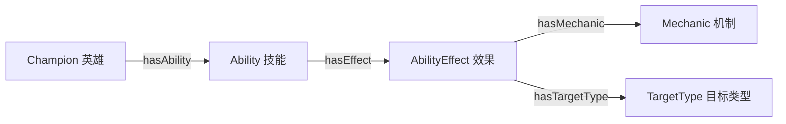
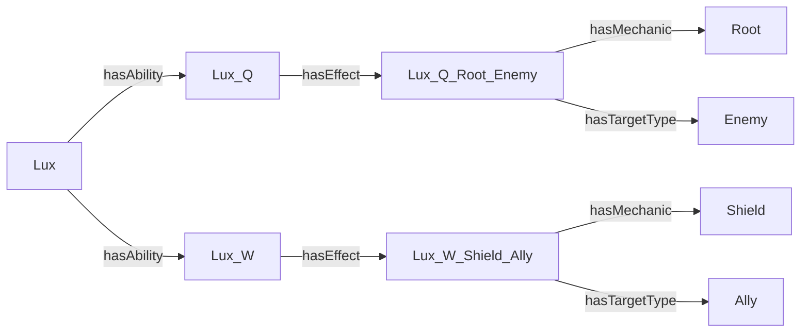
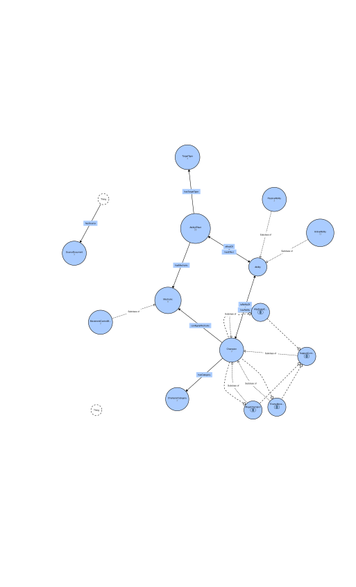

# Step-2 本体与图谱展示答辩：操作流程与中俄话术

适用文件：当前 Protégé 中打开的 `lol_full.owl`。完整讲解建议用时 18–22 分钟；只保留核心示例与每节总结可压缩至 12–15 分钟。本文是演示脚本，不是已经完成现场操作的记录。

主线：**介绍领域问题 → 核对模型 → 展示类和属性 → 展示实例图 → 执行推理 → 用可视化检查模型**。

每个展示环节采用 **整体说明 → 操作一个代表实例 → 回到整体归纳**。各节的“界面定位”适用于该节所有小点，表格末列与话术前的“指向”进一步细化位置；没有单独界面字段的概括会明确说明。表格用于完整理解，不要求现场逐行朗读；示例用于证明整体说明确实落实在模型中。标为“整体话术”的段落可在该节原有示例话术之后连着讲。

## 1. 教材要求与本次展示范围
**界面定位｜点哪里、指哪里：**先打开教材 PDF 第 249–250 页，指向任务 3_1 / 3_2 的条目；然后切回 Protégé 顶部 `Active ontology` 标签，指向右侧 `Ontology metrics`。讲教材对应关系时用下表逐项切换，不要求同时放在同一画面。


依据学科目录中的教材 [语义 Web 技术研讨课](../Копия_Семинар_“Семантические_веб_технологии”_1.pdf)，以下均为 PDF 文件页码。

| 教材要求 | 对应展示 | 验收依据 |
| --- | --- | --- |
| 第 249 页，3_1：任意领域，至少 8 个类、6 个对象属性、10 个数据属性 | Protégé 统计、类树、属性列表 | 本模型为 14 / 9 / 18 |
| 第 249 页：使用一种或多种关系特性 | 展示 `hasAbility inverseOf isAbilityOf` | 逆关系已满足该项；教材没有要求必须使用传递性 |
| 第 249 页：填充实例、确定关系 | Lux、技能、效果及其属性 | 全量文件有 1260 个个体；选一个局部讲解即可 |
| 第 249 页：通过推理构造新关系 | HermiT 推导技能所属逆关系 | 主证据为 `isAbilityOf value Lux`；定义类分类作为补充 |
| 第 250 页，3_2：导入 Ontodia 并检查模型 | Ontodia 原站操作；不可用时展示 Reactodia 并解释替代 | Reactodia 是替代演示，是否认可需由教师决定 |
| 第 250 页：导入 VOWL | WebVOWL 加载模型，检查结构与统计 | 现有 JSON 为同一本体设计的三英雄演示数据集 |
| 第 248 页，实践任务 2：注册 Ontodia | 如教师检查此项，出示实际注册结果 | 不能用本地 OntoGraf 或 Reactodia 冒充原站注册 |

教材第 143 页说明 domain/range 的类型推断语义；第 146 页介绍逆属性，第 148 页介绍属性限制，第 152–154 页介绍推理。属性链是本项目的补充成果，不作为教材明确要求必须实现的项目。SPARQL、图嵌入和图神经网络不作为本次 3_1 / 3_2 的主线。

**本次展示边界：**全量基础数据为 173 个英雄、865 条主要技能；28 个效果仅覆盖 Lux、Karma、Morgana。全量不等于全部英雄的机制均已标注。

## 2. 演示前准备
**界面定位｜点哪里、指哪里：**准备操作不必作为答辩成果展示。自己检查时先看窗口最上方标题栏中的 `lol_full.owl`，再看菜单下方横排标签。路径与文件选择发生在 `File → Open` 打开的文件对话框中。


本机项目目录：

```text
D:\Study-Note\KnowledgeGraphs\Step-2\LoL_Ontology_Submission\LoL_Ontology
```

下表链接可直接定位文件。不要使用旧教程中的 `C:\develop\...` 路径。

| 用途 | 文件或工具 |
| --- | --- |
| 启动 Protégé | [Protege.exe](Protege-5.6.9-win/Protege-5.6.9/Protege.exe) |
| 主演示：原始全量本体 | [lol_full.owl](LoL_Ontology_Submission/LoL_Ontology/output/lol_full.owl) |
| 全量推理结果备用 | [lol_full_inferred.owl](LoL_Ontology_Submission/LoL_Ontology/output/lol_full_inferred.owl) |
| Reactodia 已有数据 | [lol_demo_inferred.ttl](LoL_Ontology_Submission/LoL_Ontology/output/lol_demo_inferred.ttl) |
| Reactodia 已有布局 | [lux_relations.reactodia.json](LoL_Ontology_Submission/LoL_Ontology/output/lux_relations.reactodia.json) |
| WebVOWL 已有模型与布局 | [lol_demo.webvowl.json](LoL_Ontology_Submission/LoL_Ontology/output/lol_demo.webvowl.json) |
| 离线实例图 | [lux_relations.svg](LoL_Ontology_Submission/LoL_Ontology/output/lux_relations.svg) |
| 离线本体结构图 | [lol_schema_webvowl_full.svg](LoL_Ontology_Submission/LoL_Ontology/output/lol_schema_webvowl_full.svg) |
| 历史全量推理检查 | [hermit_full_verification.txt](LoL_Ontology_Submission/LoL_Ontology/output/hermit_full_verification.txt) |

准备步骤：

1. 打开原始 `lol_full.owl`，确认标题栏文件名。不要用 `_inferred.owl` 开始展示“从原始事实执行推理”。
2. 保留 `Active ontology`、`Entities`、`Individuals by class`、`DL Query`、`OntoGraf` 五个标签页；缺少时在 `Window → Tabs` 中启用。
3. 提前排练 OntoGraf 的添加、展开和缩放。已检查安装中有 `ontograf-2.0.3.jar`，你的截图也显示了标签页；本文没有实际操作该界面，按钮名称和布局以本机为准。
4. 提前打开 WebVOWL、Reactodia，完成文件加载。浏览器无法使用时准备好两个 SVG。
5. 正式演示若要做推理前后对照，应先停止推理器并重新打开原始文件，再按第 7 节操作。

**版本切换口径：**Protégé 主线展示全量版：1260 个体；已有 WebVOWL JSON 和 Reactodia Turtle 是演示版：66 个体。两者采用相同本体设计，但不是相同数据规模。当前目录没有教程所述的 `lol_full_inferred.ttl`，不要现场寻找或声称已加载该文件。


### 界面方位速查（按当前截图识别）

| 代号 | 画面位置 | 应指的内容 |
| --- | --- | --- |
| A | Protégé 顶部横排 `Active ontology` → 右侧 `Ontology metrics` | 统计的字段名和数值 |
| B | `Active ontology` → 左侧 `Annotations` | `rdfs:label`、`rdfs:comment`，必要时滚动到版本注释 |
| C | `Entities → Classes` → `Class hierarchy` | 左侧类名称与父子展开关系；选类后看 `Description` |
| D | `Entities → Object properties / Data properties` | 左侧属性列表；详情中查看 domain、range、逆属性或链 |
| E | `Individuals by class` → 选类和个体 → 实体详情 | `Types`、`Object property assertions`、`Data property assertions` |
| F | `DL Query` → 主区域上方、右侧、下方 | 上方输入框／Execute，右侧 Instances，下方 Query results |
| G | `OntoGraf` → 中央画布 | 节点名称、边标签与箭头；具体位置由布局决定 |
| H | Reactodia → 中央画布 | 左 Lux，上 Q、下 W，右机制和目标（已有保存布局） |
| I | WebVOWL → 中央与右侧栏 | 图、Statistics、Selection Details |

A、B、F、H、I 的方位参考你提供的界面和项目已有截图；C、D、E 按 Protégé 面板名称定位，具体排布可能因布局设置而变。G 未经本次 GUI 实测。若找不到字段，先确认选对实体，再滚动相应详情面板；不要假定所有内容都在固定的右上角。

**指示方式：**先点击实体使其选中，再把鼠标移到正在解释的字段名、值或边上停留。整体总结时指向整个面板／路径，不必逐字移动。不要点击编辑加号或删除按钮。

## 3. 开场：说明解决什么问题（约 40 秒）
**界面定位｜点哪里、指哪里：**点击上方 `Active ontology`；指向左侧 `Annotations` 中的 `rdfs:label`（本体名称），再指向 `rdfs:comment`（范围与限制）。三层结构是口头概括，没有一个名为“三层”的界面字段；此处保留总览画面即可。


**画面：**Protégé 当前 `Active ontology` 页面。

**中文说明：**先交代领域，再提出问题，避免只介绍软件按钮。

**讲这段时指向：**点击上方 `Active ontology`；指向左侧 `Annotations` 中的 `rdfs:label`（本体名称），再指向 `rdfs:comment`（范围与限制）。三层结构是口头概括，没有一个名为“三层”的界面字段；此处保留总览画面即可。

**俄语话术：**

> Я построил онтологию чемпионов, умений и эффектов League of Legends. Основной вопрос: какие маги могут дать союзнику щит и ограничить передвижение противника? Для ответа я использую классы, свойства, экземпляры и логический вывод.

中文含义：我建立了英雄、技能和效果的本体，通过类、属性、实例和推理，寻找能够保护友军并限制敌人移动的法师。

**整体说明与归纳：**本体按三个层次组织：第一层保存英雄和技能的基础事实，第二层用效果、机制、目标和条件解释技能能做什么，第三层用逻辑定义判断英雄满足哪些能力条件。数据来源把这些知识连接到可核查的原始材料。后面的展示依次检查这三层是否建立、是否连接正确、是否能够推出答案。

**讲这段时指向：**点击上方 `Active ontology`；指向左侧 `Annotations` 中的 `rdfs:label`（本体名称），再指向 `rdfs:comment`（范围与限制）。三层结构是口头概括，没有一个名为“三层”的界面字段；此处保留总览画面即可。

**俄语整体话术：**

> Модель организована на трёх уровнях. Первый описывает чемпионов и их умения. Второй раскрывает эффекты, механизмы, цели и условия. Третий позволяет классифицировать чемпионов по их возможностям. Источники связывают факты с исходными документами. Далее я покажу структуру, конкретные данные и результаты вывода.

## 4. 模型规模与结构（完整讲解约 5–6 分钟）
**界面定位｜点哪里、指哪里：**在上方标签栏依次切换 `Active ontology → Entities`。本节分别指右侧统计、左侧类树、选中实体后的 `Description` 面板；不要把所有内容都指向统计区。


### 4.1 当前统计页面
**界面定位｜点哪里、指哪里：**点击 `Active ontology`，指向右侧 `Ontology metrics → Metrics` 中的 `Class count / Object property count / Data property count / Individual count` 四行。总量 1260 在这里；各类别明细不在此面板，见下表的定位列。


**操作：**右侧 `Ontology metrics` 指出以下四行：

| 指标 | 全量版预期值 |
| --- | --- |
| Class count | 14 |
| Object property count | 9 |
| Data property count | 18 |
| Individual count | 1260 |

**讲这段时指向：**点击 `Active ontology`，指向右侧 `Ontology metrics → Metrics` 中的 `Class count / Object property count / Data property count / Individual count` 四行。总量 1260 在这里；各类别明细不在此面板，见下表的定位列。

**俄语话术：**

> В модели 14 именованных классов, 9 объектных свойств и 18 свойств данных. Это соответствует минимальным требованиям задания 3_1. Полная версия содержит 173 чемпиона и 865 основных умений, всего 1260 индивидов. Эффекты пока размечены только для Люкс, Кармы и Морганы.

无需逐项解释公理数量，也不必滚动读完统计页面。

**本小点指向：**保留 Active ontology，指右侧四项统计。解释个体组成时使用本表定位列；这些明细不是 Metrics 中七条现成统计。

**整体说明：这些数字分别衡量什么？**14 个类表示概念种类，9 个对象属性表示实体之间的关系种类，18 个数据属性表示文本和数值的字段种类，1260 个个体表示实际填入的实体。前面三个数描述模型结构，最后一个数描述数据规模，不能互相替代。

全量个体的组成如下。这里只按互不重叠的七个领域类别相加，技能子类和推理定义类不能重复计入。

| 领域类别 | 个体数 | 整体作用 | 展示位置／鼠标指向 |
| --- | --- | --- | --- |
| Champion | 173 | 全部已导入英雄的基础记录 | `Individuals by class → Champion`：指个体列表；精确计数可在推理后用 DL Query 查询该类查看结果数 |
| Ability | 865 | 每名英雄的 P/Q/W/E/R 五个主要槽位；不表示所有技能变体 | 推理后 `DL Query → Ability`：指 Instances 结果；原始文件直接声明在 ActiveAbility / PassiveAbility 下 |
| AbilityEffect | 28 | 三名英雄的定性效果标注 | `Individuals by class → AbilityEffect`：指效果个体列表 |
| Mechanic | 11 | 共用机制词汇，如护盾、治疗、控制 | 推理后 `DL Query → Mechanic`：指结果；其中三个控制机制原始类型在子类中 |
| ChampionCategory | 6 | 共用英雄分类，不是地图分路 | `Individuals by class → ChampionCategory`：指 Category_Mage 等个体 |
| TargetType | 4 | Ally、Enemy、Self、OwnAbility，表示效果目标类型 | `Individuals by class → TargetType`：指 Ally / Enemy / Self / OwnAbility |
| SourceDocument | 173 | 各英雄对应的来源文档 | `Individuals by class → SourceDocument`：指 Source_Lux 等文档个体 |
| 合计 | 1260 | 不重复计数的原始领域个体 | 回 `Active ontology` 右侧 `Individual count = 1260`；分类明细是本表归纳 |

**讲这段时指向：**点击 `Active ontology`，指向右侧 `Ontology metrics → Metrics` 中的 `Class count / Object property count / Data property count / Individual count` 四行。总量 1260 在这里；各类别明细不在此面板，见下表的定位列。

**俄语整体话术：**

> Первые три показателя описывают схему, а число индивидов — её наполнение. Данные включают чемпионов, умения, эффекты, общие справочники и документы-источники. Подклассы и вычисляемые классы не добавляют новых индивидов: один и тот же объект может принадлежать нескольким классам. Полнота базовых данных и полнота разметки эффектов здесь различаются.

### 4.2 类树与定义类
**界面定位｜点哪里、指哪里：**点击 `Entities`，在实体类型标签中选 `Classes`。指向左侧 `Class hierarchy` 树；选中一个类后，指向实体详情中的 `Description` 及其 `SubClass Of / Equivalent To / Disjoint With` 区域。具体面板可能随布局移动，应按面板标题定位。


**先整体说明全部 14 个类：**它们可按建模作用分成七个领域类、三个细分类和四个定义类。这里的分组用于讲解，不是额外创建的 OWL 类。

| 分组 | 类 | 在整个模型中的作用 | 展示位置／鼠标指向 |
| --- | --- | --- | --- |
| 领域对象 | Champion、Ability、AbilityEffect | 分别回答“谁”“有什么技能”“技能产生什么具体效果” | `Classes` 左侧分别选 Champion / Ability / AbilityEffect，指名称及 Description |
| 共用分类与词汇 | ChampionCategory、Mechanic、TargetType | 分别回答“英雄属于哪类”“效果是什么机制”“作用于哪类目标” | 同一类树分别选 ChampionCategory / Mechanic / TargetType；类型个体在 Individuals by class 中看 |
| 来源 | SourceDocument | 回答“事实依据是什么、来自哪个版本” | 类树选 SourceDocument，随后在个体页选 Source_Lux 查看数据值 |
| 技能细分 | PassiveAbility、ActiveAbility | Ability 的两个互斥子类，对应 P 与 Q/W/E/R | 类树展开 Ability：指两个子类；选 PassiveAbility 后看 Disjoint With |
| 机制细分 | MovementControlMechanic | Mechanic 的子类，Root、Slow、Stun 是它的机制个体 | 类树展开 Mechanic：指 MovementControlMechanic；Root 等在个体页看 |
| 定义类 | MageChampion | 根据 Category_Mage 分类关系识别法师 | 类树选 MageChampion → Description / Equivalent To：指 Category_Mage 条件 |
| 定义类 | AllyShieldChampion | 根据技能效果识别能给友军提供护盾的英雄 | 选 AllyShieldChampion → Equivalent To：指 Shield 与 Ally 所在限制表达式 |
| 定义类 | EnemyMovementControlChampion | 根据技能效果识别能限制敌人移动的英雄 | 选 EnemyMovementControlChampion → Equivalent To：指 MovementControlMechanic 与 Enemy 条件 |
| 定义类 | SupportControlMage | 前三个定义类的交集，直接对应领域问题 | 选 SupportControlMage → Equivalent To：指 and 连接的三个类 |

七个领域类声明为互斥，避免将英雄错误地同时归为技能或来源文档；四个定义类是 Champion 的子类，可以重叠。`ChampionCategory` 中的 Mage 分类个体与 `MageChampion` 这个英雄类处在不同层次。

**操作：**进入 `Entities → Classes`，展示：

- `Champion`：英雄。**指向：**类树中的 Champion 名称；选中后指 Description。
- `Ability → ActiveAbility / PassiveAbility`：技能分为主动和被动。**指向：**展开 Ability 后的两个子节点。
- `AbilityEffect`：技能的一项具体效果。**指向：**类树名称及该类 Description。
- `Mechanic → MovementControlMechanic`：机制与移动控制机制。**指向：**Mechanic 下的子类节点。
- 选中 `SupportControlMage`，查看 `Equivalent To`。**指向：**详情里由 and 连接的三个类名。

需要解释的定义：

```text
SupportControlMage EquivalentTo
    MageChampion
    and AllyShieldChampion
    and EnemyMovementControlChampion
```

**讲这段时指向：**点击 `Entities`，在实体类型标签中选 `Classes`。指向左侧 `Class hierarchy` 树；选中一个类后，指向实体详情中的 `Description` 及其 `SubClass Of / Equivalent To / Disjoint With` 区域。具体面板可能随布局移动，应按面板标题定位。

**俄语话术：**

> Я разделил чемпионов, умения и отдельные эффекты. У одного умения может быть несколько эффектов с разными целями и условиями. Класс SupportControlMage задан как пересечение трёх классов: маги, чемпионы со щитом для союзника и чемпионы с контролем передвижения врага.

这里的“护盾”和“控制”可以由两个不同技能提供。

**本小点指向：**回到 Classes 类树，从七个领域类指到三个子类，再点四个定义类的 Equivalent To；不必同时打开四个详情。

**例后整体归纳：**类设计同时承担“组织数据”和“表达判断条件”两项工作。前十个类提供领域概念和层次，后四个定义类把领域问题转为逻辑条件。Lux 只是检验这些条件的一个实例，类定义适用于任何拥有足够相关事实的英雄。

**讲这段时指向：**点击 `Entities`，在实体类型标签中选 `Classes`。指向左侧 `Class hierarchy` 树；选中一个类后，指向实体详情中的 `Description` 及其 `SubClass Of / Equivalent To / Disjoint With` 区域。具体面板可能随布局移动，应按面板标题定位。

**俄语整体话术：**

> В целом классы решают две задачи: организуют данные и задают условия классификации. Семь основных классов описывают предметную область, три подкласса уточняют умения и механизмы. Ещё четыре класса определены логически и связывают структуру с нашим вопросом. Эти определения применимы к любому чемпиону, для которого имеются необходимые факты.

### 4.3 属性与关系特性
**界面定位｜点哪里、指哪里：**点击 `Entities`，先选 `Object properties`：左侧选属性，详情看 `Domains / Ranges / Inverse Of / SuperProperty Of (Chain)`；再选 `Data properties`，详情看 `Ranges`。若要展示实际字符串或数值，必须再切到个体的 `Data property assertions`，不能只停在属性定义页。


**对象属性的整体设计：**九个属性连接前述各类个体，组成从英雄到能力证据的关系网络。

| 属性 | 方向 | 整体用途 | 展示位置／鼠标指向 |
| --- | --- | --- | --- |
| hasAbility | Champion → Ability | 技能所有权主路径 | `Object properties` 左侧选 hasAbility → 指 Domains、Ranges |
| isAbilityOf | Ability → Champion | 上述关系的逆向导航 | 选 isAbilityOf → 指 Inverse Of（若显示在 hasAbility 侧，可回该侧看） |
| hasCategory | Champion → ChampionCategory | 英雄分类，为 MageChampion 提供依据 | 选 hasCategory → 指 Domains、Ranges；实例值在 Lux 的 Object property assertions |
| hasEffect | Ability → AbilityEffect | 将技能展开为具体效果 | 选 hasEffect → 指 Domains、Ranges、Inverse Of |
| effectOf | AbilityEffect → Ability | 从效果追溯所属技能，与 hasEffect 互逆 | 选 effectOf → 指逆属性；实际效果所属关系用推理后查询或导出文件核对 |
| hasMechanic | AbilityEffect → Mechanic | 确定效果机制 | 选 hasMechanic → 指 Domains、Ranges；效果个体面板指 Shield / Root 值 |
| hasTargetType | AbilityEffect → TargetType | 区分自身、友军、敌人等效果目标 | 选 hasTargetType → 指 Domains、Ranges；效果个体面板指 Ally / Enemy 值 |
| hasSource | 不设置统一 domain → SourceDocument | 英雄、技能、效果共用来源连接，避免错误缩窄类型 | 选 hasSource → 指 Ranges 中 SourceDocument 和未设置统一 domain 的 Domains 区 |
| canApplyMechanic | Champion → Mechanic | 根据属性链推导的能力概括 | 选 canApplyMechanic → 指 SuperProperty Of (Chain) 中三段链 |

其中两对逆属性解决双向关系，一条属性链概括跨越技能与效果的路径。它们是对关系含义的统一约定，不是只针对 Lux 编写的特殊规则。

**数据属性的整体设计：**18 个属性按用途分为以下五组。类型主要为字符串，五项基础数值为 decimal，来源地址为 anyURI。

| 分组 | 属性 | 整体用途 | 展示位置／鼠标指向 |
| --- | --- | --- | --- |
| 标识与版本（3） | entityId、name、gameVersion | 标识实体、提供名称并固定数据版本 | `Data properties` 左侧依次选 entityId / name / gameVersion；实际值在 Lux → Data property assertions |
| 英雄说明（3） | title、resourceType、description | 保存称号、资源类型和描述；description 也可用于其他实体 | 属性列表指三项名称；Lux 的数据断言看 title / resourceType，技能数据断言看 description |
| 英雄基础数值（5） | baseHP、baseMP、baseArmor、baseAttackDamage、baseMoveSpeed | 保存生命、资源、护甲、攻击力、移速等数值 | 属性列表指五项 base 属性；选 baseHP 看 Ranges；Lux 数据断言看实际数值 |
| 技能文本（2） | slot、tooltipText | 区分技能槽位，保留技能说明原文 | 属性列表选 slot / tooltipText；个体页选 Lux_W → Data property assertions 指内容 |
| 来源与效果核查（5） | sourceURL、conditionText、evidenceText、evidenceField、reviewStatus | 保存来源、条件、证据文本、证据字段和复核状态 | Source_Lux 数据断言指 sourceURL；Lux_W_Shield_Ally 数据断言指条件、证据、字段、复核状态 |

这些是展示用的功能分组，不代表每组属性共享同一个 domain。`rdfs:label`、`rdfs:comment` 等注释不计入这 18 个数据属性。

**操作：**

1. 切换 `Object properties`，选 `hasAbility`，展示 domain 为 `Champion`、range 为 `Ability`，以及 `Inverse Of: isAbilityOf`。
2. 如时间允许，展示 `hasEffect` 与 `effectOf` 也是逆属性。
3. 切换 `Data properties`，展示 `name`、`baseHP`、`conditionText`；不必逐一朗读 18 个属性。

**讲这段时指向：**点击 `Entities`，先选 `Object properties`：左侧选属性，详情看 `Domains / Ranges / Inverse Of / SuperProperty Of (Chain)`；再选 `Data properties`，详情看 `Ranges`。若要展示实际字符串或数值，必须再切到个体的 `Data property assertions`，不能只停在属性定义页。

**俄语话术：**

> Объектные свойства связывают индивидов, например чемпиона с умением. Свойства данных хранят строки и числа. Для hasAbility задано обратное свойство isAbilityOf. Если Люкс имеет умение Lux_Q, ризонер может вывести, что Lux_Q принадлежит Люкс.

若被问到 domain/range：它们支持类型推断，不是数据库式的输入校验。不要把 `hasAbility` 说成传递属性；本模型未作此设置。

**本小点指向：**先指 Object properties 列表，再指 Data properties 列表，最后在 Lux 的数据断言里指 name / baseHP，在效果个体里指 conditionText。

**例后整体归纳：**对象属性建立“谁与谁相关”的路径，数据属性补充“它是什么、数值多少、在什么条件下、依据是什么”。两者共同让模型既能推理，又能解释。现场点开 hasAbility、name、conditionText 是抽样检查整体设计，不代表模型只有这几项。

**讲这段时指向：**点击 `Entities`，先选 `Object properties`：左侧选属性，详情看 `Domains / Ranges / Inverse Of / SuperProperty Of (Chain)`；再选 `Data properties`，详情看 `Ranges`。若要展示实际字符串或数值，必须再切到个体的 `Data property assertions`，不能只停在属性定义页。

**俄语整体话术：**

> Все объектные свойства образуют единый путь: чемпион, его категория, умения, эффекты, механизмы, цели и источники. Свойства данных дополняют этот путь идентификаторами, версией, описаниями, числовыми характеристиками и доказательствами. Обратные свойства дают навигацию в двух направлениях, а цепочка свойств позволяет получить обобщённую связь. В результате модель хранит и структуру знаний, и сведения для их объяснения.

## 5. 在 Protégé 中展示图谱（约 2–3 分钟）
**界面定位｜点哪里、指哪里：**点击顶部 `OntoGraf`。整体现象指中央图画布，局部说明指具体节点、边标签和箭头；搜索、过滤、布局属于操作控件。此标签的当前画面未提供截图，以下不固定控件的左右位置。


这部分回应“有没有节点和连线的图”。推荐准备两幅局部视图，不要把整个数据集一次展开。

**本小点指向：**先指类结构画布，再指实例画布；此句是在概括两种视图，不对应单个字段。

**整体说明：**结构图展示可重复使用的建模规则，实例图展示这些规则下已经填入的事实。整个图谱并非一棵简单的英雄技能树：多个英雄可以共享分类、机制和目标类型，各实体还能连接来源文档，因此构成相互连接的网络。局部展开是为了读清楚路径，不是把全图解释成只有几个节点。

### 5.1 图 A：类与属性的结构图
**界面定位｜点哪里、指哪里：**在 `OntoGraf` 画布指 `Champion → Ability → AbilityEffect` 主路径及机制、目标两个分支；补充说明时分别指 `ChampionCategory`、`SourceDocument` 或相关层级。若当前画布未显示这些内容，应先展开；不能指着空白说明已经显示。


**目的：**解释有哪些概念，以及概念之间的关系。

**操作：**

1. 切到 `OntoGraf`。
2. 在搜索区域查找 `Champion`，从匹配结果加入画布。搜索项和按钮以实际界面为准。
3. 使用节点的展开操作（可检查双击或右键菜单），逐层加入 `Ability`、`AbilityEffect`、`Mechanic`、`TargetType`。
4. 使用关系过滤控件保留需要的关系；用布局工具和缩放让节点文字可读。
5. 如果自动展开没有呈现某一条 domain/range 关系，回到 `Object properties` 核查，不要为“补一条线”修改本体。

讲解目标如下。**这是结构示意，不是导出的软件截图；类间箭头表示属性的 domain/range 设计，不是给类个体断言该属性。**



**讲这段时指向：**在 `OntoGraf` 画布指 `Champion → Ability → AbilityEffect` 主路径及机制、目标两个分支；补充说明时分别指 `ChampionCategory`、`SourceDocument` 或相关层级。若当前画布未显示这些内容，应先展开；不能指着空白说明已经显示。

**俄语话术：**

> На этой схеме показана структура модели. Чемпион связан с умением, умение — с конкретным эффектом. У эффекта отдельно заданы механизм и тип цели. Такое разделение позволяет отличать щит для союзника от щита только для самого чемпиона.

**本小点指向：**指结构图的主路径，再指已显示的分类、来源或子类；未展开的部分先展开或只作口头补充。

**例后整体归纳：**图 A 中的主路径是全模型的骨架；完整结构还包含英雄分类、来源追溯、技能及机制子类、逆向关系和定义类。每个英雄复用同一套结构，不需单独设计一张不同的模型。

**讲这段时指向：**在 `OntoGraf` 画布指 `Champion → Ability → AbilityEffect` 主路径及机制、目标两个分支；补充说明时分别指 `ChampionCategory`、`SourceDocument` 或相关层级。若当前画布未显示这些内容，应先展开；不能指着空白说明已经显示。

**俄语整体话术：**

> Показанный путь — основа всей схемы. Её дополняют категории чемпионов, источники, подклассы, обратные связи и логические определения. Одна схема используется для всех чемпионов; различаются сами данные и полнота описания эффектов.

### 5.2 图 B：Lux 的实例关系图
**界面定位｜点哪里、指哪里：**在 `OntoGraf` 画布先指 Lux，再沿 Q 分支指 Root、Enemy，沿 W 分支指 Shield、Ally，最后回指 Lux。位置取决于自动布局，按节点名称定位。需要稳定位置时使用第 8.1 节的已有 Reactodia 布局。


**目的：**展示真正的实例与关系，而不只是类结构。

**操作：**

1. 使用新的或清空后的视图，查找个体 `Lux`。注意英文 ID 与俄语标签可能不同。
2. 若搜索只显示类，检查实体类型筛选是否包含 individuals；必要时先从 `Champion` 展开个体。
3. 添加 `Lux_Q`、`Lux_W`，再展开到 `Lux_Q_Root_Enemy`、`Lux_W_Shield_Ally`。
4. 继续加入 `Root`、`Shield`、`Enemy`、`Ally`。
5. 只保留主路径，移走无关节点；过滤视图不会删除 OWL 数据。
6. 如果本机 OntoGraf 不便得到可读的实例图，使用第 8 节已保存的 Reactodia 图；不必现场调整插件。



**讲这段时指向：**在 `OntoGraf` 画布先指 Lux，再沿 Q 分支指 Root、Enemy，沿 W 分支指 Shield、Ally，最后回指 Lux。位置取决于自动布局，按节点名称定位。需要稳定位置时使用第 8.1 节的已有 Reactodia 布局。

**俄语话术：**

> Здесь уже показаны конкретные индивиды. У Люкс есть умение Q с эффектом обездвиживания врага и умение W со щитом для союзника. На графе видны два отдельных пути. Вместе с категорией Mage они дают основания для ответа на исходный вопрос.

不要说“只要连到 Shield 就证明能保护友军”；必须查看效果上的 `hasTargetType Ally`。

**本小点指向：**指 Lux 到两个效果的分支，再分别指共享的 Shield / Root 与目标节点；最后回指 Lux。

**例后整体归纳：**Lux 展示了模型如何把一个英雄的两种能力连成可解释的证据路径。对其他英雄同样检查“英雄 → 技能 → 效果 → 机制和目标”，再结合英雄分类；但只有已经标注的效果能为这种判断提供证据。共享 Shield、Root 等个体使不同英雄的能力可以在同一词汇体系下比较。

**讲这段时指向：**在 `OntoGraf` 画布先指 Lux，再沿 Q 分支指 Root、Enemy，沿 W 分支指 Shield、Ally，最后回指 Lux。位置取决于自动布局，按节点名称定位。需要稳定位置时使用第 8.1 节的已有 Reactodia 布局。

**俄语整体话术：**

> На примере Люкс мы проверили общий способ описания возможностей. Для других чемпионов используется тот же путь через умение и эффект к механизму и цели. Общие индивиды механизмов позволяют сопоставлять чемпионов. При этом вывод возможен только при наличии необходимых фактов: отсутствие разметки не доказывает отсутствие способности.

### 5.3 已有实例图：离线可直接打开
**界面定位｜点哪里、指哪里：**打开本节嵌入的 SVG 或点其文件链接。指左侧 Lux、上方 Q 控制分支、下方 W 护盾分支和右侧机制／目标；它是离线图，不在 Protégé 面板内。


下图为项目已经保存的 Reactodia Lux 局部图，来自演示数据集；不是本次新生成的 OntoGraf 截图。


如 Markdown 阅读器不支持 SVG，直接用浏览器打开上面的 SVG 文件链接。此图保留局部关系，隐藏的关系不表示模型中不存在。

## 6. 在实例面板核对图中的含义（约 1 分钟）
**界面定位｜点哪里、指哪里：**点击 `Individuals by class`。通常左侧选类、中间选个体，右侧看详情；按面板标题确认。选 `AbilityEffect → Lux_W_Shield_Ally` 后，依次指 `Types`、`Object property assertions`、`Data property assertions`。不要点这些区域的加号修改数据。


**本小点指向：**指效果详情中的 Object property assertions 和 Data property assertions，再选 Source_Lux 指 sourceURL / gameVersion。

**整体说明：**每个实例都通过所属类、对象关系和数据值进入模型。英雄实例主要承载基础信息、分类、技能和来源；技能实例承载槽位、说明和效果；效果实例承载机制、目标、条件及证据；来源实例承载文档地址和版本。机制、分类和目标类型作为共用个体被多处引用。下面用一个效果实例检查这套填充方式。

**操作：**进入 `Individuals by class`，找到 `Lux_W_Shield_Ally`，检查：

| 内容 | 应展示的值 | 展示位置／鼠标指向 |
| --- | --- | --- |
| 所属类 | `AbilityEffect` | 效果个体详情的 Types 区 |
| `hasMechanic` | `Shield` | Object property assertions → hasMechanic 的值 |
| `hasTargetType` | `Ally` | Object property assertions → hasTargetType 的值 |
| `conditionText` | 法杖在飞出或返回路径上触及友军 | Data property assertions → conditionText 的文字；过长时展开／滚动 |
| `evidenceText` | 对应俄语技能原文 | Data property assertions → evidenceText 的俄语原文 |
| `hasSource` | `Source_Lux` | Object property assertions → hasSource；再选择 Source_Lux 看数据断言 |

打开 `Source_Lux` 可查看 `sourceURL` 与版本来源。若查找困难，从 `AbilityEffect` 类的实例列表定位，不要只依赖显示标签。

**讲这段时指向：**点击 `Individuals by class`。通常左侧选类、中间选个体，右侧看详情；按面板标题确认。选 `AbilityEffect → Lux_W_Shield_Ally` 后，依次指 `Types`、`Object property assertions`、`Data property assertions`。不要点这些区域的加号修改数据。

**俄语话术：**

> Для эффекта сохранены не только механизм и цель, но и условие срабатывания и исходный текст. Например, щит Люкс действует, когда жезл касается союзника. Эти условия хранятся текстом; модель не симулирует игровой бой.

这一段用于视觉检查：图上关系能在具体实例的属性中核实，并有来源可追溯。

**本小点指向：**指效果详情中的 Object property assertions 和 Data property assertions，再选 Source_Lux 指 sourceURL / gameVersion。

**例后整体归纳：**实例面板把图谱上的路径还原为可检查的事实记录。条件和证据用于解释标注的语义，版本与来源用于追溯事实；目前文本条件并没有全部转换成可自动求值的逻辑约束，reviewStatus 也不能当作已经由教师或本人独立复核。

**讲这段时指向：**点击 `Individuals by class`。通常左侧选类、中间选个体，右侧看详情；按面板标题确认。选 `AbilityEffect → Lux_W_Shield_Ally` 后，依次指 `Types`、`Object property assertions`、`Data property assertions`。不要点这些区域的加号修改数据。

**俄语整体话术：**

> В целом каждый индивид имеет тип и связанные с ним факты. У чемпиона это характеристики и умения, у умения — слот и эффекты, у эффекта — механизм, цель, условие и свидетельство. Документы обеспечивают прослеживаемость. Такая организация позволяет объяснить ответ, но текстовые условия ещё не означают автоматическую проверку игровой ситуации.

## 7. 推理：展示新关系与问题答案（约 2–3 分钟）
**界面定位｜点哪里、指哪里：**先指顶部 `Reasoner` 菜单，再切到 `DL Query`。启动状态看窗口底部；输入看 `Query (class expression)`；答案看 `Query results`。下文每个查询都按这一套位置展示。


**本小点指向：**先指 Reasoner 菜单，再指 DL Query 输入和结果区；这一段是输入、公理、结果的概括。

**先整体说明：**输入由原始事实与本体公理组成，HermiT 根据两者进行一致性检查和逻辑推导。本项目的主要输出包括两对逆关系、属性链得到的英雄机制关系，以及四个定义类的成员。推理不联网补充事实，也不从技能自然语言中自行学习机制。下面的查询只是查看这些输出的不同窗口。

### 7.1 启动推理器
**界面定位｜点哪里、指哪里：**点击窗口顶部 `Reasoner` 菜单，选择 HermiT 后执行 `Start reasoner`。完成后指窗口底部状态区域；现有截图显示 `Reasoner active`。底部 `Show Inferences` 勾选项本身不证明已经成功启动推理。


**操作：**确认打开的是原始 `lol_full.owl`。在 `Reasoner` 菜单选择 HermiT，再执行 `Start reasoner`，等待完成。

**讲这段时指向：**点击窗口顶部 `Reasoner` 菜单，选择 HermiT 后执行 `Start reasoner`。完成后指窗口底部状态区域；现有截图显示 `Reasoner active`。底部 `Show Inferences` 勾选项本身不证明已经成功启动推理。

**话术：**

> Теперь я запускаю HermiT. Он проверяет согласованность онтологии и выводит отношения и принадлежность к классам на основе заданных аксиом.

没有报错不应被夸大为“所有现实知识均正确”。一致性检查只说明当前逻辑公理和事实没有造成相应的矛盾。

### 7.2 必展示：逆关系推理
**界面定位｜点哪里、指哪里：**点击 `DL Query`；在右侧主区域上方的 `Query (class expression)` 输入框填表达式，在其下点击 `Execute`。右侧 `Query for` 只勾 `Instances`；最后指下方 `Query results → Instances` 中五个技能名称。


**操作：**`DL Query` 中只勾选 `Instances`，输入并执行：

```text
isAbilityOf value Lux
```

**预期结果：**`Lux_P`、`Lux_Q`、`Lux_W`、`Lux_E`、`Lux_R`，显示顺序不限。

**讲这段时指向：**点击 `DL Query`；在右侧主区域上方的 `Query (class expression)` 输入框填表达式，在其下点击 `Execute`。右侧 `Query for` 只勾 `Instances`；最后指下方 `Query results → Instances` 中五个技能名称。

**俄语话术：**

> В исходном файле записаны связи hasAbility от Люкс к её умениям. Обратные связи isAbilityOf не введены вручную. После запуска ризонера запрос возвращает пять умений Люкс. Это пример построения новых отношений по свойству инверсии, как требуется в задании 3_1.

原始断言关系与推理结果的区别：

```text
原始事实：Lux hasAbility Lux_Q
关系规则：hasAbility inverseOf isAbilityOf
推理结论：Lux_Q isAbilityOf Lux
```

### 7.3 必展示：回答领域问题
**界面定位｜点哪里、指哪里：**停留 `DL Query`，替换上方输入框为 `SupportControlMage`，点 `Execute`。指中下部 `Query results → Instances (3 of 3)` 下的 Karma、Lux、Morgana；解释定义时切到 `Entities → Classes → SupportControlMage → Equivalent To`。


执行：

```text
SupportControlMage
```

**预期结果：**`Karma`、`Lux`、`Morgana`。

**讲这段时指向：**停留 `DL Query`，替换上方输入框为 `SupportControlMage`，点 `Execute`。指中下部 `Query results → Instances (3 of 3)` 下的 Karma、Lux、Morgana；解释定义时切到 `Entities → Classes → SupportControlMage → Equivalent To`。

**俄语话术：**

> В результате получены Карма, Люкс и Моргана. Принадлежность к целевому классу не записана вручную, а выведена из определения класса и фактов об эффектах. Это доказанные ответы в пределах текущей разметки, а не полный список всех подходящих чемпионов игры.

### 7.4 可选：属性链推理
**界面定位｜点哪里、指哪里：**先在 `Entities → Object properties` 左侧选 `canApplyMechanic`，指详情中的 `SuperProperty Of (Chain)` 三段链；再回 `DL Query` 上方输入表达式，点 `Execute`，指下方三个实例结果。


有时间再在 `Object properties → canApplyMechanic` 查看 `SuperProperty Of (Chain)`：

```text
hasAbility o hasEffect o hasMechanic SubPropertyOf canApplyMechanic
```

再查询：

```text
canApplyMechanic value Shield
```

**预期结果：**`Karma`、`Lux`、`Morgana`。

**讲这段时指向：**先在 `Entities → Object properties` 左侧选 `canApplyMechanic`，指详情中的 `SuperProperty Of (Chain)` 三段链；再回 `DL Query` 上方输入表达式，点 `Execute`，指下方三个实例结果。

**俄语话术：**

> Дополнительно задана цепочка свойств. Если чемпион имеет умение с эффектом определённого механизма, можно вывести, что чемпион способен применять этот механизм. Но эта сокращённая связь сама по себе не хранит тип цели и условие.

不要点击 `Add to ontology` 来保存查询答案；展示查询不需要修改本体。

### 7.5 如何严谨展示“推理前后”
**界面定位｜点哪里、指哪里：**原始事实：`Individuals by class → Champion → Lux → Object property assertions` 指五个 `hasAbility`。推理答案：回 `DL Query` 指逆关系结果。全量 865 的历史统计：用文本编辑器打开本节 JSON，指 `full.inverse_relations_after_hermit`；它不是 Protégé 当前界面中的自动计数。


| 项目 | 原始全量文件中的显式断言 | 现有 HermiT 验证记录 |
| --- | --- | --- |
| `isAbilityOf` 技能所属关系 | 0 条 | 推理后 865 条 |
| `SupportControlMage` 的显式类成员 | 0 个 | 推理后 3 个 |

数据来自 [query_validation.json](LoL_Ontology_Submission/LoL_Ontology/output/query_validation.json) 和全量验证日志。它们是已有检查记录，不能说成本次现场刚统计的结果。

推理前没有显式断言，不等于逻辑上无法由公理推出；未运行推理器时 DL Query 的行为也不能当作可靠的“前测”。演示时先在实例面板查看原始断言，再运行 HermiT 查询即可。若运行失败，展示保存的推理文件和历史日志，并明确说这是备用结果。

### 7.6 例后整体归纳：这三种结果分别说明什么
**界面定位｜点哪里、指哪里：**总结第一行时指逆关系查询结果；第二行切到 `canApplyMechanic` 的属性链；第三行切到 `SupportControlMage → Equivalent To` 后回查询结果。若时间短，可保留最终三英雄结果画面，口头回顾前两个画面，不必反复切换。


| 结果层次 | 使用的整体规则 | 示例展示的作用 | 展示位置／鼠标指向 |
| --- | --- | --- | --- |
| 新的关系方向 | 两对逆属性 | Lux 的技能所属查询证明可以由正向事实得到反向关系 | DL Query 的 isAbilityOf 查询结果；规则在 hasAbility → Inverse Of |
| 跨多跳的能力概括 | hasAbility / hasEffect / hasMechanic 属性链 | 英雄与机制直接连接；概括不保留具体目标与条件 | canApplyMechanic → SuperProperty Of (Chain)，再指对应查询结果 |
| 按条件归类 | 四个 EquivalentClasses 定义 | 从英雄类别与效果事实推导目标类成员，回答领域问题 | SupportControlMage → Equivalent To；再指 DL Query 三英雄结果 |

这些规则适用于整个本体中符合条件的事实，不只适用于示例节点。技能所有权覆盖全部 865 条主要技能，因此可完整推导相应逆关系；效果推理受三英雄标注范围限制。逆关系和属性链推导新对象关系，定义类推导新类型归属，二者应分别说明。

**讲这段时指向：**总结第一行时指逆关系查询结果；第二行切到 `canApplyMechanic` 的属性链；第三行切到 `SupportControlMage → Equivalent To` 后回查询结果。若时间短，可保留最终三英雄结果画面，口头回顾前两个画面，不必反复切换。

**俄语整体话术：**

> В целом вывод даёт три вида результатов: обратные отношения, обобщённые связи через цепочки свойств и принадлежность к определяемым классам. Это общие правила для всей онтологии. Для всех импортированных умений можно вывести владельца, а вывод по эффектам ограничен имеющейся разметкой. Поэтому нужно различать полноту логического вывода из данных и полноту самих данных.

## 8. 教材 3_2：实例可视化与 VOWL（约 2–3 分钟）
**界面定位｜点哪里、指哪里：**实例层指 Reactodia 中央画布的节点与箭头；结构层指 WebVOWL 中央画布及右侧信息栏。本节切换到浏览器，不能继续指 Protégé 页面说明已完成网页导入。


**若本次仅做 Protégé 内成果预览，可停在第 7 节；若按教材 3_2 验收，应保留本节。** OntoGraf 是本地展示补充，不自动替代教材指定工具。

**本小点指向：**指 Reactodia 的具体节点边，再切 WebVOWL 整体图；检查发现疑问时回 Protégé 相应实体详情。

**整体说明：**可视化检查分为实例层和结构层。实例层检查关系端点、方向、目标是否正确；结构层检查概念划分、层级、属性连接是否符合设计。操作中遇到可疑连线，应回到 Protégé 核查事实或公理，不能只凭图上距离、颜色或布局下结论。

### 8.1 Reactodia：恢复可操作的实例图
**界面定位｜点哪里、指哪里：**Reactodia 左上角三横线菜单用于两次加载。已有布局中：Lux 在左侧中部，Q 路径在上方，W 路径在下方，机制与目标在最右侧；缩放／适应画布按钮在左侧竖向工具栏。若窗口大小改变，以名称和按钮提示为准。


1. 打开 [Reactodia RDF Explorer](https://reactodia.github.io/playground/rdf-explorer/)。
2. 左上角菜单选择 `Load RDF (Turtle) data`，加载 `lol_demo_inferred.ttl`。
3. 同一菜单选择 `Open diagram from file`，加载 `lux_relations.reactodia.json`。
4. 点击 `Fit to Screen` 或对应适应画布按钮，核对第 5 节两条路径。
5. 需要时换用 [Karma 布局](LoL_Ontology_Submission/LoL_Ontology/output/karma_relations.reactodia.json) 或 [Morgana 布局](LoL_Ontology_Submission/LoL_Ontology/output/morgana_relations.reactodia.json)；无需重新导入另一份数据。

JSON 只保存视图，必须先加载 RDF 数据。本节切换到了同一设计的三英雄演示数据集。

**讲这段时指向：**Reactodia 左上角三横线菜单用于两次加载。已有布局中：Lux 在左侧中部，Q 路径在上方，W 路径在下方，机制与目标在最右侧；缩放／适应画布按钮在左侧竖向工具栏。若窗口大小改变，以名称和按钮提示为准。

**俄语话术：**

> Для проверки связей между экземплярами я показываю локальный граф Люкс в Reactodia. Здесь используется демонстрационный набор с той же схемой. Исходный сервис Ontodia ранее был недоступен, поэтому использована его открытая ветвь Reactodia. Это замена инструмента визуализации, а не выполненная регистрация в Ontodia.

原站问题依据提交包中的 [历史访问记录](LoL_Ontology_Submission/LoL_Ontology/evidence/05_ontodia_unavailable.txt)；本次未重新验证原站可用性。如原站恢复并可使用，应按教材补做实际注册、加载和检查；具体导入界面以原站为准。教师是否接受替代仍需确认。

**本小点指向：**指左侧 Lux、上下两条技能路径、右侧机制与目标；沿箭头方向移动鼠标。

**例后整体归纳：**Lux 图是实例层的局部检查样本：确认英雄连到自己的技能，技能连到相应效果，效果的机制与目标没有接错。Karma、Morgana 可按同一方法核查。局部图支持检查已显示的事实，不证明未显示部分全部正确。

**讲这段时指向：**Reactodia 左上角三横线菜单用于两次加载。已有布局中：Lux 在左侧中部，Q 路径在上方，W 路径在下方，机制与目标在最右侧；缩放／适应画布按钮在左侧竖向工具栏。若窗口大小改变，以名称和按钮提示为准。

**俄语整体话术：**

> На уровне экземпляров я проверяю, что умение связано с правильным чемпионом, а эффект — с правильным механизмом и целью. Тот же способ проверки применим к другим чемпионам. Локальная диаграмма помогает найти ошибки в показанных связях, но не является полной проверкой всего набора данных.

### 8.2 WebVOWL：展示整体本体结构
**界面定位｜点哪里、指哪里：**WebVOWL 下方工具栏 `Ontology` 菜单用于加载（小窗口可用底栏左右箭头找到隐藏项）；图在中央；右侧 `Statistics` 展开后显示统计。点选节点后的信息位于右侧 `Selection Details`。面板折叠时先展开侧栏。


1. 打开 [WebVOWL](https://service.tib.eu/webvowl/)。
2. 在 `Ontology` 菜单选择文件，加载 `lol_demo.webvowl.json`，恢复已有模型和布局。
3. 展示类和属性，点选 `Champion`、`Ability`、`AbilityEffect`，对照前面的实例路径。
4. 打开 `Statistics`：演示版预期为 **14 / 9 / 18 / 66**。
5. 若需要全量展示，选择 `lol_full.owl` 交由网站转换，成功后核对 **1260 个体**；此路径需提前排练，现有 JSON 不能作为全量导入证据。

**讲这段时指向：**WebVOWL 下方工具栏 `Ontology` 菜单用于加载（小窗口可用底栏左右箭头找到隐藏项）；图在中央；右侧 `Statistics` 展开后显示统计。点选节点后的信息位于右侧 `Selection Details`。面板折叠时先展开侧栏。

**俄语话术：**

> WebVOWL показывает структуру онтологии: классы, свойства и ограничения. Здесь загружен демонстрационный набор: 14 классов, 9 объектных свойств, 18 свойств данных и 66 индивидов. В Protégé до этого была полная версия с 1260 индивидами. Схема у них одна, объём данных различается.

**检查什么：**类的层次是否合理、属性方向是否正确、效果是否连接到机制和目标；再回到 Protégé 核对复杂定义。画布节点数不等于命名类数，图形看起来正确也不代替推理检查。

下图是已有 WebVOWL 结构图，包含全部命名类；文件名中的 `full` 指该结构视图包含全部命名类，不能据此声称图来自全量实例数据。图中隐藏了数据属性以提高可读性。



**本小点指向：**先指 WebVOWL 中央整体图与 Statistics，再回局部图指一条路径；无需再加载数据。

**例后整体归纳：**三种视图各有作用：Protégé 类树与属性面板用于查看精确公理，OntoGraf / Reactodia 用于沿关系浏览局部，WebVOWL 用于看整体结构。它们展示的是同一领域模型的不同侧面。正确的图谱展示既要看整体结构，也要沿一条实例路径核查事实，最后用推理验证逻辑结果。

**讲这段时指向：**WebVOWL 下方工具栏 `Ontology` 菜单用于加载（小窗口可用底栏左右箭头找到隐藏项）；图在中央；右侧 `Statistics` 展开后显示统计。点选节点后的信息位于右侧 `Selection Details`。面板折叠时先展开侧栏。

**俄语整体话术：**

> В целом визуализация связывает общий обзор с проверкой отдельных фактов. WebVOWL помогает увидеть схему, а граф экземпляров — проследить конкретные отношения. Точные аксиомы проверяются в Protégé, логические следствия — ризонером. Эти способы проверки дополняют друг друга.

## 9. 收尾话术（约 20 秒）
**界面定位｜点哪里、指哪里：**保留 `DL Query` 的三英雄结果，或切到 Lux 局部图作最后画面。讲结构、数据、推理时可口头回顾，无需新开页面。提及限制时指出此前的 `rdfs:comment` 或效果标注范围，不把限制说成界面新结果。


> Я построил и наполнил OWL-онтологию, задал обратные свойства и выполнил логический вывод. На примере Люкс показаны исходные факты и выведенные отношения. Визуализация помогает проверить структуру и связи. Основное ограничение — эффекты размечены только для трёх чемпионов; расширение этой разметки остаётся дальнейшей работой.

中文含义：已完成本体建模、实例填充、关系规则和推理，并用图展示结构和事实；主要限制是机制标注尚未覆盖所有英雄。

**如需更完整的整体收束，可用下面一段替换上面的短版：**

> В работе построена единая модель от исходных документов до ответа на предметный вопрос. Классы организуют понятия, объектные свойства связывают индивидов, а свойства данных сохраняют характеристики и свидетельства. Факты о чемпионах и умениях дополнены разметкой эффектов. На этой основе ризонер выводит новые отношения и классифицирует чемпионов. Диаграммы позволяют проверить структуру и проследить объяснение ответа. Ограничение состоит в неполной разметке эффектов и текстовом представлении игровых условий.

中文含义：从来源材料到领域答案形成一条完整链路：类组织概念，对象属性连接实例，数据属性保存特征与证据；实例提供事实，公理支持推理，图谱帮助检查与解释。当前限制在于效果标注不完整、游戏条件仍以文本表示。

## 10. 建议保留的截图
**界面定位｜点哪里、指哪里：**按本表逐行到对应画面截图。截图包含当前文件名／数据版本、面板标题、关键字段与结果；不要只截鼠标附近的一小块数字。


这些是演示准备建议，教材没有规定截图数量。不要把旧的 66 个体截图当作当前 1260 个体截图。

| 截图 | 内容 | 证明什么 | 展示位置／鼠标指向 |
| --- | --- | --- | --- |
| 01 | 全量统计 14 / 9 / 18 / 1260，含文件上下文 | 模型规模 | Active ontology 右侧 Metrics，包含标题栏文件名 |
| 02 | `hasAbility` 的 domain、range、inverse | 关系规则 | Entities → Object properties → hasAbility 的详情区 |
| 03 | OntoGraf 类结构或 Lux 局部图 | 本地可视化成果 | OntoGraf 中央画布；包含完整局部路径和边标签 |
| 04 | HermiT 完成后 `isAbilityOf value Lux` 的五条结果 | 关系推理 | DL Query 输入框、Instances 勾选项与五条结果同框 |
| 05 | `SupportControlMage` 三个结果 | 定义类分类 | DL Query 输入框与 Instances (3 of 3) 同框 |
| 06 | Reactodia 实例图、WebVOWL 模型与统计 | 教材 3_2 可视化；明确替代和数据版本 | Reactodia 中央局部图；WebVOWL 中央图与右侧 Statistics 分别截取 |

已有截图保存在 [evidence 文件夹](LoL_Ontology_Submission/LoL_Ontology/evidence)，用于备用和历史核对；本次未新增现场截图。

## 11. 教师常见提问
**界面定位｜点哪里、指哪里：**问答不用固定一张图。每个问题下方都标明应切到的证据位置；如果问题只是范围或方法解释，可以保留当前画面并口头回答。


**为什么把技能效果单独建成个体？**

**答题时指向：**个体页选 Lux_W_Shield_Ally，指对象断言里的 Shield / Ally，再指数据断言中的 conditionText。

一个技能可能对自身、友军、敌人产生不同效果，条件也不同。独立效果节点把机制、目标、条件和证据放在一起，避免把自身治疗错当作友军治疗。

> Один эффект связывает механизм, цель и условие. Это позволяет не смешивать разные действия одного умения.

**为什么没有使用传递性？**

**答题时指向：**Object properties 选 hasAbility，指 Inverse Of；若详情显示 Characteristics，指 Transitive 未勾选，不要勾选修改它。

教材要求一种或多种关系特性，逆关系已满足。英雄拥有技能这一关系不适合强行设为传递。

> В задании требуется одно или несколько свойств связей. Я использую инверсию; для hasAbility транзитивность не соответствует смыслу отношения.

**Shield 是类吗？Mage 和 MageChampion 有什么区别？**

**答题时指向：**个体页依次选 Shield → Types、Category_Mage → Types；再切 Classes → MageChampion → Equivalent To。

`Shield` 是 `Mechanic` 的个体；`Category_Mage` 是 `ChampionCategory` 的个体；`MageChampion` 是根据分类关系定义的英雄类。查询固定个体用 `value`，查询某类的成员用 `some`。

**为什么 Aatrox 不在结果中？**

**答题时指向：**DL Query 的 SupportControlMage 三个结果；再到 Aatrox 的数据断言看 reviewStatus，说明其效果未标注，不以空结果证明不存在。

现有标注不足以证明它满足目标定义。开放世界下，“未查到”不等于“证明没有”。

> Отсутствие в результате означает, что текущих фактов недостаточно для вывода, а не доказанное отсутствие способности.

**你是否训练了模型？**

**答题时指向：**保留 HermiT 查询结果即可；这是方法说明，没有训练指标页面可展示。

没有。本次是符号知识表示与 OWL 逻辑推理，不涉及嵌入或神经网络训练。

**图与推理有什么区别？**

**答题时指向：**先指局部图的节点边，再切 DL Query 的结果，并回 hasAbility 的 Inverse Of 说明依据。

图帮助人检查结构和事实；推理器根据公理推导结论并检查一致性。显示一条连线本身不能证明它是推理产生的。

**是否完整完成了教材 3_2？**

**答题时指向：**浏览器展示实际已加载的 Reactodia / WebVOWL；原站失败记录在 evidence 文本中，不能把替代页面指作 Ontodia 原站。

如实说明当前使用 Reactodia 替代 Ontodia，原站注册与导入尚无成功证据。WebVOWL 有已有模型、图与截图；现场是否重新加载成功应以当次操作为准。

## 12. 五分钟压缩版
**界面定位｜点哪里、指哪里：**这是快速切屏顺序，各编号行已标出路径与指向。操作路径与完整版相同，只缩短讲解时间。


适合教师只要求快速查看当前成果；它不改变教材 3_2 的验收要求。

1. **30 秒：**开场问题，指出 14 / 9 / 18 / 1260。**位置：**Active ontology 左侧名称／说明，右侧 Metrics 四行。
2. **60 秒：**整体概括类和属性的分工，再用 `hasAbility` 与 Lux 效果说明。**位置：**Entities 的类树、对象属性 Inverse Of；个体页的效果对象断言。
3. **60 秒：**OntoGraf 或已有 SVG 展示 Lux 两条路径，说明其他英雄复用同一结构。**位置：**画布的 Lux、Q/W 两个分支及终点机制／目标。
4. **90 秒：**HermiT，查询逆关系和 `SupportControlMage`，归纳关系推导与分类推导的区别。**位置：**顶部 Reasoner，底部状态，DL Query 上方输入、右侧 Instances、下方结果。
5. **60 秒：**展示已准备的 Reactodia / WebVOWL 页面，总结结构层和实例层检查，交代替代与数据规模差异。**位置：**Reactodia 中央实例图；WebVOWL 中央结构图和右侧 Statistics 的 Individuals。

## 13. 排练检查与依据
**界面定位｜点哪里、指哪里：**这是排练用清单，不要求答辩时向教师展示。勾选前到清单所写页面实际检查；资料链接用于核对依据。


- [ ] Protégé 标题栏为 `lol_full.owl`，统计为 14 / 9 / 18 / 1260。
- [ ] 能定位 Lux 的护盾效果，并说明机制、目标、条件、来源。
- [ ] OntoGraf 局部图可读；如不便展开，离线 SVG 已准备。
- [ ] HermiT 现场运行完成；两条必展示查询结果符合预期。
- [ ] WebVOWL 和 Reactodia 使用的数据集已明确，不把 66 与 1260 混用。
- [ ] 对 Ontodia 原站状态、替代工具和效果标注范围如实说明。

本指南制作时核对了教材相关页、实际文件清单、构建清单、原始 OWL 及已有查询与推理记录；没有重新运行 HermiT，也没有重新操作 GUI 或网页上传。以上复选框供正式答辩前实际排练后勾选。

资料：

- 本地教材第 143、146–148、152–154、248–250 页。
- [项目 README](LoL_Ontology_Submission/LoL_Ontology/README.md)、[构建清单](LoL_Ontology_Submission/LoL_Ontology/output/build_manifest.json)、[查询核验记录](LoL_Ontology_Submission/LoL_Ontology/output/query_validation.json)。
- [OntoGraf 官方说明](https://protegewiki.stanford.edu/wiki/OntoGraf)：交互浏览、关系与节点过滤。
- [WebVOWL 官方项目](https://github.com/VisualDataWeb/WebVOWL)、[Reactodia RDF Explorer](https://reactodia.github.io/playground/rdf-explorer/)。
- 补充课程：[第 2 讲 RDF、RDFS、OWL](https://migalkin.github.io/kgcourse2021/lectures/lecture2)。
