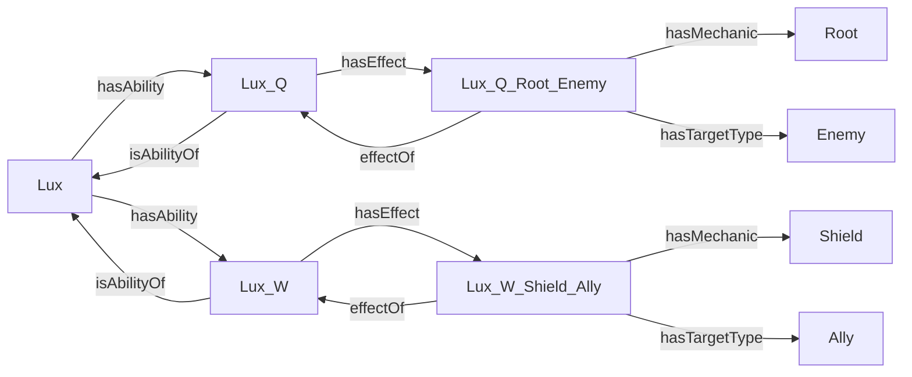

# LoL 本体实验完整教程：使用 lol_full.owl 展示当前阶段成果

本教程用于完成并展示教材中的 `Практическое задание 3_1 / 3_2`：介绍领域模型，在 Protégé 中检查全量数据，使用 HermiT 推导新知识，再用实例关系图和 WebVOWL 检查模型。全程以 **`lol_full.owl`** 为起点。

当前版本采用固定的 **Data Dragon 16.20.1、俄语 ru_RU** 数据快照，包含 **173 个英雄、865 条主要技能、1260 个个体**。技能机制的定性标注覆盖 **Lux、Karma、Morgana**，共 **28 个效果个体**。因此，本阶段可以展示全量基础数据和三名英雄的机制推理；不能声称全部英雄的机制已经标注完成。

建议先按第 3–10 节完整操作一遍，再按第 12 节的顺序进行约 12–15 分钟的现场演示。第 11 节提供脚本复现方法，第 13–15 节用于验收、排错和回答教师提问。

## 1. 教材要求与本阶段对应关系

依据教材 **PDF 文件页码第 249–250 页**，要求如下。第 248 页另有 Ontodia 注册任务。

| 教材任务 | 具体要求 | 全量版本的实现 | 如何展示或检验 |
| --- | --- | --- | --- |
| 3_1：建立本体 | 任意领域，至少 8 个类 | 14 个命名类 | Protégé 的类列表与统计 |
| 3_1：对象属性 | 至少 6 个 Object Properties | 9 个对象属性 | 展示对象属性列表、domain、range |
| 3_1：数据属性 | 至少 10 个 Data Properties | 18 个数据属性 | 展示数据属性及实例数值、文本 |
| 3_1：关系特性 | 使用一种或多种关系特性，例如逆关系、传递性 | 两对逆属性，并使用一条属性链 | 展示 `Inverse Of` 和 `SuperProperty Of (Chain)` |
| 3_1：填充数据 | 建立实例并确定关系 | 173 个英雄、865 条技能及效果、来源等，共 1260 个个体 | 查找 Lux、Aatrox 等实例及其技能 |
| 3_1：推理 | 根据关系特性构造新关系 | 推导 865 条技能所属逆关系；推导英雄机制关系和目标类成员 | HermiT + DL Query + 推理前后对照 |
| 3_2：实例可视化 | 将填充后的模型载入 Ontodia 并检查正确性 | 已有 Reactodia 替代操作路径 | 用全量 Turtle 加载局部关系图 |
| 3_2：VOWL | 将模型载入 VOWL | 使用 WebVOWL 载入全量 OWL | 查看结构图和全量统计 |

教材没有在这两页规定最低英雄数、最低实例数、固定截图数或统一报告格式。至少 8 个指的是**类**，不是英雄个体；“逆关系、传递性等”也不表示每一种特性都必须使用。

**Ontodia 的实际状态需要如实说明：**此前于 2026-11-03 访问原站 `https://ontodia.org` 时出现 `ERR_CONNECTION_CLOSED`，没有完成原站注册和上传。Reactodia 是可用的开源分支，能完成实例图检查；教师是否接受这一替代，需要按课程要求确认。若演示时原站恢复，应补做原站注册、模型导入和截图，不能把 Reactodia 操作记录说成原站记录。

## 2. 准备工具和文件

### 2.1 工具

| 工具 | 用途 | 本次是否必须 |
| --- | --- | --- |
| Protégé Desktop | 打开 OWL，检查类、属性和实例 | 必须；已经安装 |
| HermiT | 检查一致性，推导类成员和对象关系 | 必须；已在 Protégé 中选定 |
| DL Query 标签页 | 在 Protégé 内查询推理结果 | 必须；无需额外数据库 |
| 浏览器 + Reactodia | 检查具体实例之间的关系 | 用于实例可视化部分 |
| 浏览器 + WebVOWL | 检查本体结构 | 用于 VOWL 部分 |
| Python + RDFLib | 重新构建、导出查询或转换 Turtle | 只在复现脚本时需要 |
| JDK 17 | 运行已有的独立 HermiT 验证脚本 | 只在复现脚本时需要；手动启动 Protégé 不需要另做此步骤 |

本机已有环境为 Protégé 5.6.9、HermiT 1.4.3.456。若你的界面小版本不同，菜单文字可能略有差别。

### 2.2 本教程的工作目录

```text
C:\develop\NOTE_UTP\StudyNote\5 Knowledge Graphs\Project\ontology
```

后续出现的 `output/...`、`queries/...` 均相对于这个目录。核心文件如下。

| 文件 | 用途 |
| --- | --- |
| `output/ontologies/lol_full.owl` | 全量原始断言本体；现场启动推理时打开它 |
| `output/ontologies/lol_full_inferred.owl` | 已由 HermiT 导出类成员和对象属性推理事实的全量版本 |
| `output/ontologies/lol_full.ttl` | 全量原始断言的 Turtle 格式 |
| `output/ontologies/lol_full_inferred.ttl` | 全量推理结果的 Turtle 格式；本教程配套导出，用于 Reactodia |
| `output/visualizations/reactodia/lux_relations.reactodia.json` | Lux 的局部布局，包含 9 个节点、12 条关系 |
| `output/visualizations/reactodia/karma_relations.reactodia.json` | Karma 的局部布局 |
| `output/visualizations/reactodia/morgana_relations.reactodia.json` | Morgana 的局部布局 |
| `output/results/full_query_explanations.csv` | 7 条技能与效果解释路径 |
| `output/results/full_inferred_matches.csv` | 推理得到的 3 名目标英雄 |
| `output/results/full_inverse_relations.csv` | 865 条技能所属逆关系 |
| `output/results/full_effect_evidence.csv` | 28 条效果的机制、目标、条件和证据 |
| `output/verification/hermit_full_verification.txt` | HermiT 全量验证记录 |
| `output/verification/query_validation.json` | demo / full 各自的查询核验摘要；本教程看 `full` 对象 |
| `mechanics_annotations.csv` | 独立保存的机制标注及来源 |

直接打开：[全量原始本体](<C:/develop/NOTE_UTP/StudyNote/5 Knowledge Graphs/Project/ontology/output/ontologies/lol_full.owl>)、[全量推理 Turtle](<C:/develop/NOTE_UTP/StudyNote/5 Knowledge Graphs/Project/ontology/output/ontologies/lol_full_inferred.ttl>)。

**本教程不加载文件名包含 `demo` 的本体或 WebVOWL JSON。**已有的 `lol_demo.webvowl.json`、66 个体的旧截图只能作为此前演示版的历史证据，不能用于证明本次全量导入成功。现有 Lux / Karma / Morgana 布局引用的是相同实体 IRI，布局中的节点和关系已逐条核对存在于全量推理图中，因此可以配合全量 Turtle 使用。

## 3. 先介绍领域问题与数据范围

### 3.1 本体要回答的问题

中文：**哪些法师能够给友军提供护盾，同时限制敌人的移动？**

俄语：**Какие маги могут защищать союзников щитом и ограничивать передвижение противника?**

这个问题包含三个条件：英雄属于 Mage 分类；至少有一个对友军产生护盾的技能效果；至少有一个对敌人限制移动的技能效果。护盾和控制可以来自两个不同的技能。

本阶段的可证明答案为 **Karma、Lux、Morgana**。这是已导入事实和当前机制标注支持的结果，不能把它解释为整个游戏中符合条件的英雄只有这三名。

### 3.2 向教师交代数据规模

| 数据类型 | 数量 | 含义 |
| --- | --- | --- |
| Champion | 173 | 快照中的英雄基础记录 |
| Ability | 865 | 每名英雄的 P、Q、W、E、R 共 5 条主要技能记录 |
| PassiveAbility | 173 | P 槽位 |
| ActiveAbility | 692 | Q、W、E、R 槽位 |
| AbilityEffect | 28 | 三名英雄技能的定性效果标注 |
| Mechanic | 11 | Shield、Root、Slow 等机制个体 |
| ChampionCategory | 6 | Assassin、Fighter、Mage、Marksman、Support、Tank |
| TargetType | 4 | Ally、Enemy、Self、OwnAbility |
| SourceDocument | 173 | 对应各英雄的 Data Dragon 来源文档 |
| 个体总数 | 1260 | 上述互不重叠的顶层类别合计，不重复加计技能子类 |

`865 = 173 × 5` 表示主要槽位记录，并不表示每一种变身、强化或多阶段技能变体都建成了独立技能。Mage / Support 是 Data Dragon 分类，不是地图分路。

可直接使用的俄语讲解词：

> На этом этапе я построил онтологию чемпионов, умений и эффектов League of Legends. Полная версия содержит 173 чемпиона, 865 основных умений и 1260 индивидов. Эффекты пока размечены для Люкс, Кармы и Морганы. Я использую эти данные, чтобы найти магов, которые могут дать союзнику щит и ограничить передвижение противника.

## 4. 在 Protégé 中打开全量本体并核对规模

1. 在 Protégé 中选择 `File → Open`。
2. 打开 `output/ontologies/lol_full.owl`。
3. 若弹出打开方式选择，可在新窗口打开，避免与此前的 demo 混淆。
4. 在 `Active ontology` 中找到 ontology metrics / 本体统计区域。
5. 核对命名实体统计：**Classes 14、Object properties 9、Data properties 18、Individuals 1260**。
6. 在实体区域查找 `Aatrox`，确认能够找到该英雄和 `Aatrox_P / Q / W / E / R`。这是区别于三英雄演示版的直观检查。

本体 IRI 为 `https://example.org/lol-ontology`，实体命名空间为 `https://example.org/lol-ontology#`。IRI 是模型中的标识符；这里没有声称该地址提供在线知识图谱服务。

如果只看到 66 个体，你打开的是 demo 或 demo 的推理文件；如果看不到实例，检查是否打开了 `lol_schema.owl`。四个定义类是否已经出现推理成员，取决于 HermiT 是否运行，不影响原始文件中 1260 个个体的数量。

建议截图文件名：`full_01_metrics.png`，画面应同时显示全量文件上下文和 14 / 9 / 18 / 1260 统计。

## 5. 展示本体结构：类、属性、关系特性

### 5.1 查看 14 个命名类

进入 `Entities → Classes`。如果当前布局没有 `Entities`，在 `Window → Tabs` 中启用相应标签页。按下面的结构介绍模型。

| 类 | 中文含义 | 需要说明的关系或定义 |
| --- | --- | --- |
| Champion | 英雄 | 连接技能、英雄分类和来源 |
| ChampionCategory | 英雄分类 | 类别本身也被建成个体，例如 Category_Mage |
| Ability | 技能 | 所有主要技能的父类 |
| PassiveAbility | 被动技能 | Ability 的子类，与 ActiveAbility 互斥 |
| ActiveAbility | 主动技能 | Ability 的子类 |
| AbilityEffect | 技能的具体效果 | 每个效果分别具有机制、目标和生效条件 |
| Mechanic | 效果机制 | 例如 Shield、Heal、Root |
| MovementControlMechanic | 移动控制机制 | Mechanic 的子类，包含 Root、Slow、Stun 三个机制个体 |
| TargetType | 效果目标类型 | Ally / Enemy / Self / OwnAbility |
| SourceDocument | 来源文档 | 保存来源 URL 与版本 |
| MageChampion | 法师英雄 | 根据 hasCategory value Category_Mage 定义 |
| AllyShieldChampion | 可为友军提供护盾的英雄 | 根据技能效果、Shield 和 Ally 的组合定义 |
| EnemyMovementControlChampion | 可限制敌人移动的英雄 | 根据技能效果、移动控制机制和 Enemy 的组合定义 |
| SupportControlMage | 同时满足上述条件的法师 | 三个定义类的交集 |

注意：`Shield` 是 Mechanic 类的一个**个体**，不是另一个类；`MovementControlMechanic` 是一个**类**，Root / Slow / Stun 是它的个体。对应 DL 查询分别使用 `value Shield` 和 `some MovementControlMechanic`。

七个顶层领域类 Champion、ChampionCategory、Ability、AbilityEffect、Mechanic、TargetType、SourceDocument 被声明为互斥，避免把英雄错误地归类为技能。

### 5.2 查看 9 个对象属性

切换至 `Object properties`，依次选中属性查看 domain、range 和逆属性。

| 对象属性 | 关系方向 | 本阶段作用 |
| --- | --- | --- |
| hasAbility | Champion → Ability | 英雄拥有技能 |
| isAbilityOf | Ability → Champion | hasAbility 的逆属性 |
| hasCategory | Champion → ChampionCategory | 英雄具有分类 |
| hasEffect | Ability → AbilityEffect | 技能具有具体效果 |
| effectOf | AbilityEffect → Ability | hasEffect 的逆属性 |
| hasMechanic | AbilityEffect → Mechanic | 效果对应的机制 |
| hasTargetType | AbilityEffect → TargetType | 效果作用目标的类型 |
| hasSource | 领域实体 → SourceDocument | 连接来源；未设置过窄的全局 domain |
| canApplyMechanic | Champion → Mechanic | 由属性链推导英雄可施加的机制 |

这里的 domain / range 会产生类型推断，并不等同于数据库输入校验规则。不同层次的数据可以共同连接 SourceDocument，所以 `hasSource` 没有被限制为只从 Champion 出发。

### 5.3 展示两对逆关系

选中 `hasAbility`，找到 `Inverse Of`，应显示 `isAbilityOf`；选中 `hasEffect`，其逆属性是 `effectOf`。

```text
hasAbility inverseOf isAbilityOf
hasEffect  inverseOf effectOf

已知：Lux hasAbility Lux_Q
推得：Lux_Q isAbilityOf Lux

已知：Lux_Q hasEffect Lux_Q_Root_Enemy
推得：Lux_Q_Root_Enemy effectOf Lux_Q
```

原始全量文件只保存技能所有权的正向事实；865 条 `isAbilityOf` 关系由 HermiT 得到。这部分直接回应教材“基于关系特性构造新关系”的要求。

### 5.4 展示属性链

选中 `canApplyMechanic`，找到 `SuperProperty Of (Chain)`，应看到下面三个属性组成的链。该名称已按本机 Protégé 5.6.9 核对：

```text
hasAbility o hasEffect o hasMechanic  SubPropertyOf  canApplyMechanic
```

含义是：如果某英雄有一个技能，该技能有一个效果，该效果属于某机制，那么可推导该英雄能够施加此机制。

```text
Lux → hasAbility → Lux_W
Lux_W → hasEffect → Lux_W_Shield_Ally
Lux_W_Shield_Ally → hasMechanic → Shield

推得：Lux → canApplyMechanic → Shield
```

`canApplyMechanic` 本身不保留目标类型或自然语言条件。因此，“能产生 Shield”不能单独证明“能给友军提供 Shield”，后者必须检查 AbilityEffect 上的 `hasTargetType Ally`。本体没有把 hasAbility 错设为传递关系。

### 5.5 查看 18 个数据属性

切换至 `Data properties`，至少现场展示几个代表属性；完整清单如下。

| 数据属性 | 数据类型 | 含义或例子 |
| --- | --- | --- |
| entityId | xsd:string | 英雄或技能原始 ID，例如 Lux、Lux:W |
| name | xsd:string | 俄语名称 |
| description | xsd:string | 技能说明文本 |
| gameVersion | xsd:string | 16.20.1 |
| sourceURL | xsd:anyURI | SourceDocument 保存的来源地址 |
| slot | xsd:string | P / Q / W / E / R |
| baseHP | xsd:decimal | 英雄基础生命值 |
| baseMP | xsd:decimal | 英雄基础法力或对应资源数值 |
| baseArmor | xsd:decimal | 基础护甲 |
| baseAttackDamage | xsd:decimal | 基础攻击力 |
| baseMoveSpeed | xsd:decimal | 基础移动速度 |
| title | xsd:string | 英雄称号 |
| resourceType | xsd:string | 资源类型 |
| tooltipText | xsd:string | 技能 tooltip 原文 |
| conditionText | xsd:string | 特定效果的生效条件 |
| evidenceText | xsd:string | 支持效果标注的原文证据 |
| evidenceField | xsd:string | 证据来自 description_text 或 tooltip_text |
| reviewStatus | xsd:string | 当前标注或复核状态 |

这里统计的是 OWL Data Properties。`rdfs:label`、`rdfs:comment` 和标题注释不应混入 18 个数据属性。

建议截图：`full_02_class_definitions.png`、`full_03_inverse_properties.png`、`full_04_property_chain.png`。截图数量是演示建议，并非教材规定。

## 6. 展示实例：从 Lux 追溯到效果和证据

### 6.1 查看英雄及技能

1. 切换到 `Individuals by class`，或在 Entities 中打开个体列表。
2. 查找并选中 `Lux`。
3. 在类型中确认它的原始断言包含 `Champion`。
4. 在对象属性断言中查看 5 个 `hasAbility` 值：`Lux_P`、`Lux_Q`、`Lux_W`、`Lux_E`、`Lux_R`。
5. 查看 `hasCategory Category_Mage`、`hasCategory Category_Support` 和 `hasSource Source_Lux`。
6. 查看 `name`、`baseHP`、`gameVersion` 等数据属性。
7. 打开 `Aatrox`，确认另一个英雄同样有五个主要技能，但没有被本阶段机制标注覆盖。

### 6.2 查看友军护盾效果

依次定位 `Lux_W` 和 `Lux_W_Shield_Ally`，核对下表。

| 所在个体 | 属性 | 预期内容 |
| --- | --- | --- |
| Lux_W | hasEffect | Lux_W_Shield_Ally |
| Lux_W_Shield_Ally | hasMechanic | Shield |
| Lux_W_Shield_Ally | hasTargetType | Ally |
| Lux_W_Shield_Ally | conditionText | 法杖在飞出或返回路径上接触到友军 |
| Lux_W_Shield_Ally | evidenceText | 保存俄语 tooltip 原文，不是凭空添加的结论 |
| Lux_W_Shield_Ally | evidenceField | tooltip_text |
| Lux_W_Shield_Ally | reviewStatus | reviewed_by_assistant |
| Lux_W_Shield_Ally | hasSource | Source_Lux |

再打开 `Source_Lux`，其 `sourceURL` 应指向：

```text
https://ddragon.leagueoflegends.com/cdn/16.20.1/data/ru_RU/champion/Lux.json
```

来源地址可以追溯事实，实验复现使用的是本地固定快照，不依赖重新下载最新版本。

### 6.3 用两个例子说明目标和条件不可省略

- 打开 `Karma_W_Heal_Self`：机制为 Heal，目标为 Self，条件涉及 Mantra 强化。它不能被当作友军治疗。
- 打开 `Morgana_E_Shield_Ally`：目标为 Ally，但条件说明这是吸收魔法伤害的护盾，不能将结果讲成“抵挡所有伤害”。

`conditionText` 保存的是自然语言。当前推理检查结构和类别，不会判断游戏当下是否命中、距离是否足够、锁链是否持续，也不模拟伤害数值。tooltip 中的 `{{ ... }}` 模板保留原样，没有猜测未解析的数值。

建议截图：`full_05_effect_evidence.png`，尽量把机制、目标、条件、证据和来源放在同一画面内。

## 7. 启动 HermiT，并在 DL Query 中检验结果

### 7.1 启动推理器

1. 确认当前打开的是 **`lol_full.owl`**。
2. 在 `Reasoner` 菜单中选中 HermiT。
3. 选择 `Reasoner → Start reasoner`，等待完成；状态栏应显示推理器已激活，例如 `Reasoner active`。
4. 确认没有本体不一致错误，没有命名领域类被判定为不可满足。`owl:Nothing` 本身是内置空类，不代表本体出错。
5. 在 `Window → Tabs → DL Query` 启用查询标签页，然后切换至 `DL Query`。
6. 查询结果类型勾选 **Instances**。为便于查看，可取消 Subclasses、Superclasses 等其他结果类型。

直接输入类名和属性名即可。这些表达式使用 Manchester OWL 语法，不是 SPARQL，不需要写 `SELECT` 或 `PREFIX`。

若输入框出现名称无法解析的错误，先确认拼写与实体显示名称一致，再使用编辑器自动补全选择实体。

### 7.2 先检查全量数据

逐条输入下列表达式，每次点击 `Execute`。应使用包含间接类型的结果；若界面提供 Direct only 选项，关闭它。

| DL Query | 推理后预期数量 | 检验目的 |
| --- | --- | --- |
| `Champion` | 173 | 确认英雄全量导入 |
| `Ability` | 865 | 包含主动与被动技能的父类查询 |
| `ActiveAbility` | 692 | Q/W/E/R 槽位 |
| `PassiveAbility` | 173 | P 槽位 |
| `AbilityEffect` | 28 | 本阶段效果标注数量 |
| `ChampionCategory` | 6 | 英雄类别个体 |
| `SourceDocument` | 173 | 来源文档 |
| `MageChampion` | 75 | 从 Mage 分类推导法师身份 |

这些数量已对当前全量文件的推理结果核对。不同版本的数据快照可能不同，本教程数字只针对 16.20.1 / ru_RU。

### 7.3 核心查询：回答领域问题

输入：

```text
SupportControlMage
```

预期得到且仅得到：

```text
Karma
Lux
Morgana
```

再输入等价的展开查询：

```text
MageChampion and AllyShieldChampion and EnemyMovementControlChampion
```

预期仍为相同的三名英雄。

关键解释：原始文件没有直接给这些英雄填写 `SupportControlMage` 类型；结果来自定义类和已有事实的组合。只打开 `lol_full_inferred.owl` 查看已保存的结果，不能代替现场对原始文件启动 HermiT 的过程。

建议截图：`full_06_support_control_mage.png`，包含查询表达式、Instances 结果和推理器状态。

### 7.4 验证逆关系

输入：

```text
isAbilityOf value Lux
```

预期返回五个技能，顺序可以不同：

```text
Lux_P
Lux_Q
Lux_W
Lux_E
Lux_R
```

输入：

```text
isAbilityOf value Aatrox
```

预期返回 `Aatrox_P / Aatrox_Q / Aatrox_W / Aatrox_E / Aatrox_R`。这说明逆关系推理覆盖全量基础数据，不只对三名已标注英雄起作用。

再输入：

```text
effectOf value Lux_W
```

预期返回 `Lux_W_Shield_Ally`。这验证第二对逆属性。

整个全量图的 `isAbilityOf` 正向存储条数在推理前为 0，导出推理结果后为 865；可在 `full_inverse_relations.csv` 和 `query_validation.json` 中复核。

### 7.5 验证属性链

输入：

```text
canApplyMechanic value Shield
```

预期返回 Karma、Lux、Morgana。它说明 HermiT 沿“英雄 → 技能 → 效果 → 机制”属性链推导了新关系。这个查询没有检查目标是否为 Ally；核心问题仍应使用 `SupportControlMage`。

### 7.6 验证自身与友军效果被区分

输入：

```text
AbilityEffect and hasMechanic value Heal and hasTargetType value Self
```

预期返回：

```text
Karma_W_Heal_Self
Morgana_P_Heal_Self
```

再输入：

```text
AbilityEffect and hasMechanic value Heal and hasTargetType value Ally
```

当前标注中没有可证明的匹配。这不等于证明游戏里不存在友军治疗，也不等于对全部 173 名英雄的机制都做过否定判断。

查询只需要 `Execute`，不需要点击 `Add to ontology`。不要为了让结果出现而手动给英雄增加 `SupportControlMage` 类型。

## 8. 解释为什么得到这三名英雄

### 8.1 查看定义类的 Equivalent To

在 Classes 中依次选中下列定义类，查看 `Equivalent To`。为方便阅读，下式采用较完整的 Manchester 语法；实际界面可能调整换行和括号。

```text
MageChampion EquivalentTo
    Champion and (hasCategory value Category_Mage)

AllyShieldChampion EquivalentTo
    Champion and
    (hasAbility some
        (hasEffect some
            (AbilityEffect and
             (hasMechanic value Shield) and
             (hasTargetType value Ally))))

EnemyMovementControlChampion EquivalentTo
    Champion and
    (hasAbility some
        (hasEffect some
            (AbilityEffect and
             (hasMechanic some MovementControlMechanic) and
             (hasTargetType value Enemy))))

SupportControlMage EquivalentTo
    MageChampion and AllyShieldChampion and EnemyMovementControlChampion
```

上面的整段用于解释定义，不应连同 `EquivalentTo` 一起粘贴到 DL Query 输入框。查询时输入第 7 节的单个表达式即可。

`some` 表示存在至少一个满足条件的关联对象；`value` 指定具体个体。机制和目标放在同一个 AbilityEffect 约束内，可以避免把一个效果的 Shield 与另一个效果的 Ally 错配在一起。

`SupportControlMage` 的定义没有额外要求 `hasCategory value Category_Support`。这里的 Support 描述护盾支援能力，不能将类名解读为强制要求 Support 分类或辅助分路。

### 8.2 展示七条解释路径

打开 `output/results/full_query_explanations.csv`，应有 7 条数据行，不含表头。

| 英雄 | 友军护盾技能 | 敌方移动控制技能 | 控制机制 |
| --- | --- | --- | --- |
| Karma | E | Q | Slow |
| Karma | E | W | Root |
| Lux | W | E | Slow |
| Lux | W | Q | Root |
| Morgana | E | Q | Root |
| Morgana | E | R | Slow |
| Morgana | E | R | Stun |

七条路径对应三名英雄，不是七名英雄。CSV 还包含护盾和控制的条件文本；例如 Morgana R 的 Stun 要求锁链保持至延迟结束，不能省略这一条件。

### 8.3 可选：用反例说明模型确实检查了目标

已有自动验证包含两个只在内存副本上执行的反例：

| 反例改动 | 预期结果 | 能说明什么 |
| --- | --- | --- |
| 将 Lux 护盾效果的目标由 Ally **替换**为 Self | 不能再从当前事实证明 Lux 属于 SupportControlMage | 目标类型参与核心查询，而不是只检查“有护盾” |
| 把英雄 Lux 同时声明为 Ability | 本体不一致 | Champion 与 Ability 的互斥约束生效 |

反例没有改动提交的原始本体，结果在 HermiT 验证日志中。现场需要手动复现时，应先 `Save As` 为单独的练习副本，仅在副本中改动并重新同步推理器；“把 Ally 替换为 Self”需要删除原来的 Ally 断言，仅新增 Self 不会撤销 Ally 事实。

开放世界下，Lux 未再出现在结果中表示“不能证明其满足条件”，不表示自动推得一个显式的否定类断言。

## 9. 用 Reactodia 检查全量模型中的实例关系

### 9.1 加载全量推理数据

1. 打开 [Reactodia RDF Explorer](https://reactodia.github.io/playground/rdf-explorer)。
2. 打开左上角菜单 `Open menu`。
3. 选择 `Load RDF (Turtle) data`。
4. 上传 **`output/ontologies/lol_full_inferred.ttl`**。
5. 等待数据加载完成。
6. 再打开菜单，选择 `Open diagram from file`。
7. 上传 `output/visualizations/reactodia/lux_relations.reactodia.json`。
8. 点击 `Fit to Screen`，必要时再缩小一级；可以收起导航小地图，便于截图。

推理 Turtle 与 `lol_full_inferred.owl` 已做 RDF 图同构检查，二者表达相同 RDF 数据。布局 JSON 只保存视图，不能代替知识图谱数据；必须先载入 Turtle，再载入布局。

本步骤的数据源是全量图，但画布只展示选定的局部关系，不需要把 1260 个个体一次性全部铺到屏幕上。

### 9.2 检查 Lux 图中的 9 个节点和 12 条关系

应看到以下节点：

```text
Lux
Lux_Q
Lux_W
Lux_Q_Root_Enemy
Lux_W_Shield_Ally
Root
Enemy
Shield
Ally
```

对应关系可按下面的图核对。正向与逆向边均来自全量推理数据。



重点检查：Q 的禁锢目标为 Enemy，W 的护盾目标为 Ally；两种技能都属于 Lux；效果能通过 effectOf 返回所属技能。

布局将 `canApplyMechanic` 长边设为隐藏以减少交叉。这些关系仍在数据里。如页面自动显示额外推导边，可以在关系类型面板中隐藏 `canApplyMechanic`；不要删除 RDF 事实。页面不同版本或自动补边行为可能改变可见边数，核心验收是上述 12 条边确实存在且连接正确。

### 9.3 查看其余两名英雄并保存本次证据

1. 保持全量 Turtle 不变，换开 `karma_relations.reactodia.json`。
2. 检查 Karma E → Shield / Ally，以及 Karma W → Root / Enemy。
3. 换开 `morgana_relations.reactodia.json`。
4. 检查 Morgana E → Shield / Ally，以及 Morgana Q → Root / Enemy。
5. 通过页面菜单保存本次布局或导出 SVG；截图建议命名为 `full_07_reactodia_lux.png`。

局部布局可以复用，但旧的 Lux SVG 和此前截图只记录了旧会话。若需要证明本次全量数据已加载，应重新操作、记录加载文件名，并保存当前会话截图，不要只改旧截图的文件名。

## 10. 用 WebVOWL 检查全量本体结构

### 10.1 导入全量 OWL

1. 打开 [WebVOWL](https://service.tib.eu/webvowl/)。
2. 打开 `Ontology` 菜单。
3. 使用文件选择入口，上传 **`output/ontologies/lol_full.owl`**，由页面的 OWL2VOWL 转换服务处理。
4. 等待转换和布局完成，再展开 `Statistics`。
5. 应核对以下全量模型统计。

| WebVOWL 指标 | 本次预期 |
| --- | --- |
| Classes | 14 |
| Object properties / Object prop. | 9 |
| Datatype properties / Datatype prop. | 18 |
| Individuals | 1260 |

这些是待现场核对的全量验收值，来自本体文件本身的统计；此前保存的 WebVOWL 截图只验证过 66 个体的演示版，不应说成已经截图验证了全量界面。

**不要导入现有的 `lol_demo.webvowl.json` 来代替本步骤。**如果结果显示 Individuals 66，说明仍在查看演示版。页面可能按文件名缓存模型；遇到疑似缓存时先刷新并重新选择全量文件，必要时复制一份全量 OWL 换一个临时文件名再导入。

### 10.2 检查结构并导出

1. 找到 Champion、Ability、AbilityEffect、Mechanic 等主要类。
2. 检查 hasAbility、hasEffect、hasMechanic、hasTargetType 的方向。
3. 找到 Ability 的两个子类 ActiveAbility、PassiveAbility。
4. 找到 Mechanic 的子类 MovementControlMechanic。
5. 检查 MageChampion、AllyShieldChampion、EnemyMovementControlChampion、SupportControlMage 的定义表达式。
6. 为截图清晰，可隐藏 Datatype properties；若要展示复杂定义类，应保留集合运算符相关显示。
7. 从 Export 菜单导出 JSON，建议保存为 `lol_full.webvowl.json`；同时导出 SVG，并截图为 `full_08_webvowl_statistics.png`。

过滤器只改变图的显示，不应改变本体文件。图上的 Nodes / Edges 可能包含逻辑运算符、数据类型等辅助元素，不能当作类和对象属性数量。WebVOWL 主要展示结构，不会把全部 1260 个体逐个画成英雄网络。

如果 OWL 转换服务不可用，本步骤应记录失败信息，不能借用 demo 的 JSON 声称全量导入成功。可先用 Protégé 继续其余实验，并在转换服务恢复后补做；完整 OWL 和本地 HermiT 验证结果仍然保留。

## 11. 可选：在 PowerShell 中重新构建与验证

如果现有文件已经能打开，现场演示不需要重新运行全部脚本。本节用于修改标注后的重建，或向教师说明结果如何复现。

### 11.1 进入目录并检查环境

```powershell
Set-Location -LiteralPath 'C:\develop\NOTE_UTP\StudyNote\5 Knowledge Graphs\Project\ontology'
& .\.venv\Scripts\python.exe --version
```

当前目录已经有 Python 虚拟环境。如果换机器且没有该环境，可以先运行：

```powershell
py -3.11 -m venv .venv
& .\.venv\Scripts\python.exe -m pip install -r requirements.txt
```

构建读取项目的 `data/16.20.1/ru_RU/all/`；若该目录不可用，则读取本目录 `source/` 中的同版本 JSON。无需重新抓取英雄数据。

### 11.2 按顺序运行已有流程

```powershell
& .\.venv\Scripts\python.exe build_ontology.py
.\tools\run_hermit.ps1 -ProtegeDirectory 'C:\develop\Protege-5.6.9' -JdkDirectory 'C:\Program Files\Java\jdk-17'
& .\.venv\Scripts\python.exe export_results.py
& .\.venv\Scripts\python.exe make_diagrams.py
```

这些脚本会重新生成相关输出，其中构建、推理和查询导出都会处理 demo 与 full 两个版本；本教程验收时只看 full 对应文件。它们会覆盖生成文件，因此现场演示可直接使用已有输出。构建脚本会检查标注证据与技能原文一致、版本一致，以及 OWL/Turtle 往返解析保持同一 RDF 图。

HermiT 脚本使用给定 Protégé 安装内的 JAR，在 `tools/hermit-libs/` 提取本地依赖副本，不修改 Protégé 安装。换机器时应使用真实的安装路径；当前脚本按本机 HermiT JAR 文件名编写，不能假定任意版本都能直接替换。

### 11.3 重新导出全量推理 Turtle

当前 `export_results.py` 自动导出的是 demo 的推理 Turtle。若重新运行了推理流程，还应单独更新 full 的 Turtle：

```powershell
& .\.venv\Scripts\python.exe -c "from rdflib import Graph; Graph().parse('output/ontologies/lol_full_inferred.owl', format='xml').serialize(destination='output/ontologies/lol_full_inferred.ttl', format='turtle', encoding='utf-8')"
```

这一步只是序列化格式转换，不会再次进行 OWL 推理。Reactodia 应在该步骤之后重新加载文件。

### 11.4 读取验证结果

```powershell
Get-Content -LiteralPath '.\output\verification\hermit_full_verification.txt' -Encoding UTF8
Get-Content -LiteralPath '.\output\verification\query_validation.json' -Encoding UTF8
Import-Csv -LiteralPath '.\output\results\full_inferred_matches.csv' | Format-Table
(Import-Csv -LiteralPath '.\output\results\full_inverse_relations.csv' | Measure-Object).Count
(Import-Csv -LiteralPath '.\output\results\full_query_explanations.csv' | Measure-Object).Count
```

后两个计数应分别为 **865、7**。`query_validation.json` 的 `full` 对象应包含以下关键结果：

```json
{
  "query_matches": ["Karma", "Lux", "Morgana"],
  "explanation_rows": 7,
  "effect_evidence_rows": 28,
  "inverse_relations_asserted": 0,
  "inverse_relations_after_hermit": 865,
  "target_class_assertions_before_hermit": 0,
  "target_class_instances_after_hermit": 3
}
```

日志中的 `PASS OWL 2 DL profile`、`PASS Ontology is consistent`、`PASS No unsatisfiable named classes` 和两项 `PASS Mutation` 是重点。若日志 `Source` 仍显示整理前的 `output/lol_full.owl`，那是旧验证时的绝对路径，不代表应从旧位置打开文件；按上面流程重跑会写入当前 `output/ontologies/` 路径。

### 11.5 可选：理解 SPARQL 与 DL Query 的区别

`queries/01_competency_question.rq` 沿原始图的技能、效果、目标和机制寻找证据路径，因此在原始 full 图中就能返回 7 条解释路径。它不是“核心推理类已经预先填写”的证据。

`queries/03_inferred_class.rq` 查询 `rdf:type SupportControlMage`：普通 RDF 查询原始图时为 0 条，查询 HermiT 物化图时为 3 条。`queries/02_inverse_ownership.rq` 查询原始图为 0 条、物化图为 865 条。

因此，RDFLib 在导出过程中负责读取 RDF 和执行 SPARQL，HermiT 负责 OWL 推理。不要把运行 SPARQL 本身说成已经执行了 HermiT，也不要假定 Protégé 中任意 SPARQL 插件都会自动使用当前推理器的所有结果。

## 12. 现场演示顺序与中俄讲解词

| 时间 | 操作 | 要证明的成果 |
| --- | --- | --- |
| 0–1 分钟 | 介绍领域问题、固定快照、机制标注范围 | 问题明确，数据范围交代准确 |
| 1–3 分钟 | 打开 lol_full.owl，展示 14 / 9 / 18 / 1260；查 Aatrox | 达到规模要求，使用全量版本 |
| 3–5 分钟 | 展示类层次、两对逆属性、属性链 | 有实际逻辑约束和关系特性 |
| 5–7 分钟 | 查看 Lux → W → Shield / Ally，并打开来源和条件 | 数据与机制标注可解释、可追溯 |
| 7–10 分钟 | 启动 HermiT；执行核心、逆属性和属性链查询 | 确实生成新类成员和新关系 |
| 10–12 分钟 | Reactodia 加载全量 Turtle，展示 Lux 局部图 | 实例关系连接正确 |
| 12–14 分钟 | WebVOWL 导入全量 OWL，展示结构和统计 | 完成 VOWL 检查 |
| 14–15 分钟 | 打开解释 CSV 和验证日志，说明未标注范围及 Ontodia 状态 | 结果有证据，完成与待补项界限清楚 |

可以直接使用下面几段俄语讲解：

**展示结构：**

> В онтологии 14 именованных классов, 9 объектных свойств и 18 свойств данных. Эффект умения выделен в отдельный объект: у него есть механика, тип цели, условие и источник. Это позволяет различать, например, лечение самого чемпиона и лечение союзника.

**展示关系特性：**

> Свойства hasAbility и isAbilityOf объявлены обратными. Поэтому из связи «Люкс имеет умение Lux_Q» HermiT выводит связь «Lux_Q принадлежит Люкс». Кроме того, цепочка hasAbility, hasEffect, hasMechanic позволяет вывести отношение canApplyMechanic.

**展示推理结果：**

> Я запускаю HermiT на исходном файле lol_full.owl. Класс SupportControlMage определяется как пересечение трёх условий: категория Mage, щит для союзника и ограничение передвижения врага. В текущих данных HermiT выводит три экземпляра этого класса: Карму, Люкс и Моргану. Эти типы не были заранее указаны вручную.

**展示可视化与范围：**

> В Reactodia загружены полные данные после вывода, а на диаграмме показан выбранный фрагмент. WebVOWL используется для проверки структуры. Механики пока размечены только для трёх чемпионов, поэтому отсутствие другого чемпиона в результате не доказывает отсутствие у него нужных способностей.

若原站仍无法访问，可补充：

> При предыдущей попытке сайт Ontodia был недоступен. Для визуальной проверки я использую Reactodia. Этот вариант замены нужно согласовать с преподавателем; регистрацию и загрузку на исходном сайте я не выдаю за выполненные.

## 13. 本阶段验收清单

以下框只应在你实际完成操作后勾选。它们不是预先声称全量浏览器演示已经全部完成。

- [ ] 教材要求：能说清至少 8 类、6 对象属性、10 数据属性，以及推理和两种可视化任务。
- [ ] 全量文件：Protégé 打开的是 `lol_full.owl`，统计为 14 / 9 / 18 / 1260。
- [ ] 数据范围：能展示 173 英雄、865 技能；能说明机制标注仅覆盖三名英雄。
- [ ] 类结构：能解释 Ability、AbilityEffect、Mechanic 和 TargetType 的区别。
- [ ] 关系特性：能展示两对逆属性和 canApplyMechanic 属性链。
- [ ] 实例证据：Lux_W_Shield_Ally 的目标、条件和来源正确。
- [ ] 推理运行：HermiT 正常完成，一致性检查通过。
- [ ] 核心答案：SupportControlMage 返回 Karma、Lux、Morgana。
- [ ] 逆关系：isAbilityOf value Aatrox 返回五个技能；全量导出共有 865 条。
- [ ] 属性链：canApplyMechanic value Shield 返回三名已标注英雄。
- [ ] 目标区分：Self 的治疗不会被当作 Ally 的治疗。
- [ ] 实例可视化：Reactodia 加载 full 推理 Turtle，Lux 局部关系连接正确。
- [ ] 结构可视化：WebVOWL 加载 full OWL，统计为 14 / 9 / 18 / 1260，并保存本次输出。
- [ ] 工具替代：原 Ontodia 任务已补做，或教师已接受 Reactodia 替代；若尚未确认，应明确列为待确认项。
- [ ] 结果留存：保存当前全量会话截图、解释 CSV、HermiT 日志和使用的 OWL。

逻辑一致性只说明本体中的断言与规则能够共同成立，不能单独证明所有游戏事实都正确。28 条机制标注的状态是 `reviewed_by_assistant`，建议你对照原文复核后再用于正式答辩；没有冒充已经过本人或教师独立审核。

## 14. 常见问题排查

| 现象 | 常见原因 | 处理方法 |
| --- | --- | --- |
| Individuals 是 66 | 打开 demo 或复用了 demo WebVOWL JSON | 改用 full 文件，重新加载并核对文件名 |
| 几乎没有实例 | 打开了 schema 文件 | 使用 lol_full.owl |
| DL Query 没有结果 | HermiT 未启动、Instances 未勾选、表达式拼写错误 | 依次核对推理状态、结果类型、实体名称 |
| Ability 查询少于 865 | 只看直接实例，没有包含子类成员 | 关闭 Direct only，使用包含间接类型的查询结果 |
| Protégé 里找不到反向关系 | 正在查看仅显示原始断言的面板 | 用 isAbilityOf value Lux 查询；或打开物化文件核对已导出的事实 |
| Reactodia 提示不能读取文件 | 将 OWL 或布局 JSON 当成 Turtle 数据上传 | 数据入口用 full_inferred.ttl，布局入口用 reactodia.json |
| Reactodia 画布为空或关系不完整 | 只加载布局、没有数据，或加载原始 Turtle 缺少推导边 | 先加载 full_inferred.ttl，再打开布局 |
| 图中不是 1260 个节点 | 局部布局只包含选定个体 | 属于预期；全量规模用 Protégé / 文件统计证明 |
| WebVOWL 图拥挤 | 数据属性和逻辑节点较多 | 调整缩放和过滤器；需要检查定义类时保留集合运算符 |
| WebVOWL 的节点数不同于 14 | 节点包含数据类型、限制和逻辑表达式 | 对照 Statistics 中 Classes，而不是 Nodes |
| WebVOWL 不能转换 OWL | 转换服务网络或服务故障 | 记录错误，保留全量 OWL，服务恢复后重新导入 |
| 未标注英雄不在目标结果里 | 当前没有足够机制事实 | 按开放世界解释，不能直接判定它没有相应能力 |
| PowerShell 找不到文件 | 当前目录不对，或用了整理前的 output 平铺路径 | 先 Set-Location，使用本教程的新分类路径 |
| 重建后 Reactodia 仍是旧结果 | full 推理 Turtle 没有重新生成或浏览器未重载 | 先运行第 11.3 节转换，再重新上传数据 |

## 15. 教师可能追问的问题

**为什么把技能和效果分开？** 一个技能可以同时有伤害、减速、治疗等多种效果，而且目标和条件可能不同。将它们分开，可以把机制、目标与条件绑定在同一个效果对象上。

**新知识具体在哪里？** 原始全量图没有存储 865 条 isAbilityOf 逆关系，也没有直接给英雄写入 SupportControlMage 类型；HermiT 根据逆属性、属性链和等价类定义得到这些结果。

**为什么没用传递性？** 教材允许使用一种或多种关系特性。本模型使用逆关系；hasAbility 不具有传递语义，不应为了凑特性而声明为传递属性。

**为什么 173 个英雄只查出三个？** 三名英雄的效果已经标注，其他英雄主要导入基础数据。结果是当前知识支持的匹配，不是游戏全部候选的完整枚举。

**75 个 MageChampion 与 3 个 SupportControlMage 是否矛盾？** 不矛盾。前者由全量英雄分类得到；后者还需要友军护盾和敌方控制效果的事实支持。

**推理能保证游戏机制正确吗？** 不能。HermiT 检查逻辑关系，领域事实还需要核对来源原文；本阶段保留 evidenceText、conditionText、版本和 sourceURL 来支持复核。

**条件会自动判断吗？** 不会。条件以文本保存，结果表达“在注明条件下具备这种能力”，不是对任意一次施法结果的保证。

**如何继续完善？** 在 `mechanics_annotations.csv` 中扩展其他英雄的效果、目标、条件与证据，调整构建脚本当前对三英雄标注范围的校验和相关固定预期，再重新构建、推理和导出。不能只增加 CSV 行而忽略代码中现阶段的范围限制。

## 16. 资料入口与提交注意事项

- [教材 PDF](<C:/develop/NOTE_UTP/StudyNote/5 Knowledge Graphs/Lecture/Копия_Семинар_“Семантические_веб_технологии”.pdf>)：PDF 第 249 页为 3_1，第 250 页为 3_2，第 248 页为 Ontodia 注册任务。
- [Protégé 官方网站](https://protege.stanford.edu/) 与 [DL Query 文档](https://protegewiki.stanford.edu/wiki/DLQueryTab)。
- [HermiT 官方项目](https://github.com/phillord/hermit-reasoner)。
- [Reactodia 项目](https://github.com/reactodia/reactodia-workspace)。
- [WebVOWL 项目](https://github.com/VisualDataWeb/WebVOWL)。
- [Riot Data Dragon 文档](https://developer.riotgames.com/docs/lol#data-dragon)。

正式提交时按教师要求组织文件。建议至少保留全量原始 OWL、本教程、机制标注表、full 查询结果、full 验证记录和本次实际生成的全量演示截图。浏览器导出的新文件应使用 `full` 命名，便于区分历史 demo 成果。

根目录已有的 `LoL_Ontology_Submission.zip` 是整理前的快照，不会因为增加本教程或新截图自动更新。若需要重新打包，应先准备当前打包脚本要求的俄语报告，并核对包内路径与内容；不要直接把旧 ZIP 当作已经包含本教程和本次全量可视化证据的提交包。
