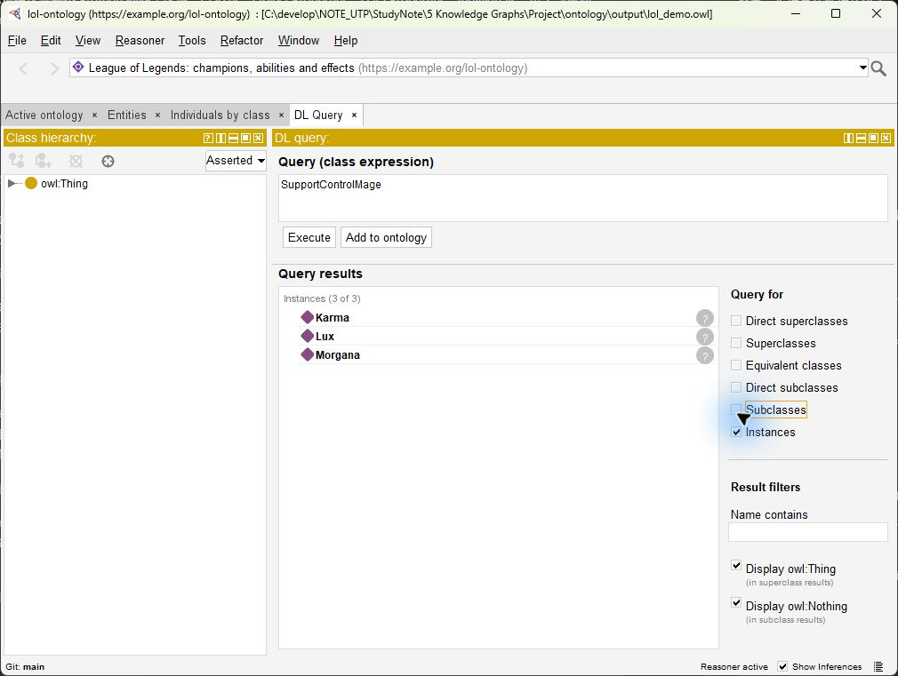
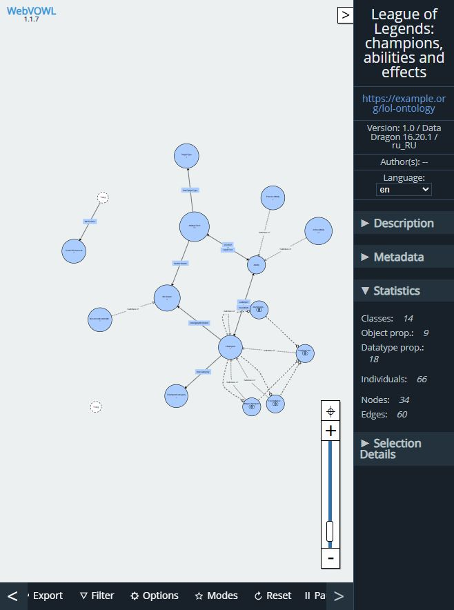
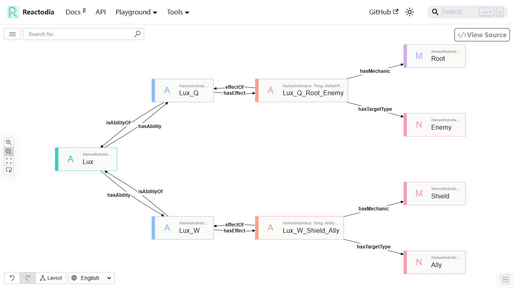

# Разработка онтологии чемпионов League of Legends

Практические задания 3_1 и 3_2. Дата выполнения: 3 ноября 2026 года.

## 1. Цель работы

Построить OWL-онтологию выбранной предметной области, заполнить ее экземплярами, использовать свойства отношений для логического вывода и проверить модель средствами визуализации.

Предметная область — чемпионы League of Legends, их основные умения и механики эффектов. Исходный вопрос проекта:

> Какие маги могут защищать союзников щитом и ограничивать передвижение противника?

Ответ должен объясняться конкретными умениями и условиями действия эффектов. Защита и контроль могут обеспечиваться разными умениями одного чемпиона.

## 2. Требования и инструменты

На страницах 249–250 PDF «Копия_Семинар_“Семантические_веб_технологии”» требуются не менее 8 классов, 6 Object Properties и 10 Data Properties, экземпляры и связи, использование характеристик отношений, выполнение reasoning и визуализация.

Использованы Protégé Desktop 5.6.9, HermiT 1.4.3.456, Python 3.11 с RDFLib 7.6.0 и WebVOWL 1.1.7. Для просмотра экземпляров применен Reactodia RDF Explorer — открытая ветвь проекта Ontodia. 3 ноября 2026 года обращение к `https://ontodia.org` из встроенного браузера завершилось ошибкой `ERR_CONNECTION_CLOSED`. Регистрация и загрузка в исходный сервис поэтому не выполнены; замена инструмента отражена в отчете и требует принятия преподавателем.

## 3. Данные

Использован локальный снимок Riot Data Dragon **16.20.1**, локализация **ru_RU**. Он содержит 173 чемпионов и 865 записей основных умений P/Q/W/E/R. Для эксперимента выбраны Lux, Morgana и Karma: 3 чемпиона и 15 умений.

Для этих умений по полям `description_text` и `tooltip_text` подготовлены 28 утверждений об эффектах. Каждое утверждение имеет тип механики, тип получателя, текстовое условие, цитату из исходного поля, версию и источник. Поля `review_status` и `reviewer` фиксируют проверку ассистентом; независимое подтверждение человеком в данных не заявляется.

Основные файлы:

- `output/lol_demo.owl` — исходные утверждения и аксиомы экспериментальной онтологии;
- `output/lol_demo_inferred.owl` — дополнение исходных аксиом результатами HermiT;
- `output/lol_full.owl` — та же схема с 173 чемпионами и 865 умениями;
- `mechanics_annotations.csv` — разметка эффектов трех выбранных чемпионов.

В полном варианте разметка механик не расширяется автоматически на остальных чемпионов. Дополнительные источники CommunityDragon и страницы чемпионов сохранены в проекте первого этапа; настоящая сборка использует зафиксированные описания Data Dragon.

## 4. Классы онтологии

Пространство имен: `https://example.org/lol-ontology#`. Это учебный идентификатор, публикация сервиса по этому адресу не предполагается.

| Класс | Смысл |
| --- | --- |
| Champion | Чемпион |
| ChampionCategory | Категория Data Dragon, например Mage или Support |
| Ability | Основное умение |
| PassiveAbility | Подкласс Ability, пассивное умение P |
| ActiveAbility | Подкласс Ability, активное умение Q/W/E/R |
| AbilityEffect | Отдельный эффект умения со своей целью и условием |
| Mechanic | Тип механики |
| MovementControlMechanic | Подкласс Mechanic: Root, Slow, Stun |
| TargetType | Тип получателя: Ally, Enemy, Self или OwnAbility |
| SourceDocument | Документ-источник |
| MageChampion | Определяемый класс чемпионов категории Mage |
| AllyShieldChampion | Определяемый класс чемпионов со щитом для союзника |
| EnemyMovementControlChampion | Определяемый класс чемпионов с контролем передвижения врага |
| SupportControlMage | Пересечение трех предыдущих определяемых классов |

Всего **14 именованных классов**. Верхние категории Champion, ChampionCategory, Ability, AbilityEffect, Mechanic, TargetType и SourceDocument попарно несовместимы. PassiveAbility и ActiveAbility также несовместимы.

Выделение AbilityEffect предотвращает смешение получателей разных эффектов одного умения. Например, Karma W может обездвижить противника и при усилении Мантрой вылечить саму Карму. Для этих эффектов используются разные экземпляры.

## 5. Объектные свойства

| Свойство | Domain → Range | Назначение |
| --- | --- | --- |
| hasAbility | Champion → Ability | Умения чемпиона |
| isAbilityOf | Ability → Champion | Обратное к hasAbility |
| hasCategory | Champion → ChampionCategory | Категория чемпиона |
| hasEffect | Ability → AbilityEffect | Эффекты умения |
| effectOf | AbilityEffect → Ability | Обратное к hasEffect |
| hasMechanic | AbilityEffect → Mechanic | Механика эффекта |
| hasTargetType | AbilityEffect → TargetType | Получатель эффекта |
| hasSource | owl:Thing → SourceDocument | Источник; узкий domain намеренно не задан |
| canApplyMechanic | Champion → Mechanic | Производное свойство по цепочке |

Всего **9 Object Properties**. Заданы две пары инверсных свойств:

```text
hasAbility inverseOf isAbilityOf
hasEffect inverseOf effectOf
```

Дополнительно используется цепочка:

```text
hasAbility o hasEffect o hasMechanic -> canApplyMechanic
```

Например, из `Lux hasAbility Lux_W`, `Lux_W hasEffect Lux_W_Shield_Ally` и `Lux_W_Shield_Ally hasMechanic Shield` выводится `Lux canApplyMechanic Shield`. Это сокращенная связь о наличии механики; получатель и условие по-прежнему хранятся в полном пути через эффект.

Транзитивность отношения владения умением не задавалась: для этой предметной связи она не соответствует смыслу.

## 6. Свойства данных

Всего **18 Data Properties**:

| Группа | Свойства | Тип |
| --- | --- | --- |
| Идентификация | entityId, name, description, gameVersion | xsd:string |
| Чемпион | title, resourceType | xsd:string |
| Базовые характеристики | baseHP, baseMP, baseArmor, baseAttackDamage, baseMoveSpeed | xsd:decimal |
| Умение | slot, tooltipText | xsd:string |
| Обоснование эффекта | conditionText, evidenceText, evidenceField, reviewStatus | xsd:string |
| Источник | sourceURL | xsd:anyURI |

Неизвестные значения вида `{{ totalshieldtt }}` сохраняются в исходном тексте. Числовые характеристики эффектов из них не угадываются. Базовые характеристики чемпионов импортируются как числа из JSON.

## 7. Заполнение экземплярами

Экспериментальная модель содержит **66 экземпляров**:

| Тип объектов | Количество |
| --- | ---: |
| Чемпионы | 3 |
| Основные умения | 15 |
| Эффекты | 28 |
| Механики | 11 |
| Категории чемпионов | 2 |
| Типы получателя | 4 |
| Документы-источники | 3 |

Mage и Support представлены экземплярами ChampionCategory. Это категории чемпионов, а не позиции на карте и не экземпляры OWL-классов способностей.

Пример заполнения:

```text
Lux                  a Champion
Lux_Q                a ActiveAbility
Lux_W                a ActiveAbility
Lux hasAbility       Lux_Q, Lux_W
Lux hasCategory      Category_Mage, Category_Support
Lux_Q hasEffect      Lux_Q_Root_Enemy
Lux_W hasEffect      Lux_W_Shield_Ally
Lux_Q_Root_Enemy      hasMechanic Root; hasTargetType Enemy
Lux_W_Shield_Ally     hasMechanic Shield; hasTargetType Ally
```

Для щита Lux W сохранено условие контакта жезла с союзником. Для обездвиживания Karma W требуется сохранение связи до завершения задержки. Щит Morgana E поглощает магический урон; он не трактуется как универсальная защита от любого урона.

## 8. Логический вывод

В Protégé был выбран HermiT и выполнена команда `Reasoner → Start reasoner`. Проверка той же онтологии отдельно воспроизведена через OWLAPI 4.5.29 и HermiT из установленного Protégé.

Класс MageChampion определяется как:

```text
Champion and (hasCategory value Category_Mage)
```

Класс AllyShieldChampion определяется как:

```text
Champion and
  (hasAbility some
    (hasEffect some
      (AbilityEffect and
       (hasMechanic value Shield) and
       (hasTargetType value Ally))))
```

Аналогично EnemyMovementControlChampion требует эффект с целью Enemy и механикой класса MovementControlMechanic. Тип Root, Slow или Stun задается экземпляру механики; область и условие действия остаются у конкретного эффекта.

```text
SupportControlMage equivalentTo
  MageChampion and AllyShieldChampion and EnemyMovementControlChampion
```

Результаты проверки:

| Проверка | Результат |
| --- | --- |
| Соответствие OWL 2 DL | Выполнено |
| Логическая согласованность | Подтверждена |
| Неудовлетворимые именованные классы | Не обнаружены |
| Явные типизации SupportControlMage до вывода | 0 |
| Экземпляры SupportControlMage после вывода | Karma, Lux, Morgana |
| Явные связи isAbilityOf до вывода | 0 |
| Связи isAbilityOf после вывода, экспериментальный вариант | 15 |
| Связи isAbilityOf после вывода, полный вариант | 865 |



Проверены также два измененных варианта в памяти, без изменения исходного файла. Если у Lux заменить цель щита Ally на Self, она перестает выводиться как SupportControlMage. Если одновременно типизировать Lux как Champion и Ability, HermiT обнаруживает противоречие из-за несовместимости классов. Собственное лечение Karma и собственное ускорение Morgana не выводятся как эффекты для союзника.

Подробные протоколы сохранены в `output/hermit_demo_verification.txt` и `output/hermit_full_verification.txt`.

## 9. Ответ на вопрос проекта

SPARQL-запрос `queries/01_competency_question.rq` возвращает не только имя чемпиона, но и умения, механики и условия. В текущей разметке получены **3 чемпиона и 7 объясняющих строк**.

| Чемпион | Щит союзнику | Ограничение передвижения врага |
| --- | --- | --- |
| Lux | W: контакт жезла с союзником | Q: попадание и Root; E: нахождение в области и Slow |
| Karma | E: щит выбранному союзнику | Q: попадание и Slow; W: сохранение связи и Root |
| Morgana | E: магический щит союзнику | Q: попадание и Root; R: цепь и Slow, затем Stun при сохранении цепи |

Одна строка соответствует одной комбинации подтвержденных эффектов. Поэтому число строк больше числа чемпионов. Полный результат с текстовыми условиями находится в `output/demo_query_explanations.csv`.

## 10. Визуальная проверка

В **WebVOWL** загружен файл с экспериментальной онтологией. Интерфейс показал 14 классов, 9 объектных свойств, 18 свойств данных и 66 экземпляров. Сохранены JSON с моделью и расположением элементов, SVG с полной структурой и скриншот статистики. В структурном SVG скрыты свойства данных, чтобы улучшить читаемость; они остаются в исходной OWL-модели и в JSON.



В **Reactodia** загружен `lol_demo_inferred.ttl`, после чего проверена диаграмма Lux с 9 узлами и 12 видимыми отношениями. Она показывает умения Q/W, два эффекта, их механики и получателей, а также обратные связи, полученные после reasoning. Производные прямые связи canApplyMechanic скрыты только на этой диаграмме, чтобы не пересекать полные объясняющие пути. Они сохранены в RDF.



Для повторного открытия сначала загружается Turtle, затем `lux_relations.reactodia.json`. Формат диаграммы не заменяет сами данные. Для Karma и Morgana также подготовлены проверенные файлы расположения узлов.

## 11. Вывод и границы модели

Разработана OWL 2 DL онтология, превышающая требуемые минимумы по классам и свойствам. Она заполнена экземплярами, проверена HermiT и позволяет объяснять результаты поиска через конкретные эффекты. Структура показана в WebVOWL, экземпляры — в Reactodia.

Модель описывает наличие способности при указанных условиях, а не гарантирует успех каждого применения в матче. Условия хранятся текстом, без симуляции игровой ситуации. Разметка качественная и ограничена тремя чемпионами; отсутствие доказанного результата для других чемпионов не означает отсутствие у них нужных механик. Доступ к исходному сервису Ontodia и принятие Reactodia в качестве замены остаются отдельным ограничением задания 3_2.

## Источники

1. «Копия_Семинар_“Семантические_веб_технологии”», PDF, задания на страницах 249–250.
2. [Riot Games: Data Dragon](https://developer.riotgames.com/docs/lol#data-dragon). Конкретные URL и версия сохранены в модели.
3. [Protégé Desktop](https://protege.stanford.edu/software/).
4. [WebVOWL](https://github.com/VisualDataWeb/WebVOWL), [действующий веб-интерфейс](https://service.tib.eu/webvowl/).
5. [Reactodia — открытая ветвь Ontodia](https://github.com/reactodia/reactodia-workspace), [RDF Explorer](https://reactodia.github.io/playground/rdf-explorer).
