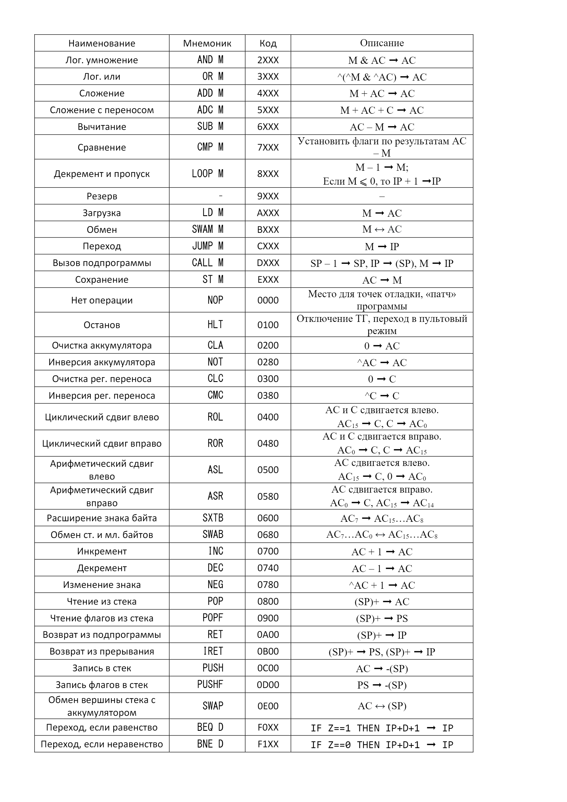
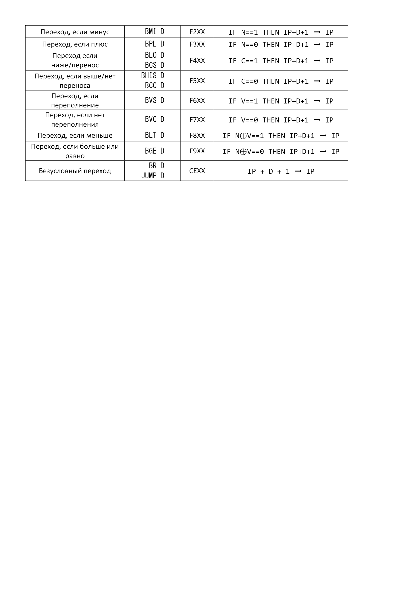

# 专业活动基础 · Основы профессиональной деятельности

<!-- kb:course-overview:start -->

[主页](../README.md) · [第 1 学期](../academic/semester-01.md) · [第 2 学期](../academic/semester-02.md) · [课程总览](../navigation/courses.md)

**课程状态：✓ 已通过**

[全部实验](#labs) · [讲座与教材](#theory) · [学期作业](#assignments) · [考试内容](#exam) · [考试答案与解答](#answers) · [实验答辩](#defense)

保留 БЭВМ、I/O、中断及 Lab 1–6 原路径；Part 2/4 只有标题，不作为独立理论入口。

<!-- kb:course-overview:end -->

<!-- kb:course-resources:start -->

## 全部实验 

| 实验 | 状态 | 资料与说明 |
|---|---|---|
| [Lab 1：Linux / Helios](lab/lab1/quesOfLab1.md) | ✓ 已通过 | [全部实验文件](lab/lab1) |
| [Lab 2：CPU](lab/lab2/lab2.md) | ✓ 已通过 | [全部实验文件](lab/lab2) |
| [Lab 3：程序与问答](lab/lab3/lab3.md) | ✓ 已通过 | [全部实验文件](lab/lab3) · [lab3](lab/lab3/readme.md) |
| [Lab 4](lab/lab4/lab4.md) | ✓ 已通过 | [全部实验文件](lab/lab4) · [lab4](lab/lab4/readme.md) |
| [Lab 5](lab/lab5/lab5.md) | ✓ 已通过 | [全部实验文件](lab/lab5) |
| [Lab 6](lab/lab6/lab6.md) | ✓ 已通过 | [全部实验文件](lab/lab6) |

## 讲座与教材 

- [БЭВМ 基础、指令与计算机组成](Part1.md)
- [I/O 与中断](Part3.md)
- [Part 2：课程笔记](Part2.md)
- [Part 4：课程笔记](Part4.md)

## 学期作业 

学期作业尚未收录。

## 考试内容 

- [考试题目与 PDF / DOCX](exam)
- [阶段测验](rub/rub2.md)

## 考试答案与解答 

考试答案尚未收录。

## 实验答辩 

- [Lab 1：命令与控制问题](lab/lab1/quesOfLab1.md)

## 复习与关联

[考前复习](../study/revision.md) · [实验答辩](../study/defense.md) · [知识地图](../knowledge/index.md)

关联课程：[计算机体系结构](../ComputerArchitecture/readme.md) · [操作系统](../OperatingSystem/readme.md)

<!-- kb:course-resources:end -->

## БЭВМ-NG 命令参考

