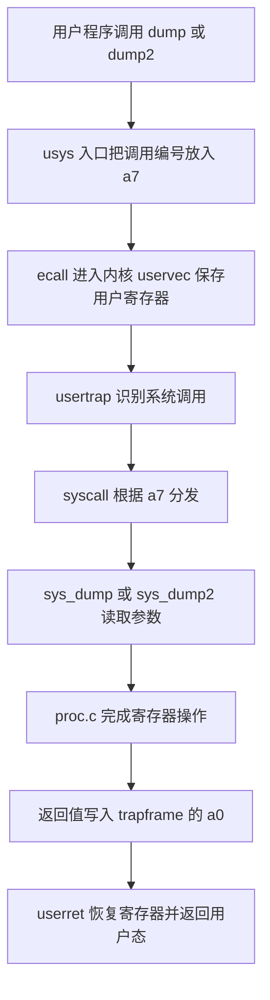

# xv6 Intro 学习与答辩 / Введение в xv6

核对日期：2026-10-17，莫斯科时间。本文是已实现代码的学习说明和答辩练习，采用学校 `secs-dev/xv6-riscv` 源码。源码目录为 `D:\Study-Note\OperatingSystem\Lab\xv6-intro`，本地实验分支为 `lab-1`。

Дата проверки: 17 октября 2026 года, московское время. Документ объясняет выполненную вводную лабораторную работу на основе учебного репозитория `secs-dev/xv6-riscv`. Рабочая ветка — `lab-1`.

2026-10-19 补充已复验的测试驱动启动同步修复，以及 Intro `ci/test` 提示符处理修复。原本地结果表仍对应 10 月 17 日。

Дополнение от 19 октября касается проверенных исправлений запуска тестового драйвера и обработки приглашения shell в `ci/test` для Intro. Таблица первоначальных локальных результатов относится к 17 октября.

## 1. 实验目标与验收范围 / Цель и объём работы

| 部分 / Часть | 实现内容 / Реализация | 当前验证 / Проверка |
| --- | --- | --- |
| Pingpong | 父子进程通过两条管道交换 ping 和 pong / Обмен сообщениями между родителем и ребёнком через два канала | 默认容量 10 次，1 字节容量 20 次，恢复容量后 10 次，合计 40 次通过 |
| Dump | 读取当前进程 s2 到 s11，输出低 32 位 / Вывод младших 32 бит регистров текущего процесса | 学校 dumptests，4/4 通过 |
| Dump2 | 读取自己或后代进程的指定寄存器，向调用者地址空间返回完整 64 位 / Чтение регистра своего процесса или потомка с возвратом 64-битного значения | 学校 dump2tests，4/4 通过，补充测试四组通过 |

学校 Intro 文档把 Dump2 写为 `Часть 3*`，没有在该文档中解释星号。本项目仍实现了 Dump2，因为学校仓库的 `.github/workflows/UserTests.yml` 会对来源分支 `lab-1` 运行 `dumptests` 和 `dump2tests`。这说明当前仓库的自动检查包含 Dump2，不等于额外推断教师对星号的口头解释。

Pingpong、Dump 和 Dump2 是学校任务。祖父权限、完整高 32 位、懒分配页和跨页缓冲区等检查是本项目补充测试。全套 usertests 和 crash 检查用于发现对现有功能的破坏，不能替代三个功能各自的验证。

В тексте задания Dump2 обозначен как `Часть 3*`, но значение звёздочки не объяснено. Реализация включена в работу, поскольку существующая конфигурация CI запускает обе проверки для ветки `lab-1`. Дополнительные тесты проверяют границы интерфейса и не выдаются за отдельные официальные требования.

## 2. 环境与三种命令行 / Окружение и три командные строки

开发过程有三个层次，要先判断自己所在的位置。

| 所在环境 / Среда | 用途 / Назначение | 示例 / Пример |
| --- | --- | --- |
| Windows PowerShell | 启动 Docker 开发环境 / Запуск контейнера | `Start-Xv6.ps1 -Project intro -Action shell` |
| Docker 中的 Linux shell | 编译源码、启动 QEMU、运行自动检查 / Сборка и автоматические проверки | `make qemu CPUS=3` |
| xv6 shell，提示符为 `$` | 执行已装入 xv6 文件系统的用户程序 / Запуск пользовательских программ xv6 | `pingpong`、`dumptests`、`dump2tests`、`dump2extra` |

Docker 提供编译器、QEMU 和测试工具，QEMU 模拟 RISC-V 机器。真正运行 `pingpong` 的操作系统是 QEMU 内的 xv6。容器内 `/xv6` 挂载本机源码，`/lab-notes` 挂载本笔记目录。

Docker содержит инструменты сборки и QEMU. QEMU эмулирует машину RISC-V, внутри которой работает xv6. Программа `pingpong` выполняется в xv6, а не как обычный процесс Linux в контейнере.

本实验验证功能正确性，没有用运行时间得出性能结论。正常开启微信、音乐软件等后台应用不会使已通过的功能结果失效。宿主机严重繁忙时可能延长启动和测试时间，学校部分用例的 1 秒超时需要留意。旧 `lab1-intro-ex` 的性能实验数据不用于本文。

## 3. Pingpong：进程和管道 / Процессы и каналы

实现文件是 [user/pingpong.c](D:/Study-Note/OperatingSystem/Lab/xv6-intro/user/pingpong.c)。Makefile 把 `$U/_pingpong` 加入 `UPROGS`，使程序既被编译，也被放入 `fs.img`。

### 3.1 执行过程 / Порядок выполнения

1. `pipe()` 创建两条单向管道。每条管道的下标 0 是读端，下标 1 是写端。
2. `fork()` 创建子进程。父进程得到子 PID，子进程得到 0，两者都继承已经打开的描述符。
3. 父子分别关闭不使用的管道端，保留一个发送方向和一个接收方向。
4. 父进程向子进程发送四字节 `ping`。
5. 子进程累计读取完整消息，输出自己的 PID 和 `got ping`，然后回复四字节 `pong`。
6. 父进程累计读取回复，输出自己的 PID 和 `got pong`。
7. 父进程调用 `wait()`，回收子进程并检查退出状态。

```text
父进程 / родитель  -- ping -->  子进程 / ребёнок
父进程 / родитель  <-- pong --  子进程 / ребёнок
```

Два канала задают независимые направления передачи. Это исключает случай, когда родитель читает собственное сообщение из общего канала. После `fork()` оба процесса закрывают лишние концы, выполняют обмен и завершаются. Родитель вызывает `wait()`, чтобы получить статус ребёнка и освободить запись завершившегося процесса.

### 3.2 重要函数与原因 / Основные функции

`read_full()` 累计每次 `read()` 实际返回的字节数，直到收到四字节。管道是字节流，单次 `read()` 可能只得到一部分数据。遇到错误或提前 EOF，函数返回失败。

`write_full()` 同样累计实际写入的字节数。当前 xv6 的写入实现会处理管道满时的等待，外层循环仍明确表达了“整条消息必须写完”的约定。

消息缓冲区有五字节，先清零，只读取四字节内容，剩下的一字节保持 `\0`，从而可以安全作为字符串输出。正常输出顺序由通信过程决定，不依赖某个固定 PID。

Функция `read_full()` повторяет чтение до получения всех четырёх байтов. Канал передаёт поток байтов и не сохраняет границы сообщений. Пятый байт буфера содержит нулевой символ для вывода строки. `write_full()` проверяет полный объём отправки.

### 3.3 一字节容量测试 / Канал размером в один байт

学校要求临时把 `kernel/pipe.c` 的 `PIPESIZE` 改成 1，验证程序，然后恢复。本项目已验证默认 512 字节 10 次、1 字节 20 次、恢复 512 字节后 10 次。当前管道源码已恢复，与学校基线内容一致。

容量只有一字节时，发送完整消息会与接收方读取交替推进。这能检验短读处理，也能暴露只写不读造成的死锁。它不是吞吐量或耗时基准测试。

Проверка с размером канала в один байт проверяет частичное чтение и взаимодействие блокирующих операций. Исходный размер 512 байт восстановлен. Измерение производительности в этой проверке не проводилось.

## 4. 系统调用如何接通 / Как подключается системный вызов

Dump 和 Dump2 共用同一条用户态到内核态的调用链。主要接入修改分布在七个文件。

| 文件 / Файл | 作用 / Роль |
| --- | --- |
| [user/user.h](D:/Study-Note/OperatingSystem/Lab/xv6-intro/user/user.h) | 声明用户可调用的函数 / Объявление пользовательского интерфейса |
| [user/usys.pl](D:/Study-Note/OperatingSystem/Lab/xv6-intro/user/usys.pl) | 生成汇编入口，设置 a7，执行 ecall / Генерация заглушки системного вызова |
| [kernel/syscall.h](D:/Study-Note/OperatingSystem/Lab/xv6-intro/kernel/syscall.h) | 定义调用编号，本项目 Dump 为 23、Dump2 为 24 / Номера вызовов |
| [kernel/syscall.c](D:/Study-Note/OperatingSystem/Lab/xv6-intro/kernel/syscall.c) | 注册处理函数，按调用编号分发 / Таблица диспетчеризации |
| [kernel/sysproc.c](D:/Study-Note/OperatingSystem/Lab/xv6-intro/kernel/sysproc.c) | 提供 sys_dump 和 sys_dump2，读取用户传入参数 / Обработчики и извлечение аргументов |
| [kernel/proc.c](D:/Study-Note/OperatingSystem/Lab/xv6-intro/kernel/proc.c) | 实现寄存器读取、权限检查和结果返回 / Основная логика |
| [kernel/defs.h](D:/Study-Note/OperatingSystem/Lab/xv6-intro/kernel/defs.h) | 声明内核函数，让不同源文件之间可以调用 / Внутренние объявления ядра |



`dump2` 的用户参数最初位于 `a0`、`a1`、`a2`。`sys_dump2()` 通过 `argint()` 取得 PID 和寄存器编号，通过 `argaddr()` 取得结果地址。`argaddr()` 取得地址数值，本身不证明该地址可以写入，真正访问用户内存由 `copyout()` 完成。

`kernel/trampoline.S`、`kernel/trap.c` 和 `kernel/proc.h` 是理解这条链的重要原始源码，本次不需要修改它们。`user/usys.S` 是构建时生成的文件，应修改生成器 `usys.pl`。

Пользовательская заглушка помещает номер вызова в `a7` и выполняет `ecall`. Код `uservec` сохраняет регистры, затем `usertrap()` вызывает диспетчер `syscall()`. Обработчик `sys_dump2()` получает аргументы через `argint()` и `argaddr()`. Результат системного вызова записывается в `trapframe->a0` и возвращается в user-space.

## 5. trapframe 与 context / Два вида сохранённого состояния

| 结构 / Структура | 保存什么 / Что хранится | 用途 / Назначение |
| --- | --- | --- |
| `struct trapframe` | 用户态寄存器和陷入处理所需信息 / Пользовательские регистры и данные перехода | 用户态进入内核及返回 / Переход между user-space и kernel-space |
| `struct context` | 内核线程切换需要的返回地址、栈指针、被调用者保存寄存器 / Состояние переключения потока ядра | `swtch()` 和调度器切换 / Переключение контекста в планировщике |

两种结构都有名为 `s2` 的成员，但含义不同。实验要求观察用户进程的寄存器，所以读取 `p->trapframe`。如果读取 `p->context`，得到的是内核上下文切换状态，不能当作用户程序的寄存器值。

`s2` 到 `s11` 属于 RISC-V 的被调用者保存寄存器。用户程序执行系统调用时，陷入入口保存它们，因此内核能通过 trapframe 检查调用前的用户寄存器内容。

`trapframe` хранит состояние пользовательских регистров при входе в ядро. `context` используется функцией `swtch()` для переключения потоков ядра. Для задания нужны поля `trapframe`, а не одноимённые поля `context`.

## 6. Dump：低 32 位输出 / Вывод младших 32 бит

`dump()` 通过 `myproc()` 得到当前进程，再取得 `trapframe`。辅助函数 `saved_sreg()` 将 `s2` 到 `s11` 放入一个小数组，通过编号减 2 选出对应值。`dump()` 循环处理十个编号，避免十段重复打印代码，成功返回 0。

RISC-V 寄存器是 64 位。Dump 先转换为 `uint32`，保留低 32 位，再转换为 `int`，用 `%d` 打印。这样与学校测试中的有符号十进制输出一致。低 32 位为 `0x80000000` 时显示 `-2147483648`，为 `0xffffffff` 时显示 `-1`。

这属于输出格式约定，并没有修改进程原来的寄存器。Dump 总是检查当前进程，不接收 PID，也不向用户缓冲区写回结果。

`dump()` читает десять регистров из trapframe текущего процесса. Сначала значение приводится к `uint32`, чтобы оставить младшие 32 бита, затем к `int` для знакового десятичного вывода. Это соответствует ожидаемым строкам учебных тестов. Успешный вызов возвращает 0.

## 7. Dump2：权限、锁和用户内存 / Права, блокировки и память

接口为 `dump2(int pid, int register_num, uint64 *return_value)`。允许编号从 2 到 11，分别表示 `s2` 到 `s11`。与 Dump 不同，结果保留完整 64 位。

### 7.1 权限方向 / Направление проверки прав

只允许目标进程自己和目标进程的祖先读取目标寄存器。换成调用者的视角，就是“可以读取自己和后代”。

| 调用关系 / Отношение | 结果 / Результат |
| --- | --- |
| 自己读取自己 / Сам процесс | 允许 / Разрешено |
| 父读取子 / Родитель читает ребёнка | 允许 / Разрешено |
| 祖父读取孙 / Предок читает потомка через несколько поколений | 允许 / Разрешено |
| 子读取父 / Ребёнок читает родителя | 拒绝 / Запрещено |
| 兄弟互读 / Братские процессы | 拒绝 / Запрещено |

实现从目标进程开始沿 `parent` 链向上查找。如果遇到调用者，就说明调用者是目标自己或祖先。只比较 `target->parent == caller` 会漏掉祖父，因此需要循环。

Право чтения имеют сам целевой процесс и его предки. Проверка идёт от цели вверх по цепочке `parent`. Братья и потомки целевого процесса не получают доступ к его регистрам.

### 7.2 错误顺序 / Порядок проверки ошибок

| 顺序 / Порядок | 条件 / Условие | 返回值 / Код |
| --- | --- | --- |
| 1 | 编号不在 2 到 11 / Неверный номер регистра | `-3` |
| 2 | 找不到有效目标进程 / Процесс не найден | `-2` |
| 3 | 调用者不是自己或祖先 / Недостаточно прав | `-1` |
| 4 | 无法写入调用者的结果地址 / Ошибка записи в user-space | `-4` |
| 5 | 完成读取和写回 / Успех | `0` |

学校明确规定四类错误的返回码，没有规定多个错误同时发生时的优先级。这里的“编号 → PID → 权限 → copyout”是本实现选定并保持一致的顺序。例如 PID 不存在且编号也非法时，先返回 `-3`。

Задание определяет коды ошибок, но не задаёт их приоритет при нескольких ошибках сразу. Реализация сначала проверяет номер регистра, затем наличие процесса, права и возможность записи результата.

### 7.3 锁顺序与生命周期 / Порядок блокировок

先取得 `wait_lock`，再取得目标 `proc.lock`。此顺序与学校内核的 `wait()` 和 `exit()` 处理一致，避免与已有路径形成反向等待。

`wait_lock` 保护 `parent` 关系，防止检查祖先链时发生重新收养或正常回收。目标 `proc.lock` 保护目标 PID、状态及检查期间的有效性。跳过 `UNUSED` 条目，也不能把空闲槽位中的 PID 0 当成现存进程。

通过权限检查后，把所需寄存器值保存到局部 `uint64`。随后依次释放目标锁和 `wait_lock`，最后进行 `copyout()`。此时不再使用目标指针，即使目标随后退出，已经保存的数值也仍有效。

Сначала захватывается `wait_lock`, затем блокировка целевого процесса. Первая стабилизирует цепочку родителей и согласуется с ожиданием завершения, вторая защищает состояние записи процесса. Значение копируется в локальную переменную, обе блокировки освобождаются, и только после этого выполняется `copyout()`.

### 7.4 为什么必须 copyout / Зачем нужен copyout

`return_value` 是调用者地址空间中的虚拟地址。内核不能把它当作普通内核指针直接解引用。`copyout()` 使用调用者的页表把内核中的八字节结果复制到用户空间，并检查映射及写权限。

这里使用调用者的 `pagetable` 和 `sz`，不使用目标进程的页表。目标提供要观察的寄存器，调用者提供接收结果的缓冲区，两者角色不同。

本仓库的 `copyout()` 可以通过 `vmfault()` 为合法的懒分配地址建立映射，也会逐页处理跨页缓冲区。将复制放在释放锁之后，可让目标进程相关的锁仅覆盖查找、权限判断和保存数值。当前 `vmfault()` 路径没有调用 `sleep()`，不应把锁外复制的理由写成“此处一定睡眠”。

Буфер результата находится в адресном пространстве вызывающего процесса. `copyout()` переводит виртуальный адрес через его таблицу страниц, проверяет возможность записи и копирует восемь байтов. В текущем ядре он также поддерживает лениво выделенную память и переход между страницами.

### 7.5 对 RUNNING 目标能保证什么 / Что видно у работающего процесса

读取的是目标 trapframe 中最近保存的用户寄存器值。目标如果正在其他 CPU 上运行，可能在下一次陷入时更新 trapframe。获取 `proc.lock` 不等于暂停目标 CPU，陷入汇编也不会先取得这把锁才保存用户寄存器。

因此 Dump2 不能宣称返回“调用瞬间的实时 CPU 寄存器”，也不是完整调试器的暂停与一致快照功能。每次调用只返回所选的一个已保存值。官方测试先通过管道同步，再让子进程保持寄存器不变，所以可以比较确定的测试值。

Для процесса в состоянии `RUNNING` возвращается сохранённое пользовательское значение из trapframe. Это не обязательно текущее содержимое физического регистра на другом ядре. Блокировка записи процесса не останавливает его CPU и не превращает интерфейс в отладчик с остановкой выполнения.

## 8. 可执行复验命令 / Команды для повторной проверки

### 8.1 PowerShell 统一入口 / Единая точка запуска

先启动 Docker Desktop。下面的命令分别运行 Intro 功能测试、通用回归和管道容量矩阵，按需要逐条执行，不要并行运行。

```powershell
& 'D:\Study-Note\OperatingSystem\Lab\xv6-notes\Start-Xv6.ps1' -Project intro -Action test
& 'D:\Study-Note\OperatingSystem\Lab\xv6-notes\Start-Xv6.ps1' -Project intro -Action regression
& 'D:\Study-Note\OperatingSystem\Lab\xv6-notes\Start-Xv6.ps1' -Project intro -Action verify
```

`test` 会先编译并检查格式，再运行学校 Dump 和 Dump2 测试、补充 Dump2 测试及十次 Pingpong。`regression` 运行完整 usertests 和三类 crash 恢复检查。`verify` 运行 10、20、10 次的三组管道矩阵。`-Project` 默认值虽然是 `intro`，复验命令仍显式指定，避免混淆两个实验目录。

若要逐步学习或手动执行下面的 Linux 命令，先进入容器 shell。

```powershell
& 'D:\Study-Note\OperatingSystem\Lab\xv6-notes\Start-Xv6.ps1' -Project intro -Action shell
```

后续 Linux 命令均在该容器 shell 内执行。不要在同一项目中同时启动两个使用同一 `fs.img` 的 QEMU，先退出交互实例，再运行自动测试。

Параметр `-Project intro` явно выбирает вводную работу. Действие `test` выполняет сборку, проверку формата и функциональные тесты, `regression` запускает полные usertests и проверки восстановления, `verify` повторяет матрицу размеров канала. Для ручного выполнения команд используется `-Action shell`. Два QEMU не должны одновременно работать с одним образом `fs.img` одного проекта.

### 8.2 构建、格式与学校功能测试 / Сборка и официальные тесты

```sh
cd /xv6
make -j2 kernel/kernel fs.img
make fmt-check
sh ./ci/test/run.sh dumptests dump2tests
```

预期构建和格式命令退出码为 0。学校测试输出两个 suite 成功，Dump 四项和 Dump2 四项全部为 `OK!`，末尾出现 `You are cool!`。如果输出找不到系统调用，可先执行 `make clean`，再重复构建，确保测试程序重新包含最新 `SYS_dump` 和 `SYS_dump2` 定义。

Ожидаются успешная сборка, отсутствие ошибок форматирования и прохождение обеих групп учебных тестов. Если программа сообщает, что системный вызов отсутствует, необходимо выполнить чистую пересборку.

### 8.3 补充边界测试 / Дополнительные проверки

```sh
python3 /lab-notes/scripts/check-qemu.py command \
  --command dump2extra \
  --expect 'ALL DUMP2 EXTRA TESTS PASSED' \
  --log /lab-notes/logs/dump2-extra-recheck.log
```

预期四组 `[OK]`，最终出现 `ALL DUMP2 EXTRA TESTS PASSED` 和 `PASS: dump2extra`。汇编辅助函数会先保存 `s2`，放入 `0x123456789abcdef0`，执行系统调用，再恢复 `s2`，因此既能检查高 32 位，也遵守 RISC-V 调用约定。

### 8.4 通用回归与崩溃恢复 / Регрессия и восстановление

```sh
python3 ./test-xv6.py usertests
python3 ./test-xv6.py crash
```

第一条运行完整 usertests，预期最终出现 `ALL TESTS PASSED`。其中部分检查会故意触发用户异常或资源耗尽，需要结合最终结果判断。

第二条检查日志恢复、孤儿文件恢复和孤儿目录恢复，预期三类检查分别输出 `OK`。学校脚本对后两类都打印相同的 `Test recovery of an orphaned file` 标题，实际分别由 `test_forphan()` 和 `test_dorphan()` 执行。

这些脚本会重建测试用 `fs.img`。源码保存在本机挂载目录，不依靠 xv6 镜像里的临时文件保存。

Полные usertests должны закончиться строкой `ALL TESTS PASSED`. Проверка `crash` проверяет восстановление журнала, осиротевшего файла и осиротевшего каталога. Образы файловой системы в этих проверках пересоздаются.

### 启动同步修复 / Исправление синхронизации запуска

10 月 19 日的三场原始诊断都捕获到 `$ wait for kill and reclaim 31`。Python 驱动只等待固定 1 秒便发送命令，shell 提示符与程序消息因此落在同一行，而 `re.match('wait', line)` 只接受从行首开始的匹配，产生假阴性。这一证据定位的是驱动启动同步问题。

Intro 与 Shebang 的 `test-xv6.py` 现采用相同修复：`QEMU.__init__()` 中的启动延迟 `time.sleep(1)` 改为 `self.monitor(r'^\$ ', timeout=30)`，先等待 shell 就绪。学校原有 C/汇编测试程序、结果断言和功能场景的时限保留，启动阶段新增独立的 30 秒有界等待。修复的诊断与回归复验、当前 PR 最终提交的 CI 状态统一见 [CI 复核记录](CI-复核记录.md)。

В трёх исходных диагностических запусках сообщение начиналось с `$ wait`, поэтому `re.match('wait', line)` его не принимал. В общем Python-драйвере фиксированная задержка заменена ожиданием приглашения shell. Пользовательские тесты на C и ассемблере, проверки результатов и тайм-ауты функциональных сценариев сохранены. Для готовности shell добавлено отдельное ожидание до 30 секунд. Подтверждение исправления и состояние текущих PR приведены в журнале CI выше.

### Intro ci/test 的提示符处理 / Обработка приглашения в ci/test

Intro 的 `ci/test` 是另一条测试驱动路径。shell 提示符可能出现在命令回显前，也可能出现在首条结果前，不能把它固定在某一行。`ci/test/xv6.py` 现在允许命令前出现零个或多个完整的 `$ ` 前缀，通过 `re.escape(program)` 把程序名按字面量处理，再由 `assert_matches()` 内的 `re.fullmatch()` 检查整行。错误命令、额外参数或其他杂字符仍会被拒绝。

`SimpleSuite` 对首条结果的提示符数量由 `+` 改为 `*`。如果提示符已出现在命令回显前，结果行就可以直接以原有预期内容开头。官方 C/汇编测试程序、预期寄存器值和功能场景超时均未改变。这一修复与上节 `test-xv6.py` 的启动等待分别处理。

新增的主机回归 `ci/test/test_prompt_handling.py` 包含四组检查：合法提示符位置，程序名中的正则特殊字符按字面量匹配，错误命令或错误空行被拒绝，错误寄存器值被拒绝。以下命令在 Intro 容器的 `/xv6` 根目录执行，`run.sh` 已接入主机回归，会先检查驱动，再运行所选 xv6 功能用例。

```sh
python3 ci/test/test_prompt_handling.py
sh ci/test/run.sh dumptests dump2tests
```

10 月 19 日已实际在本地运行正序 `dumptests dump2tests` 三轮、倒序 `dump2tests dumptests` 一轮，每轮 8 项，合计 32 项检查全部通过。接入 `run.sh` 后又运行一轮，四组主机回归及 8 项官方功能检查通过。这里记录本地复验，最新远程状态仍统一见 [CI 复核记录](CI-复核记录.md)。

В драйвере `ci/test` приглашение shell может стоять перед эхом команды или первым результатом. Поэтому перед командой допускаются только полные повторения `$ `, имя программы экранируется через `re.escape()`, а строка проверяется целиком через `re.fullmatch()`. У первого результата префикс приглашения стал необязательным. Официальные программы на C и ассемблере, ожидаемые значения регистров и функциональные тайм-ауты сохранены. Добавлены четыре группы регрессий драйвера. Локально пройдены три запуска в прямом порядке и один в обратном, всего 32 проверки, затем ещё 8 через обновлённый `run.sh` вместе с регрессиями драйвера.

### 8.5 交互观察 / Интерактивный запуск

```sh
make qemu CPUS=3
```

出现 xv6 的 `$` 提示符后逐条输入以下程序名。

```text
pingpong
dumptests
dump2tests
dump2extra
```

Pingpong 输出子进程的 `got ping` 和父进程的 `got pong`，PID 可以变化。Dump 测试打印实际值和期望值。Dump2 最后显示 `4 tests were run. 4 tests passed`。补充测试显示总成功标记。退出 QEMU 时先按 `Ctrl+A`，松开后再按 `X`。

一字节容量的完整矩阵可以在容器内运行以下命令。该脚本负责恢复原管道源码并重新构建，运行期间不要并行修改 `kernel/pipe.c`。

```sh
python3 /lab-notes/scripts/verify-pingpong.py
```

## 9. 已保存的验证证据 / Сохранённые результаты

以下是已经实际运行的结果，不是仅列出的测试计划。

| 检查 / Проверка | 实际结果 / Результат | 日志 / Журнал |
| --- | --- | --- |
| Pingpong 默认容量 | 10/10 | `logs/pipe-512-initial-result.log` |
| Pingpong 一字节容量 | 20/20 | `logs/pipe-1-result.log` |
| Pingpong 恢复容量 | 10/10 | `logs/pipe-512-restored-result.log` |
| Dump 学校测试 | 4/4 | `logs/intro-official.log` |
| Dump2 学校测试 | 4/4 | `logs/intro-official.log` |
| Dump2 补充测试 | 四组全部通过 / Четыре группы пройдены | `logs/dump2-extra-qemu.log` |
| 完整 usertests | `ALL TESTS PASSED` | `logs/intro-usertests.log` |
| crash | 三类恢复通过 / Три проверки восстановления пройдены | `logs/intro-crash.log` |

日志位于 `D:\Study-Note\OperatingSystem\Lab\xv6-notes\logs`。这些结果证明当前本地实现已通过上述范围的实际检查，不替代教师验收或远程 CI 的结果。

## 10. 俄语答辩问答 / Вопросы для защиты

### 1. Какова цель вводной лабораторной работы?

**Ответ:** Цель — изучить взаимодействие процессов через каналы и путь системного вызова от пользовательской программы до ядра. В первой части реализован обмен ping и pong, затем добавлены вызовы dump и dump2 для чтения сохранённых пользовательских регистров.

**中文解释：** 实验由进程间通信和自定义系统调用组成。Pingpong 学习 pipe 与 fork，Dump 和 Dump2 学习陷入处理、寄存器以及用户内存访问。

### 2. Почему вы используете два канала и закрываете лишние дескрипторы?

**Ответ:** Один канал передаёт ping ребёнку, другой возвращает pong родителю. У каждого направления есть отдельный читатель. После fork оба процесса наследуют дескрипторы, поэтому неиспользуемые концы закрываются, чтобы правильно освобождать ресурсы и определять EOF.

**中文解释：** 两条管道明确两个传输方向，防止读回自己的消息。关闭多余端点还关系到 EOF 能否被正确识别。

### 3. Почему недостаточно одного read и что проверяет канал в один байт?

**Ответ:** Канал является потоком байтов. Read может вернуть меньше байтов, чем запрошено, поэтому чтение повторяется до получения всего сообщения. Размер в один байт заставляет запись и чтение продвигаться по частям и проверяет, что программа не теряет данные и не зависает. После проверки размер восстановлен до 512 байт.

**中文解释：** 消息没有天然边界，需要累计短读。1 字节容量检验阻塞和分段通信，完成后必须恢复原容量。

### 4. Как пользовательская программа вызывает dump2?

**Ответ:** Программа вызывает функцию, объявленную в user.h. Сгенерированная заглушка помещает номер SYS_dump2 в a7 и выполняет ecall. После сохранения пользовательских регистров usertrap вызывает syscall. Диспетчер выбирает sys_dump2, обработчик извлекает аргументы и вызывает реализацию в proc.c. Код возврата передаётся через a0.

**中文解释：** 说明七个接入文件各自的角色，不能把普通函数调用和系统调用的权限切换混为一谈。

### 5. Почему регистры нужно брать из trapframe, а не из context?

**Ответ:** Trapframe содержит пользовательские регистры, сохранённые при входе в ядро. Context хранит состояние потока ядра для swtch и планировщика. Несмотря на одинаковые имена некоторых полей, это разные состояния. В задании требуется состояние пользовательской программы.

**中文解释：** trapframe 对应用户态陷入，context 对应内核调度。名字相同的 s2 字段不代表同一份值。

### 6. Почему dump может вывести отрицательное число?

**Ответ:** По заданию выводятся только младшие 32 бита 64-битного регистра. Реализация сначала оставляет эти биты приведением к uint32, затем выводит их как int в знаковом десятичном формате. Например, 0xffffffff выводится как минус один. Сам регистр при этом не изменяется.

**中文解释：** 先截取低 32 位，再按有符号整数显示。负号是解释这些位的方式，不是读错了寄存器。

### 7. Чем dump2 отличается от dump и зачем нужен copyout?

**Ответ:** Dump печатает младшие 32 бита десяти регистров своего процесса. Dump2 возвращает полное 64-битное значение одного выбранного регистра заданного процесса. Адрес результата принадлежит вызывающему процессу, поэтому ядро использует copyout с его таблицей страниц, а не разыменовывает пользовательский указатель напрямую.

**中文解释：** 两者在位宽、输出方式和目标选择上不同。copyout 的目标页表属于调用者，寄存器来源才属于被观察的目标。

### 8. Кто имеет право читать регистры и зачем нужны две блокировки?

**Ответ:** Регистры могут читать сам целевой процесс и его предки. Проверка поднимается по цепочке parent от цели к корню. Сначала берётся wait_lock, затем блокировка целевого процесса. Это сохраняет правильный порядок с wait и exit, стабилизирует отношения родства и защищает состояние записи процесса. Перед copyout блокировки освобождаются.

**中文解释：** 权限是自己及祖先，不是所有亲属。wait_lock 保护父子关系，proc.lock 保护目标状态，锁顺序不能倒过来。

### 9. Можно ли считать результат dump2 текущим состоянием CPU работающего процесса?

**Ответ:** Нет. Возвращается сохранённое значение из trapframe. Процесс на другом ядре может продолжать работу и обновить trapframe при следующем входе в ядро. Захват proc.lock не останавливает этот CPU. Интерфейс возвращает один сохранённый регистр и не гарантирует остановку процесса или согласованный снимок всех регистров.

**中文解释：** 必须承认快照语义的限制，不能把它描述成能够暂停其他 CPU 的调试器。

### 10. Как обрабатываются ошибки и чем подтверждена корректность?

**Ответ:** Сначала проверяется номер регистра с ошибкой минус три, затем существование PID с ошибкой минус два, права с ошибкой минус один и запись результата с ошибкой минус четыре. Успех возвращает ноль. Пройдены обе официальные группы по четыре теста, дополнительные проверки родства, 64-битных значений и памяти, полный набор usertests и три проверки восстановления после сбоя. Pingpong проверен сорок раз, включая канал размером в один байт.

**中文解释：** 四个错误码来自学校要求，多个错误同时出现时的优先级由本实现明确规定。答辩时可以打开对应日志，展示已经运行的证据。

### 11. Почему исправлен Python-драйвер и изменились ли сами тесты?

**Ответ:** В диагностическом выводе приглашение shell оказалось в одной строке с сообщением программы, и проверка начала строки дала ложный отказ. Теперь драйвер ожидает готовности shell перед отправкой команды. Официальные программы на C и ассемблере, ожидаемые результаты и прежние тайм-ауты сценариев не изменены. Для запуска добавлено отдельное ожидание до тридцати секунд.

**中文解释：** 原始输出说明程序已经输出就绪消息，假失败来自提示符前缀干扰行首匹配。修复让驱动先等 shell，不放宽结果断言，也不延长功能场景时限。新增的 30 秒只约束启动等待，验证记录与最新状态见上方 CI 复核记录。

### 12. Как ci/test обрабатывает разные положения приглашения shell?

**Ответ:** Перед эхом команды допускается ноль или несколько полных префиксов `$ `. Имя программы обрабатывается через `re.escape()`, затем проверяется вся строка через `re.fullmatch()`. У первого результата префикс тоже может отсутствовать, если он уже выведен перед командой. Значения регистров и тайм-ауты не изменены. Четыре группы регрессий проверяют как допустимые варианты вывода, так и обязательный отказ при неверной команде, строке-разделителе или значении регистра.

**中文解释：** 只允许完整提示符前缀改变位置，命令本体和结果内容仍严格检查。`re.escape()` 防止程序名被当作正则，`fullmatch()` 防止多余内容蒙混通过。四组主机回归还验证错误输入必须失败，官方 C/汇编测试和寄存器预期值没有改动。

## 11. 常用术语 / Основные термины

| 中文 | Русский | 标识或说明 |
| --- | --- | --- |
| 进程 | процесс | `struct proc` |
| 父进程、子进程 | родительский, дочерний процесс | `parent`、`fork()` |
| 祖先、后代 | предок, потомок | 可以跨越多代 |
| 管道 | канал | `pipe()` |
| 文件描述符 | файловый дескриптор | 进程中的打开文件编号 |
| 短读 | частичное чтение | 实际读取数量少于请求数量 |
| 系统调用 | системный вызов | `ecall` |
| 用户空间、内核空间 | пространство пользователя, пространство ядра | user-space、kernel-space |
| 陷入帧 | trapframe, структура сохранённых регистров | 用户寄存器的保存区域 |
| 上下文切换 | переключение контекста | `swtch()` |
| 自旋锁 | спин-блокировка | `struct spinlock` |
| 页表 | таблица страниц | `pagetable` |
| 懒分配 | ленивое выделение памяти | 按访问需求建立映射 |
| 僵尸进程 | процесс-зомби | 退出后等待回收的进程 |

## 12. 资料与提交边界 / Источники и границы сдачи

主要依据是学校基线 `57dc72da888497f03084262bcbb40eed04e83eb4` 的 [Intro 文档](https://github.com/secs-dev/xv6-riscv/blob/57dc72da888497f03084262bcbb40eed04e83eb4/doc/lab/intro.md)、本地实际实现、学校测试源码和上述运行日志。

Intro 文档要求使用精确名称 `lab-1`，向 `main` 发起 MR。当前代码已经推送到私有仓库，并创建 [Intro PR #1](https://github.com/ivanstylish/os-course-xv6-riscv/pull/1)，来源分支为 `lab-1`，目标分支为 `main`。PR 尚未合并。远程 CI 状态和首次超时的复查见 [CI 复核记录](CI-复核记录.md)，本文验证表为本地结果。

Shebang 使用独立源码工作目录及 `lab-shebang` 分支，另有 [Shebang PR #2](https://github.com/ivanstylish/os-course-xv6-riscv/pull/2)，同样尚未合并。它遵循学校通用 PR 模板的 `lab-<slug>` 来源分支规则。本文的寄存器实现、测试成绩和答辩范围属于 Intro。参考 PDF 未经实际读取，不把它作为本文事实依据。

Изменения Intro отправлены в частный репозиторий через PR #1 из ветки `lab-1` в `main`. Shebang оформлен отдельно как PR #2 из ветки `lab-shebang`. Оба PR ещё не объединены. Локальные и удалённые результаты описаны отдельно. Текущее состояние CI приведено в отдельном журнале проверки, ссылка указана выше.
