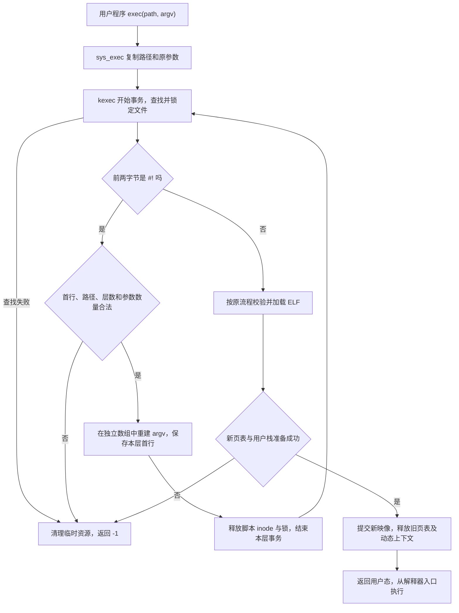

# xv6 Shebang 学习与答辩

记录日期为 2026-10-17，时区为 Europe/Moscow。

## 任务范围与目录

学校 [Shebang 任务](https://github.com/secs-dev/xv6-riscv/blob/main/doc/lab/shebang.md)明确要求为 xv6 增加 Shebang 支持。学校文档没有规定首行长度、可选参数解析规则、嵌套层数或个人变体。下文中的数值界限和解析细节是本实现的选择，不能表述为学校统一规定。

本实现以学校 `secs-dev/xv6-riscv` 的提交 `57dc72da888497f03084262bcbb40eed04e83eb4` 为基线。Intro 和 Shebang 使用不同的工作目录及分支，共享同一个 Git 仓库的对象与历史。

| 内容 | 本地位置 | 分支 |
| --- | --- | --- |
| Intro，包含 Pingpong、Dump、Dump2 | `D:\Study-Note\OperatingSystem\Lab\xv6-intro` | `lab-1` |
| Shebang，独立于 Intro 的代码改动 | `D:\Study-Note\OperatingSystem\Lab\xv6-shebang` | `lab-shebang` |
| 学习记录、启动入口和日志 | `D:\Study-Note\OperatingSystem\Lab\xv6-notes` | 位于课程笔记目录 |

`xv6-shebang` 是独立 worktree，因此可以同时保留 Intro 和 Shebang 的源码及构建产物。Shebang 不依赖 Intro 的系统调用修改，答辩时应分别展示两项实验。

Shebang 正式任务只规定功能，没有单独给出提交分支细节。学校仓库的 [PR 模板](https://github.com/secs-dev/xv6-riscv/blob/57dc72da888497f03084262bcbb40eed04e83eb4/.github/pull_request_template.md)要求来源分支为 `lab-<slug>`，目标分支为 `main`，因此本实验按通用模板使用 `lab-shebang`。Intro 则继续遵循其任务文档明确规定的精确名称 `lab-1`。

当前代码已经推送到私有仓库，并创建 [Shebang PR #2](https://github.com/ivanstylish/os-course-xv6-riscv/pull/2)。Intro 单独对应 [PR #1](https://github.com/ivanstylish/os-course-xv6-riscv/pull/1)。两个 PR 均尚未合并。远程 CI 状态和首次超时的复查见 [CI 复核记录](CI-复核记录.md)，本文验证表为本地结果。

Для Shebang используется ветка `lab-shebang` по общему шаблону PR, а для Intro сохраняется явно указанное в задании имя `lab-1`. Изменения отправлены в частный репозиторий как PR #2 и PR #1 соответственно. Оба PR ещё не объединены. Состояние удалённого CI и повторные проверки отражены в отдельном журнале.

## 实际修改与调用关系

Shebang 的源码改动集中在三个文件。

- `D:\Study-Note\OperatingSystem\Lab\xv6-shebang\kernel\exec.c`，识别首行、解析解释器、重建参数，随后沿用 ELF 加载流程。
- `D:\Study-Note\OperatingSystem\Lab\xv6-shebang\user\shebangtests.c`，新增 41 项功能测试，并提供测试用的 ELF 解释器。
- `D:\Study-Note\OperatingSystem\Lab\xv6-shebang\Makefile`，在 `UPROGS` 中登记测试程序，使其进入 xv6 文件系统镜像。

调用链为用户态 `exec()` → 系统调用入口 → `sys_exec()` → `kexec()`。系统调用（системный вызов）入口保持不变。`sys_exec()` 先把路径和参数复制到内核内存，新增逻辑在 `kexec()` 中工作，因此不是仅在 shell 中识别脚本。

`parse_shebang()` 负责解析首行。`kexec()` 负责文件查找、逐层转换参数、ELF 加载、新用户栈构造以及最终提交。原来的 `loadseg()` 继续把 ELF 段复制到新页表对应的内存中。



## 如何识别与解析首行

Shebang 标记必须位于文件最开始的两个字节。示例首行为 `#!/echo INTERPRETER_OK`。内核先探测这两个字节，遇到脚本时再解析首行，否则继续原来的 ELF 校验。

不能先强制读取完整 ELF 头再判断脚本，因为有效脚本可能比 ELF 头更短。

| 项目 | 本实现的规则 |
| --- | --- |
| 首行读取窗口 | 从文件起始读取最多 256 字节 |
| 换行边界 | LF 位于下标 255 时允许，即换行前最多 255 字节 |
| 没有末尾换行 | 读取不足 256 字节且到达 EOF 时允许 |
| 过长首行 | 读满 256 字节仍没有 LF 时拒绝，不截断执行 |
| Windows 换行 | 支持 CRLF，移除行尾的 CR |
| NUL | 首行内出现 NUL 时拒绝 |
| 解释器路径 | 必须非空，长度小于 `MAXPATH=128` 字节 |
| 路径解析 | 使用 xv6 的 `namei()`，允许绝对或相对路径，不查找 PATH |
| 可选参数 | 解释器路径后的余串去掉两端空格及制表符，整体作为一个参数 |
| 引号与变量 | 不执行引号展开或变量替换 |
| 嵌套脚本 | 最多解析 4 层，第 5 层返回失败 |

例如 `#!/tool --one two` 传递一个值为 `--one two` 的可选参数。`#!/tool "two words"` 中的双引号也保留在参数字符串内，不会被内核当作 shell 语法处理。

256 字节是包括 `#!` 在内的首行读取窗口，不是解释器路径本身可以使用的长度。解释器路径另受 127 字节上限约束。

## argv 怎样重建

假设执行的脚本路径为 `script`，原参数为 `["custom-name", "hello", "xv6"]`，首行为 `#!/echo INTERPRETER_OK`。解释器实际收到的参数为下表所示。

| 下标 | 参数值 | 来源 |
| --- | --- | --- |
| 0 | `/echo` | 解释器路径 |
| 1 | `INTERPRETER_OK` | 首行的可选参数 |
| 2 | `script` | 本次执行的脚本路径 |
| 3 | `hello` | 原 `argv[1]` |
| 4 | `xv6` | 原 `argv[2]` |
| 5 | 空指针 | 参数数组结束标记 |

原来的 `argv[0]` 被替换，原 `argv[1]` 及之后的参数保持顺序。没有可选参数时，脚本路径位于下标 1。原参数数组为空时，仍构造解释器路径、可选参数和脚本路径。

`MAXARG=32` 包含末尾空指针，因此最多容纳 31 个参数字符串。无可选参数时，原先 30 个字符串可以扩展成 31 个，原先 31 个则失败。有可选参数时，原先 29 个可以扩展成 31 个，原先 30 个则失败。每处理一层脚本都重新检查数量，最终 ELF 参数复制处也检查边界。

参数数量合法不代表一定能够执行。参数字符串、指针数组以及 16 字节对齐都占用用户栈（пользовательский стек）。当前 `USERSTACK=1`，总空间不足时仍返回 -1。

## 内存、锁和失败处理

`sys_exec()` 为原参数分配内核缓冲区，`kexec()` 返回后仍由 `sys_exec()` 释放。直接改写这个原数组，会使调用者释放错误的地址或遗漏原缓冲区。

本实现首次发现脚本时，通过 `kalloc()` 分配一个页作为 `scriptargs` 上下文。上下文包含独立的参数指针数组和 4 个首行缓冲区。原参数字符串只借用，不改变其所有权。每一层解释器路径和可选参数指向各自保存的首行，因此在下一层解析时不会被覆盖。

这也避免了把多个首行缓冲区压入内核栈（стек ядра）。xv6 每个进程的内核栈只有一页，使用循环和一个动态页比递归调用 `kexec()` 更容易解释和控制空间占用。

每次准备切换到解释器前，调用 `iunlockput()` 释放当前脚本的 inode 锁及引用，再调用 `end_op()` 结束本层文件系统事务（транзакция файловой системы）。下一轮重新执行 `begin_op()`、`namei()` 和 `ilock()`。这样不会带着脚本的锁打开它自己，自引用和双脚本循环最终由 4 层限制终止。

成功时，在字符串复制到新用户栈并提交新映像后释放上下文。失败时，统一释放已经建立的新页表、仍持有的 inode 和事务，以及动态上下文。原来的进程映像（образ процесса）只在所有准备成功后才被替换，因此 `exec()` 失败返回 -1 时，原用户程序可以继续执行。

`exec()` 不创建新进程，成功时 PID 不变。用户地址空间、程序入口和用户栈被替换为解释器的映像。

## 启动、测试与演示

以下命令在 Windows PowerShell 中执行。先启动 Docker Desktop，并等待 Linux 引擎准备完成。

启动 xv6 并进入其 shell。

```powershell
& 'D:\Study-Note\OperatingSystem\Lab\xv6-notes\Start-Xv6.ps1' -Project shebang -Action run
```

预期看到内核启动信息、`init: starting sh` 和 `$`。这里的 `$` 是 xv6 提示符，不需要自行输入。退出 QEMU 时依次按 Ctrl+A 和 X。

运行 41 项功能测试，并检查源码格式。

```powershell
& 'D:\Study-Note\OperatingSystem\Lab\xv6-notes\Start-Xv6.ps1' -Project shebang -Action test
```

预期功能输出包含 `ALL SHEBANG TESTS PASSED (41 cases)`。自动入口先构建 `kernel/kernel` 和 `fs.img`，执行 `make fmt-check`，再启动真实 QEMU 运行 `shebangtests`。已启动 xv6 时，也可直接在其 shell 输入 `shebangtests`。

运行学校现有完整用户测试及崩溃恢复测试。

```powershell
& 'D:\Study-Note\OperatingSystem\Lab\xv6-notes\Start-Xv6.ps1' -Project shebang -Action regression
```

预期用户测试出现 `ALL TESTS PASSED`，恢复测试的三项检查均通过。底层分别执行 `python3 test-xv6.py usertests` 和 `python3 test-xv6.py crash`，自动入口为每项设置 900 秒上限。

运行自动 Shebang 演示。

```powershell
& 'D:\Study-Note\OperatingSystem\Lab\xv6-notes\Start-Xv6.ps1' -Project shebang -Action demo
```

自动入口在 xv6 内执行以下两行，核对输出后删除演示文件。

```text
echo #!/echo INTERPRETER_OK > sbdemo
sbdemo hello xv6
```

预期输出为 `INTERPRETER_OK sbdemo hello xv6`。`echo` 在这里充当解释器，用于直接展示内核生成的参数。它只输出参数，不读取脚本正文。读取脚本正文的行为由 `shebangtests` 中的专用解释器另行验证。

学校现有 `sh` 没有通过文件参数读取脚本的功能，也没有实现 `#` 注释处理，因此不能用 `#!/sh` 加多行命令直接证明本实验成功。当前实现没有修改 shell。

进入容器中的 Linux shell。

```powershell
& 'D:\Study-Note\OperatingSystem\Lab\xv6-notes\Start-Xv6.ps1' -Project shebang -Action shell
```

容器当前目录为 `/xv6`，此时可执行以下命令。它们属于容器 Linux，不是在 xv6 内执行。

```sh
make -j2 kernel/kernel fs.img
make fmt-check
make qemu CPUS=3
```

功能和回归入口会把新日志写入 `D:\Study-Note\OperatingSystem\Lab\xv6-notes\logs` 下的 `shebang-recheck-*` 文件。不要同时启动两份使用同一个 `fs.img` 的 QEMU。学校回归测试会重建文件系统镜像，演示文件无需长期保留。

## 已实际验证的结果

以下结果来自本次实际运行日志，记录日期为 2026-10-17。

| 检查 | 结果 | 日志文件，均位于本目录的 logs 子目录 |
| --- | --- | --- |
| `make -j2 kernel/kernel fs.img` | 构建成功 | `shebang-build.log` |
| `make fmt-check` | 通过 | `shebang-build.log` 末尾 |
| `shebangtests` | 41 项全部通过 | `shebang-functional-result.log`、`shebang-functional-qemu.log` |
| 学校 `usertests` | 出现 `ALL TESTS PASSED` | `shebang-usertests.log` |
| 学校 `crash` | 三类恢复检查均出现 `OK` | `shebang-crash.log` |

41 项功能测试覆盖普通 ELF、完整参数顺序、空参数数组、LF、CRLF、短首行 EOF、单个可选参数、引号原样保留、空文件、普通文本、首行 NUL、缺失或错误解释器、目录、MAXARG 边界、首行长度、解释器路径长度、4 层与 5 层、循环引用、连续失败及用户栈容量不足。

测试程序自身是 ELF 解释器。预期结果通过继承的文件描述符 3 传入，不给被测参数数组增加测试标记。解释器检查完整 argv，打开脚本并验证其正文，成功以 42 退出。预期执行失败时，子进程在 `exec()` 返回 -1 后以 0 退出，因此意外执行成功不会与预期失败混淆。

“连续 48 次失败后仍能正常执行”是资源恢复的功能检查，不能据此声称已经完整证明不存在内存泄漏。清理路径还需要结合代码中的资源所有权和成功、失败出口分析。完整用户测试与恢复测试提供回归证据，也不等同于覆盖所有可能的并发或异常情况。

## 俄语答辩问答

### 1. Что такое shebang?

Shebang — это первые два символа `#!` в начале файла. После них указан путь к интерпретатору и, возможно, один дополнительный аргумент.

中文解释：Shebang 是文件起始的 `#!` 标记，后面指定解释器路径，并可附带一个可选参数。

### 2. Где реализована поддержка shebang?

Поддержка реализована в `kexec()` в файле `kernel/exec.c`. Поэтому она работает для системного вызова `exec()`, а не только для одной оболочки.

中文解释：逻辑位于内核的 `kexec()` 中，因此直接调用 `exec()` 的程序也能执行脚本，不依赖特定 shell。

### 3. Чем exec отличается от fork?

`fork()` создаёт новый процесс. `exec()` заменяет образ текущего процесса, сохраняя его PID, и при успехе не возвращается к прежней пользовательской программе.

中文解释：`fork()` 创建进程，`exec()` 替换当前进程的映像。成功时不会回到原程序的调用位置，PID 不变。

### 4. Как изменяется массив argv?

Новый массив содержит путь к интерпретатору, необязательный аргумент, путь к скрипту и исходные аргументы начиная с `argv[1]`. Исходный `argv[0]` заменяется.

中文解释：新数组依次放解释器、可选参数、脚本路径和原有尾部参数。原 `argv[0]` 不保留。

### 5. Как разбирается необязательный аргумент?

Оставшаяся часть строки после пути к интерпретатору передаётся как один аргумент. Крайние пробелы и табуляции удаляются, но кавычки и переменные не раскрываются.

中文解释：路径后面的余串整体作为一个参数，只去掉两端空格和制表符，不模拟 shell 的引号或变量展开。

### 6. Какие ограничения выбраны и почему?

Окно чтения первой строки равно 256 байтам, путь к интерпретатору короче 128 байт, а глубина ограничена четырьмя скриптами. Это решения реализации для ограниченной памяти xv6, а не числовые требования задания.

中文解释：首行窗口 256 字节，解释器路径小于 128 字节，最多 4 层。这些是适合 xv6 的实现选择。必须补充说明读满 256 字节且没有 LF 会失败，255 字节加 LF 可以成功。

### 7. Почему MAXARG равен 32, но допустим только 31 аргумент?

Последний элемент массива должен быть нулевым указателем. Поэтому из 32 элементов только 31 может указывать на строку, причём добавленные интерпретатором аргументы тоже учитываются.

中文解释：末尾必须保留空指针，因此只有 31 个字符串位置。解释器和脚本路径插入后，也必须计入总数。

### 8. Почему не изменяется исходный массив sys_exec?

`sys_exec()` владеет буферами исходных аргументов и освобождает их после возврата `kexec()`. Отдельный массив сохраняет это владение и не позволяет освободить чужие адреса.

中文解释：原参数缓冲区由 `sys_exec()` 管理和释放。使用独立数组可以维持所有权关系，避免错误释放和遗漏释放。

### 9. Зачем нужен динамический контекст вместо рекурсии?

Стек ядра процесса занимает одну страницу. Цикл и одна динамически выделенная страница позволяют хранить строки всех четырёх уровней без роста стека при каждом переходе.

中文解释：内核栈只有一页，递归会叠加调用栈和局部数组。循环加单页上下文能保存各层首行，又控制栈占用。

### 10. Как предотвращаются блокировка и бесконечный цикл?

Перед открытием интерпретатора освобождаются блокировка и ссылка на inode скрипта, затем завершается транзакция. Ограничение глубины завершает самоссылку и цикл из нескольких скриптов ошибкой.

中文解释：先释放当前脚本锁和引用并结束事务，再打开解释器。自引用不会重复锁定同一个 inode，循环最终由深度限制拒绝。

### 11. Что происходит при ошибке exec?

Новая таблица страниц и временные ресурсы освобождаются. Старый образ процесса сохраняется, и системный вызов возвращает -1, потому что замена образа выполняется только после успешной подготовки.

中文解释：失败时清理准备中的新页表和临时资源。旧映像没有提前替换，因此调用者仍能继续运行并处理 -1。

### 12. Как проверена реализация и почему не используется скрипт для sh?

Пройдены 41 функциональная проверка, полные `usertests` и три проверки восстановления. Штатная оболочка xv6 не читает команды из файла, указанного аргументом, поэтому тестовый ELF-интерпретатор проверяет аргументы и тело скрипта самостоятельно.

中文解释：已有实际功能、完整用户测试和恢复测试结果。现有 `sh` 不支持文件参数脚本，所以使用专用测试解释器读正文，再用 `/echo` 演示参数传递。48 次失败检查只能作为恢复证据，不能宣称是完整泄漏证明。
